# Agentic AI 101: Foundations of Building AI Agents

A large language model can write, summarize and answer questions. On its own, however, it cannot check the weather, search for a flight or remember what a user said yesterday. An **AI agent** is a system that gives a model these abilities. The model decides which action to take next, a program carries out that action, and the result returns to the model. This cycle repeats until the task is complete.

This guide teaches you how to build such systems from first principles. You start with a single request to a model and then add one capability at a time. The capabilities are tools, a control loop, memory, design patterns, frameworks, multi-agent systems, safety checks and evaluation. Each concept comes with a short Python program, called a **lab**, that runs on an ordinary laptop.

All labs use the same example: a travel assistant that reports the weather, searches flights, converts currency and books seats. Because the example stays the same, you can attribute every change in its behavior to the concept under study.

The guide follows one principle throughout: you build each mechanism by hand before you use a framework that automates it. When you later use the OpenAI Agents SDK or Google's Agent Development Kit, you will know exactly what the framework does on your behalf.

The guide reflects the state of the field in October 2026. Model names and library versions appear as dated examples, and the concepts do not depend on them.

---

## Table of Contents

**Getting Started**

- [1. About This Guide](#1-about-this-guide)
  - [1.1 Audience and Prerequisites](#11-audience-and-prerequisites)
  - [1.2 How This Guide Was Designed: A Survey of Agentic AI Courses](#12-how-this-guide-was-designed-a-survey-of-agentic-ai-courses)
  - [1.3 The Common Core of Agentic AI Education](#13-the-common-core-of-agentic-ai-education)
  - [1.4 Design Principles](#14-design-principles)
  - [1.5 The Running Example: A Travel Assistant](#15-the-running-example-a-travel-assistant)
  - [1.6 The Learning Path](#16-the-learning-path)
- [2. Setting Up the Environment](#2-setting-up-the-environment)
  - [2.1 Requirements](#21-requirements)
  - [2.2 Choosing a Model Provider](#22-choosing-a-model-provider)
  - [2.3 Creating the Python Environments](#23-creating-the-python-environments)
  - [2.4 Configuring Credentials](#24-configuring-credentials)
  - [2.5 Project Layout](#25-project-layout)
  - [2.6 The Shared Files](#26-the-shared-files)

**Part I. Foundations**

- [3. From Language Models to Agents](#3-from-language-models-to-agents)
  - [3.1 What a Large Language Model Does](#31-what-a-large-language-model-does)
  - [3.2 Lab 1: A First Model Call](#32-lab-1-a-first-model-call)
  - [3.3 Three Limitations That Motivate Agents](#33-three-limitations-that-motivate-agents)
  - [3.4 Lab 2: The Model Remembers Nothing](#34-lab-2-the-model-remembers-nothing)
  - [3.5 Lab 3: Structured Outputs](#35-lab-3-structured-outputs)
  - [3.6 Model, Workflow and Agent: Precise Definitions](#36-model-workflow-and-agent-precise-definitions)
  - [3.7 The Autonomy Spectrum and the Levels of Agentic Systems](#37-the-autonomy-spectrum-and-the-levels-of-agentic-systems)
  - [3.8 When Not to Build an Agent](#38-when-not-to-build-an-agent)

**Part II. Building an Agent from Scratch**

- [4. Tools and Function Calling](#4-tools-and-function-calling)
  - [4.1 Definitions](#41-definitions)
  - [4.2 The Function-Calling Protocol](#42-the-function-calling-protocol)
  - [4.3 Lab 4: One Tool Call by Hand](#43-lab-4-one-tool-call-by-hand)
  - [4.4 Designing Effective Tools](#44-designing-effective-tools)
- [5. The Agent Loop](#5-the-agent-loop)
  - [5.1 The Loop in Four Steps](#51-the-loop-in-four-steps)
  - [5.2 Lab 5: The Agent Loop Written from Scratch](#52-lab-5-the-agent-loop-written-from-scratch)
  - [5.3 What the Model Sees at Each Step](#53-what-the-model-sees-at-each-step)
  - [5.4 Stopping Conditions and Failure Modes](#54-stopping-conditions-and-failure-modes)
- [6. The Harness: Everything Around the Model](#6-the-harness-everything-around-the-model)
  - [6.1 Definition](#61-definition)
  - [6.2 Components of a Harness](#62-components-of-a-harness)
  - [6.3 Harness, Framework and Protocol](#63-harness-framework-and-protocol)

**Part III. Sessions, State and Memory**

- [7. Sessions, State and Memory](#7-sessions-state-and-memory)
  - [7.1 The Problem: A Stateless Model in a Stateful Conversation](#71-the-problem-a-stateless-model-in-a-stateful-conversation)
  - [7.2 Definitions](#72-definitions)
  - [7.3 A Mental Model in Three Layers](#73-a-mental-model-in-three-layers)
  - [7.4 Lab 6: A Session Saved to Disk](#74-lab-6-a-session-saved-to-disk)
  - [7.5 Lab 7: State in Two Scopes](#75-lab-7-state-in-two-scopes)
  - [7.6 Lab 8: Long-Term Memory with Extraction and Retrieval](#76-lab-8-long-term-memory-with-extraction-and-retrieval)
  - [7.7 State or Memory? Choosing the Mechanism](#77-state-or-memory-choosing-the-mechanism)
  - [7.8 Sessions, State and Memory in the Frameworks](#78-sessions-state-and-memory-in-the-frameworks)
  - [7.9 Context Engineering in Brief](#79-context-engineering-in-brief)

**Part IV. Agentic Design Patterns**

- [8. Agentic Design Patterns](#8-agentic-design-patterns)
  - [8.1 A Catalog of Patterns](#81-a-catalog-of-patterns)
  - [8.2 Lab 9: Prompt Chaining](#82-lab-9-prompt-chaining)
  - [8.3 Lab 10: Routing](#83-lab-10-routing)
  - [8.4 Lab 11: Parallelization](#84-lab-11-parallelization)
  - [8.5 Lab 12: Orchestrator-Workers and Planning](#85-lab-12-orchestrator-workers-and-planning)
  - [8.6 Lab 13: Reflection (Evaluator-Optimizer)](#86-lab-13-reflection-evaluator-optimizer)
  - [8.7 Choosing and Combining Patterns](#87-choosing-and-combining-patterns)

**Part V. Agent Frameworks**

- [9. Agent Frameworks: The OpenAI Agents SDK and Google ADK](#9-agent-frameworks-the-openai-agents-sdk-and-google-adk)
  - [9.1 What a Framework Provides](#91-what-a-framework-provides)
  - [9.2 The OpenAI Agents SDK in Brief](#92-the-openai-agents-sdk-in-brief)
  - [9.3 Lab 14: The Travel Agent in the OpenAI Agents SDK](#93-lab-14-the-travel-agent-in-the-openai-agents-sdk)
  - [9.4 Google ADK in Brief](#94-google-adk-in-brief)
  - [9.5 Lab 15: Sessions, State and Memory in ADK](#95-lab-15-sessions-state-and-memory-in-adk)
  - [9.6 Running the Framework Labs on Open-Weight Models](#96-running-the-framework-labs-on-open-weight-models)
  - [9.7 Comparing the Two Frameworks](#97-comparing-the-two-frameworks)

**Part VI. Multi-Agent Systems, Protocols and Retrieval**

- [10. Multi-Agent Systems](#10-multi-agent-systems)
  - [10.1 When to Use More Than One Agent](#101-when-to-use-more-than-one-agent)
  - [10.2 Architectures](#102-architectures)
  - [10.3 Lab 16: Handoffs and Agents as Tools in the Agents SDK](#103-lab-16-handoffs-and-agents-as-tools-in-the-agents-sdk)
  - [10.4 Lab 17: A Coordinator and a Sequential Pipeline in ADK](#104-lab-17-a-coordinator-and-a-sequential-pipeline-in-adk)
- [11. Interoperability Protocols: MCP, A2A and Agent Skills](#11-interoperability-protocols-mcp-a2a-and-agent-skills)
  - [11.1 Why Protocols Matter](#111-why-protocols-matter)
  - [11.2 The Model Context Protocol](#112-the-model-context-protocol)
  - [11.3 Lab 18: One MCP Server, Two Frameworks](#113-lab-18-one-mcp-server-two-frameworks)
  - [11.4 The Agent2Agent Protocol](#114-the-agent2agent-protocol)
  - [11.5 Agent Skills](#115-agent-skills)
  - [11.6 Choosing the Right Mechanism](#116-choosing-the-right-mechanism)
- [12. Agentic Retrieval-Augmented Generation](#12-agentic-retrieval-augmented-generation)
  - [12.1 From Classic RAG to Agentic RAG](#121-from-classic-rag-to-agentic-rag)
  - [12.2 Lab 19: Retrieval as a Tool](#122-lab-19-retrieval-as-a-tool)

**Part VII. Reliability and Safety**

- [13. Guardrails and Human Oversight](#13-guardrails-and-human-oversight)
  - [13.1 Risks Specific to Agents](#131-risks-specific-to-agents)
  - [13.2 Defense in Depth](#132-defense-in-depth)
  - [13.3 Lab 20: An Input Guardrail and Human Approval in the Agents SDK](#133-lab-20-an-input-guardrail-and-human-approval-in-the-agents-sdk)
  - [13.4 Lab 21: A Policy Enforced in Code with an ADK Callback](#134-lab-21-a-policy-enforced-in-code-with-an-adk-callback)
- [14. Evaluation and Observability](#14-evaluation-and-observability)
  - [14.1 Why Agents Must Be Evaluated](#141-why-agents-must-be-evaluated)
  - [14.2 Graders and Metrics](#142-graders-and-metrics)
  - [14.3 Lab 22: An Evaluation Harness](#143-lab-22-an-evaluation-harness)
  - [14.4 Observability](#144-observability)

**Part VIII. The Landscape and the Road Ahead**

- [15. The Agentic AI Landscape](#15-the-agentic-ai-landscape)
  - [15.1 A Layered Map](#151-a-layered-map)
  - [15.2 Models](#152-models)
  - [15.3 Frameworks and SDKs](#153-frameworks-and-sdks)
  - [15.4 Protocols and Standards](#154-protocols-and-standards)
  - [15.5 Agent Products and Platforms](#155-agent-products-and-platforms)
  - [15.6 Supporting Infrastructure](#156-supporting-infrastructure)
  - [15.7 Evaluation, Observability and Security Tooling](#157-evaluation-observability-and-security-tooling)
  - [15.8 Trends in 2026](#158-trends-in-2026)
- [16. Where to Go Next](#16-where-to-go-next)
  - [16.1 A Consolidation Project](#161-a-consolidation-project)
  - [16.2 Advanced Topics and Where They Are Taught](#162-advanced-topics-and-where-they-are-taught)
  - [16.3 Courses for Further Study](#163-courses-for-further-study)
  - [16.4 Companion Codeverra References](#164-companion-codeverra-references)

**Reference**

- [17. Troubleshooting](#17-troubleshooting)
- [18. Glossary](#18-glossary)
- [19. References](#19-references)

---

<!-- part: Getting Started -->

## 1. About This Guide

This chapter explains whom the guide is written for, how its scope was chosen and which principles shape its presentation. It also introduces the example that runs through every lab and lays out the order of the topics. The chapter contains no code. Its purpose is to show you the complete route before the first lab begins.

### 1.1 Audience and Prerequisites

This section states what the guide expects you to know already. Checking these prerequisites first lets you decide whether to read every chapter in order or to skim some of them.

The guide is written for developers, students and career changers who can program in Python and want a rigorous first course in agentic AI. You should be comfortable with functions, dictionaries, lists, classes, modules and virtual environments. You should also be able to run a script from a terminal.

Labs 11 and later use the Python keywords `async` and `await`. Familiarity with them helps, but the guide explains each construct where it first appears. No knowledge of machine learning mathematics is assumed. The guide explains what a language model does at the level of precision that an engineer needs, without calculus or linear algebra.

If you have never called a model API, Part I gives you everything you need. If you already build applications with language models, you can skim Part I. Read [Chapter 5](#5-the-agent-loop) and [Chapter 7](#7-sessions-state-and-memory) in full, however, because later chapters depend on their vocabulary and code.

You now know which background the guide assumes and which chapters you may skim. Section 1.2 explains how the topics of the guide were selected.

### 1.2 How This Guide Was Designed: A Survey of Agentic AI Courses

The topics of this guide and their order follow a survey of widely used introductory courses on agentic AI, carried out in October 2026. This section summarizes the survey. The summary also helps you relate this guide to other courses that you may take later.

The survey recorded three properties of each course. These properties were the foundational concepts, the order of their introduction and the frameworks used for practical work. The table below lists the six courses surveyed, with their provider and format, their tooling and their distinctive emphasis.

| Course | Provider and format | Tooling | Distinctive emphasis |
|---|---|---|---|
| Agentic AI | DeepLearning.AI, taught by Andrew Ng; self-paced, intermediate level | Plain Python with a thin multi-provider client (aisuite) | Four design patterns (reflection, tool use, planning, multi-agent collaboration), task decomposition, and evaluation-driven development based on error analysis |
| AI Agents for Beginners | Microsoft; eighteen lessons on GitHub | Microsoft Agent Framework and Microsoft Foundry | Broad coverage: design patterns, agentic RAG, trustworthy agents, planning, multi-agent systems, metacognition, protocols (MCP, A2A, NLWeb), context engineering, memory, computer use, deployment, local agents and security |
| AI Agents Course | Hugging Face; units with notebooks and a free certificate | smolagents, LlamaIndex and LangGraph | The thought, action and observation cycle; a comparison of three frameworks; agentic RAG; a benchmarked final project; bonus units on fine-tuning for function calling and on observability and evaluation |
| 5-Day AI Agents Intensive | Kaggle with Google; whitepapers, codelabs and livestreams, now a self-paced Learn Guide | Google ADK | Day 1 agent architectures; Day 2 tools and MCP; Day 3 context engineering with sessions and memory; Day 4 agent quality (observability, evaluation, LLM-as-judge); Day 5 prototype to production (AgentOps, A2A) |
| Agentic AI MOOC, Fall 2025 | UC Berkeley; lecture series with guest researchers from industry laboratories | Framework-neutral | A research perspective: agent system design, post-training of agents, evaluation, multi-agent systems, scientific discovery, deployment, embodied agents, safety and security |
| LangChain Academy | LangChain; free short courses | LangGraph and Deep Agents | Explicit state graphs, persistence, human-in-the-loop interrupts, and long-running "ambient" and "deep" agents |

The survey shows that the courses differ mainly in their tooling, while their subject matter overlaps to a large degree. Section 1.3 identifies that shared subject matter and shows where this guide covers each part of it.

### 1.3 The Common Core of Agentic AI Education

This section extracts the topics that all surveyed courses teach, in broadly the same order. These topics define the minimum content of a first course in agentic AI, and they determine the chapter structure of this guide.

The table below lists each common-core topic and states what every course establishes about it. It also gives the chapters and labs of this guide that cover the topic.

| Common-core topic | What every course establishes | Chapters | Labs |
|---|---|---|---|
| Limits of language models and the definition of an agent | Statelessness, frozen knowledge and the inability to act; the distinction between a model, a workflow and an agent; degrees of autonomy | 3 | 1 to 3 |
| Tool use and function calling | Tools described by schemas; the model proposes calls and the application executes them | 4 | 4 |
| The agent loop | The cycle of reasoning, acting and observing (ReAct) until a stopping condition | 5, 6 | 5 |
| Memory and context | Sessions, state, long-term memory and context engineering | 7 | 6 to 8 |
| Design patterns | Prompt chaining, routing, parallelization, planning, reflection | 8 | 9 to 13 |
| Frameworks | What frameworks automate and how to use one | 9 | 14, 15 |
| Multi-agent systems | Coordination by handoff, by manager and by fixed pipeline | 10 | 16, 17 |
| Interoperability protocols | MCP for tools, A2A for agents, skills for procedures | 11 | 18 |
| Agentic retrieval | Retrieval performed as a tool under the agent's control | 12 | 19 |
| Safety and human oversight | Guardrails, approvals, deterministic policies | 13 | 20, 21 |
| Evaluation and observability | Trajectory and outcome evaluation, LLM-as-judge, tracing | 14 | 22 |
| Landscape and production | Frameworks, protocols, platforms and the path to deployment | 15, 16 | none |

Two further observations from the survey shaped the guide.

The first observation concerns the order of mechanisms and frameworks. Some courses build an agent from plain API calls before they introduce a framework. Examples are the DeepLearning.AI course, the first unit of the Hugging Face course and the early Microsoft lessons. These courses leave the learner with a clearer understanding of what a framework automates. This guide follows the same order. You implement every capability by hand first, and you rebuild it with the OpenAI Agents SDK or Google ADK afterwards.

The second observation concerns the weight of sessions, state and memory. The Kaggle intensive gives these topics a full day, and the Microsoft course gives them dedicated lessons. This weight reflects their importance in practice, and [Chapter 7](#7-sessions-state-and-memory) gives them the same weight here.

This section defined the common core of agentic AI education and mapped it onto the chapters of this guide. Section 1.4 states the principles that govern how the guide presents this content.

### 1.4 Design Principles

This section states five principles that govern the presentation of the guide. Knowing them in advance explains several choices that may otherwise seem unusual, such as writing every mechanism by hand before using a framework.

1. **Concepts before frameworks.** A mechanism is easier to understand, debug and evaluate when you have written it once without abstraction. Frameworks change within months, whereas the mechanisms they implement have remained stable across framework generations.
2. **Provider neutrality.** Every lab runs on a hosted model and on a local open-weight model. This lets you distinguish general behavior from behavior that is specific to one vendor.
3. **One running example.** The travel assistant grows from a single model call into a multi-agent system with memory, guardrails and evaluations.
4. **Precise vocabulary.** Each technical term is defined where it first appears. The [Glossary](#18-glossary) collects all definitions.
5. **Durable and volatile knowledge kept apart.** Concepts are the object of study. Model names, library versions and prices appear as dated examples that you should expect to change.

These principles also fix the structure of every lab. Each lab first states its goal and the problem from the previous lab that it addresses. It then names the Python environment and the run command, and it presents the complete program with a docstring for every function. An example output follows, together with an explanation of the code in the order in which the code runs. Each lab ends with short experiments, under the label **Try this**, that change one thing and show its effect.

Every lab listing was executed with the library versions stated in [Section 2.3](#23-creating-the-python-environments). The example outputs are representative rather than exact. A language model phrases its answers differently on every run, so the wording of your output will differ. The tool calls and the structure of the results should agree with the examples.

The five principles and the fixed lab structure apply throughout the guide. Section 1.5 introduces the example that every lab uses.

### 1.5 The Running Example: A Travel Assistant

This section introduces the travel assistant that every lab extends. A single, stable example lets you attribute each change in behavior to the concept under study rather than to a change of domain.

The assistant uses four tools. A **tool** is a function that the model can ask the program to run. In this guide, the tools return fixed, fictional data instead of calling real services. These mock tools have three advantages. They make every lab deterministic apart from the model itself. They cost nothing to call. They also allow you to verify every answer against the data. A production agent would replace each function with a call to a real service without changing the structure of the agent.

The table below lists the four tools, the purpose of each one and whether calling it changes anything outside the program.

| Tool | Purpose | Side effect |
|---|---|---|
| `get_weather(city)` | Returns temperature, condition and humidity for five Indian cities | None (read-only) |
| `search_flights(origin, destination)` | Returns matching fictional flights, cheapest first, with prices in Indian rupees (INR) | None (read-only) |
| `convert_currency(amount, from_currency, to_currency)` | Converts between INR, USD, EUR and GBP at fixed demonstration rates | None (read-only) |
| `book_flight(flight_id, passenger)` | Returns a booking confirmation | Consequential: in a real system it would spend money and could not be undone |

The first three tools are **read-only**: calling them changes nothing in the world. `book_flight` is the only **consequential** action. In a real system, it would spend money, and its effect could not be undone. The guide therefore withholds `book_flight` from the early labs. [Chapter 13](#13-guardrails-and-human-oversight) introduces it together with approval gates and policies. The distinction between reading and acting is the most important safety boundary in agent design.

The code of the tools appears in [Lab 4](#43-lab-4-one-tool-call-by-hand), where the model first uses them. Section 1.6 shows the route along which the travel assistant grows.

### 1.6 The Learning Path

This section describes the eight parts of the guide in order. For each part, it states what you will learn, which problem the part solves and how it leads to the next part. You can return to this section at any time to see where a topic fits.

The guide falls into two halves. Parts I to IV build an agent by hand and explain how it works. Parts V to VIII rebuild the agent with frameworks, extend it and make it safe and measurable. The diagram below shows the eight parts in two rows, one row per half.

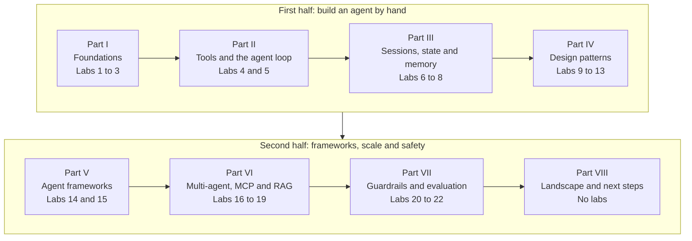

*Figure 1. The eight parts of the guide. Each part uses the vocabulary and code of the parts before it.*

The paragraphs below describe what each part teaches, which problem it solves and how it leads to the next part.

**Part I. Foundations (Chapter 3, Labs 1 to 3).** You learn what a language model does when it generates text, and what tokens and the context window are. You then observe the limitations of the model directly. The model remembers nothing between calls, its knowledge stops at a fixed date, and it cannot act. You also learn to obtain machine-readable output that follows a schema. The part ends with precise definitions of a *workflow* and an *agent*, and with guidance on when an agent is the wrong choice. At the end of Part I, the model can still produce only text, so Part II gives it the ability to act.

**Part II. Building an Agent from Scratch (Chapters 4 to 6, Labs 4 and 5).** You connect the model to tools through **function calling**. In this mechanism, the model requests an action and your program executes it. You then write the **agent loop**, which calls the model, runs the requested tools, returns the results and repeats. The result is a working agent of about fifty lines. The part ends by defining the **harness**, the software around the model. This agent forgets everything when the program stops, so Part III gives it memory.

**Part III. Sessions, State and Memory (Chapter 7, Labs 6 to 8).** You save a conversation to disk as a **session**, so that it survives a restart. You then give the agent **state**, a set of named facts that it writes through tools and reads on every turn. Finally, you add **long-term memory**, which extracts facts from past conversations and retrieves the relevant ones by meaning. The part closes with an introduction to **context engineering**, the design of what the model sees on each call. With one capable agent complete, Part IV shows how to structure the work around it.

**Part IV. Agentic Design Patterns (Chapter 8, Labs 9 to 13).** Many tasks do not need a fully autonomous agent. You implement five patterns in which code fixes part of the control flow: prompt chaining, routing, parallelization, orchestrator-workers and reflection. Each pattern trades some autonomy for predictability. You also learn how to choose and combine the patterns. At this point, you have written every mechanism by hand, so Part V shows how frameworks provide them.

**Part V. Agent Frameworks (Chapter 9, Labs 14 and 15).** You rebuild the travel assistant in the OpenAI Agents SDK and in Google ADK. You also map each framework feature to the code that you wrote earlier. Frameworks add persistence, tracing and multi-agent support with much less code. The ADK lab uses the second Python environment of [Section 2.3](#23-creating-the-python-environments), because the two frameworks need incompatible library versions. Part VI uses both frameworks to go beyond a single agent.

**Part VI. Multi-Agent Systems, Protocols and Retrieval (Chapters 10 to 12, Labs 16 to 19).** You build teams of agents that hand work to each other or call each other as tools. You publish the travel tools through the **Model Context Protocol (MCP)**, so that two different frameworks can use them. You also learn where the Agent2Agent protocol and Agent Skills fit. The part ends with **agentic retrieval-augmented generation**, in which the agent decides when and how to search a knowledge base. The agent can now take consequential actions, so Part VII makes it safe and measurable.

**Part VII. Reliability and Safety (Chapters 13 and 14, Labs 20 to 22).** You study the risks that are specific to agents, such as prompt injection. You then add layered defenses: an input guardrail, human approval before a booking and a price policy enforced in code. Finally, you build an **evaluation harness** that tests the agent over repeated trials, and you learn how traces make an agent observable. With a complete and tested agent, Part VIII places your work in context.

**Part VIII. The Landscape and the Road Ahead (Chapters 15 and 16).** This part contains no labs. It surveys the field by layer: models, frameworks, protocols, products and supporting infrastructure. It then proposes a consolidation project that combines all the labs. Finally, it lists advanced topics and courses for further study.

The reference chapters at the end of the guide contain a troubleshooting table ([Chapter 17](#17-troubleshooting)), a glossary ([Chapter 18](#18-glossary)) and the references ([Chapter 19](#19-references)).

The table below lists all 22 labs with the concept that each lab teaches, the chapter that contains it and the Python environment it needs. [Section 2.3](#23-creating-the-python-environments) explains the two environments, named *core* and *adk*.

| Lab | Concept | Chapter | Environment |
|---|---|---|---|
| 1 | A single model call and its response | 3 | core |
| 2 | Statelessness and conversation history | 3 | core |
| 3 | Schema-constrained structured output | 3 | core |
| 4 | One function call performed by hand | 4 | core |
| 5 | The agent loop written from scratch | 5 | core |
| 6 | A session persisted to disk | 7 | core |
| 7 | Session state and user state | 7 | core |
| 8 | Long-term memory: extraction and retrieval | 7 | core |
| 9 | Prompt chaining with a gate | 8 | core |
| 10 | Routing to specialized handlers | 8 | core |
| 11 | Parallelization and aggregation | 8 | core |
| 12 | Planning with an orchestrator and workers | 8 | core |
| 13 | Reflection (evaluator-optimizer) | 8 | core |
| 14 | The agent in the OpenAI Agents SDK, with a SQLite session | 9 | core |
| 15 | The agent in Google ADK with state and memory services | 9 | adk |
| 16 | Multi-agent: handoffs and agents as tools | 10 | core |
| 17 | Multi-agent: coordinator and sequential pipeline | 10 | adk |
| 18 | An MCP server used by two frameworks | 11 | core and adk |
| 19 | Agentic retrieval-augmented generation | 12 | core |
| 20 | Input guardrail and human approval | 13 | core |
| 21 | A policy enforced in code by a callback | 13 | adk |
| 22 | An evaluation harness with three kinds of grader | 14 | core |

Chapter 1 described the reader whom the guide assumes and the survey that fixed its scope. It also stated the design principles, introduced the travel assistant and laid out the eight parts with their labs. Before the first lab, you need a working Python environment and access to a model. Chapter 2 sets up both.

## 2. Setting Up the Environment

This chapter prepares your computer for the labs. It lists the requirements, explains how to choose a model provider, creates the Python environments, configures credentials and describes the project folder. The labs of Parts I to IV need only one Python environment and one model provider. Steps that only later parts need are marked, so you can postpone them until you reach those parts.

### 2.1 Requirements

This section lists the software that the labs need. Checking the list before you install anything prevents errors later in the setup.

- **Python 3.10 or newer.** Python 3.12 or 3.13 is recommended. The labs use the annotation syntax `str | None`, which requires Python 3.10 or newer.
- **A terminal.** Use Terminal on macOS, any shell on Linux or PowerShell on Windows.
- **At least one model provider.** You need an OpenAI API key or a local installation of Ollama. The Google ADK labs of Part V use a Gemini API key by default, but they can also run on OpenAI or Ollama.
- **Optional tools.** Node.js provides `npx`, which runs the MCP Inspector in Lab 18. The `sqlite3` command-line program lets you inspect the session databases of Labs 14 and 15. You can install both when you reach those labs.

With these requirements in place, the next decision is which model the labs will call. Section 2.2 compares the options.

### 2.2 Choosing a Model Provider

This section explains how the labs select a model provider. The labs read their configuration from environment variables, so the same code runs against a hosted API or a local model without modification. An **environment variable** is a named value that the operating system passes to every program started from a terminal.

The table below compares the supported providers. It shows which labs use each provider by default and how each provider is configured.

| Provider | Used by default in | Configuration | Remarks |
|---|---|---|---|
| OpenAI | All core labs | `OPENAI_API_KEY` | Default chat model `gpt-5.4-mini`; default embedding model `text-embedding-3-small` |
| Google Gemini | ADK labs (15, 17, 18 ADK client, 21) | `GOOGLE_API_KEY` | Default model `gemini-3.8-flash`; key created in Google AI Studio |
| Ollama (local) | Any lab, when selected | `LLM_BASE_URL`, `LLM_API_KEY`, `LLM_MODEL`, `EMBED_MODEL` | Free and private; requires a model that supports tool calling |
| Any other OpenAI-compatible server | Any lab, when selected | Same variables as Ollama | vLLM, LM Studio and many hosted gateways accept the same requests |

The next table lists every environment variable that the labs read, with its meaning and an example value. You set these variables in [Section 2.4](#24-configuring-credentials).

| Variable | Meaning | Example value |
|---|---|---|
| `OPENAI_API_KEY` | Key for the OpenAI API, used when `LLM_BASE_URL` is not set | `sk-...` |
| `LLM_BASE_URL` | Base URL of an OpenAI-compatible server; when set, every lab uses it instead of OpenAI or Gemini | `http://localhost:11434/v1` |
| `LLM_API_KEY` | Key for that server (Ollama accepts any value) | `ollama` |
| `LLM_MODEL` | Chat model for the core labs, and for the ADK labs when `LLM_BASE_URL` is set | `qwen3:8b` |
| `EMBED_MODEL` | Embedding model for Labs 8 and 19 | `nomic-embed-text` |
| `GOOGLE_API_KEY` | Key for the Gemini API, used by the ADK labs | `AI...` |
| `ADK_MODEL` | Model for the ADK labs when `LLM_BASE_URL` is not set | `gemini-3.8-flash` or `gpt-5.4-mini` |

Model identifiers change frequently, which is why the labs make them configurable. The defaults above were current in October 2026. Many tutorials written in 2025 use the `gpt-5-mini` snapshot, which is deprecated and scheduled for shutdown on 11 December 2026. Code that hard-codes this snapshot will stop working after that date. If a default model is unavailable, set `LLM_MODEL` or `ADK_MODEL` to a current model from the provider's models page.

You now know which providers the labs support and which variables select them. Section 2.3 creates the Python environments in which the labs run.

### 2.3 Creating the Python Environments

This section creates the virtual environments and installs the libraries that the labs use. A **virtual environment** is an isolated directory of installed Python packages that belongs to one project. Isolation prevents the packages of this guide from conflicting with the packages of other projects.

The labs need two environments, because the two frameworks of Part V require incompatible major versions of the `openai` package. The `openai-agents` package 0.23 requires `openai` 3.x, whereas the OpenAI connector of `google-adk` 2.11 requires a version below 3. The two environments therefore serve different labs:

- The environment named **core** serves the from-scratch labs, the OpenAI Agents SDK labs and the MCP server. You need it from Lab 1 onward.
- The environment named **adk** serves the Google ADK labs. Lab 15 is the first lab that needs it, so you can postpone its creation until you reach Part V.

On macOS and Linux, the commands below create the project folder and both environments. Each `deactivate` command leaves the environment that was activated before it.

```bash
# Create the project folder and enter it.
mkdir agentic-ai-101 && cd agentic-ai-101

# Environment "core": the OpenAI client, the OpenAI Agents SDK and the MCP SDK.
python3 -m venv .venv
source .venv/bin/activate
pip install "openai==3.24.0" "openai-agents==0.23.1" "mcp==2.3.0"
deactivate

# Environment "adk" (first needed in Lab 15): Google ADK with its OpenAI
# connector and database session support.
python3 -m venv .venv-adk
source .venv-adk/bin/activate
pip install "google-adk[openai,db]==2.11.0"
deactivate
```

The same steps on Windows, in PowerShell, are shown below.

```powershell
# Create the project folder and enter it.
mkdir agentic-ai-101; cd agentic-ai-101

# Environment "core".
py -m venv .venv
.venv\Scripts\Activate.ps1
pip install "openai==3.24.0" "openai-agents==0.23.1" "mcp==2.3.0"
deactivate

# Environment "adk" (first needed in Lab 15).
py -m venv .venv-adk
.venv-adk\Scripts\Activate.ps1
pip install "google-adk[openai,db]==2.11.0"
deactivate
```

The pinned versions reproduce the tested configuration. Newer versions usually work, but agent libraries change quickly. If an upgrade breaks a lab, reinstall the versions above.

An environment is active only in the terminal in which you activated it. Before you run a lab, activate the environment named in the header of the lab:

- For a core lab, run `source .venv/bin/activate`. On Windows, run `.venv\Scripts\Activate.ps1`.
- For an adk lab, run `source .venv-adk/bin/activate`. On Windows, run `.venv-adk\Scripts\Activate.ps1`.

The environments now contain every library that the guide uses. Section 2.4 gives the labs access to a model.

### 2.4 Configuring Credentials

This section stores the credentials that the labs use to call a model. An **API key** is a secret token that authenticates requests to a provider and charges their cost to the owner of the key.

Keys belong in environment variables or in a secrets manager, never in source files. Source files are copied, shared and committed to version control. Anyone who finds a leaked key can use it until you revoke it.

For hosted providers, set the keys with the commands below. The commands are for macOS and Linux. On Windows, use the form `$env:OPENAI_API_KEY="sk-..."`.

```bash
export OPENAI_API_KEY="sk-..."   # core labs, and ADK labs when ADK_MODEL=gpt-5.4-mini
export GOOGLE_API_KEY="..."      # ADK labs (Part V) with the default Gemini model
```

If you have no Gemini key, you can run the ADK labs on OpenAI. To do so, also run `export ADK_MODEL="gpt-5.4-mini"`.

For a local model, install Ollama from its website. Then download a chat model and an embedding model, and set the variables that point the labs to the local server:

```bash
ollama pull qwen3:8b            # a chat model that supports tool calling
ollama pull nomic-embed-text    # an embedding model for Labs 8 and 19
export LLM_BASE_URL="http://localhost:11434/v1"
export LLM_API_KEY="ollama"
export LLM_MODEL="qwen3:8b"
export EMBED_MODEL="nomic-embed-text"
```

An eight-billion-parameter model stored at four-bit precision needs about 5 to 6 GB of free memory. Smaller models run faster but follow tool schemas less reliably. This weakness makes them useful for observing the failure modes of [Section 5.4](#54-stopping-conditions-and-failure-modes). To return to OpenAI, run `unset LLM_BASE_URL LLM_API_KEY LLM_MODEL EMBED_MODEL`.

A variable set with `export` exists only in the current terminal. If you open a new terminal, set the variables again, or add the `export` lines to your shell profile.

Running all labs once on `gpt-5.4-mini` costs well under one US dollar at October 2026 prices. A local model costs nothing beyond electricity. An agent loop can call a model many times, however. As a safeguard, set a monthly spending limit in the billing settings of the provider.

The labs can now authenticate with a model provider. Section 2.5 describes how the project folder is organized.

### 2.5 Project Layout

This section describes the folder in which all lab files live. Each lab presents its own file in full, so you do not need to create any file now. The layout below shows where each file belongs once you have worked through the labs.

All files live in one folder. The labs import two shared files from this folder, so you must run every lab from inside it.

```text
agentic-ai-101/
    llm.py                    shared model client for the from-scratch labs (Lab 1)
    travel_tools.py           mock tools and their schemas (Lab 4)
    lab01_first_call.py       one file per lab, from Lab 1 ...
    lab22_eval.py             ... to Lab 22
    travel_adk/               the ADK agent package of Lab 15, loadable by `adk web`
        __init__.py
        agent.py
    travel_mcp_server.py      the MCP server of Lab 18
```

Several labs create data files when they run. The table below lists these files, the lab that creates each one and what each file contains. Opening the files shows how each mechanism stores its data. Deleting a file resets the corresponding lab.

| File or folder | Created by | Contents |
|---|---|---|
| `sessions/` | Lab 6 | One JSON file per conversation |
| `user_state.json` | Lab 7 | Lasting preferences, one record per user |
| `memories.json` | Lab 8 | Long-term memories with their embeddings |
| `conversations.db` | Lab 14 | The SQLite session store of the OpenAI Agents SDK |
| `adk_sessions.db` | Lab 15 | The SQLite session store of Google ADK |

The project folder now has a defined structure. Section 2.6 introduces the two shared files that most labs import.

### 2.6 The Shared Files

This section introduces the two files that most labs import. It describes their purpose only. Each file appears in full in the lab that first uses it, where its code can be explained in context.

- **`llm.py`** creates one client object for the model provider selected in Section 2.2. Every from-scratch lab imports the client and the model name from this file. Changing the environment variables therefore moves all from-scratch labs to another provider at once. Lab 1 in [Section 3.2](#32-lab-1-a-first-model-call) presents and explains this file.
- **`travel_tools.py`** contains the mock data, the four tool functions and the descriptions of the tools in the format that the model reads. Lab 4 in [Section 4.3](#43-lab-4-one-tool-call-by-hand) presents and explains this file.

When a later lab depends on a detail of either file, the lab repeats that detail briefly. You therefore never need to search an earlier chapter for that detail.

Chapter 2 prepared the environments, the credentials and the project folder. Nothing in the setup is specific to agents yet. Chapter 3 begins the study of agents with the component at their center, the language model. Its first lab sends a request to the model that you have just configured.

<!-- part: Part I. Foundations -->

---

> **Part I. Foundations.** This part establishes what a language model can and cannot do. It defines the terms *workflow* and *agent* precisely and explains how much autonomy a system should receive. It contains Labs 1 to 3. Its definitions form the vocabulary of every later part.

## 3. From Language Models to Agents

Every agent is built around a large language model. Before you add tools or loops, you need a precise picture of what the model does during a single call. Each limitation of the model becomes a requirement for the software around it. This chapter first examines the model and then demonstrates its limitations in three labs. It ends by defining workflows and agents and by explaining when an agent is the wrong choice.

### 3.1 What a Large Language Model Does

This section defines the language model and the terms that describe how it produces text. These terms explain why an agent must supply the model with everything it needs to know on every call.

A **large language model (LLM)** is a neural network trained on a very large corpus of text to predict the next token of a sequence. After this training, the network is tuned to follow instructions and to hold conversations. This guide uses *model* as a short form for a large language model. Five further terms describe how a model operates.

- A **token** is the unit of text that a model reads and writes. A token is usually a word or a fragment of a word. In English, one token corresponds on average to about three quarters of a word.
- The **context window** is the maximum number of tokens that the model can process in a single call. The limit counts the input and the output together. Everything that the model takes into account during a call must fit inside the context window.
- **Inference** is the execution of a trained model to produce output. *Training*, in contrast, adjusts the parameters of the model.
- **Autoregressive generation** is the procedure by which the model produces text. The model computes a probability distribution over the next token, selects one token and appends it to the sequence. It repeats these steps until it emits a stop token or reaches a length limit.
- **Sampling** is the random selection of the next token from that distribution. A parameter called **temperature** controls how strongly sampling favors the most probable tokens. Because of sampling, the same prompt can produce different outputs. For this reason, [Chapter 14](#14-evaluation-and-observability) evaluates agents over several trials.

The diagram below shows autoregressive generation as a loop. The model predicts one token, appends it to its input and predicts again until generation stops.

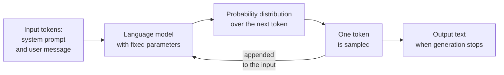

*Figure 2. Autoregressive generation. The only output of the model is a sequence of tokens; the model has no other channel through which to act.*

This mechanism has a direct consequence for agent design. During a call, the model can draw on only two sources of information. The first source is its parameters, which encode its training data up to a fixed date called the **knowledge cutoff**. The second source is the tokens in its context window. The program around the model must therefore place in the context window everything that the model needs to know. This includes the task, the conversation so far, facts about the user and the results of earlier actions.

This section showed that a model knows only what its parameters and its context window contain. Lab 1 makes this concrete: it sends one request to a model and examines every part of the response.

### 3.2 Lab 1: A First Model Call

**Goal.** Lab 1 sends one request to a model and examines the response. The lab shows the parts of a request, such as messages and roles. It also shows the parts of a response, such as the finish reason and the token usage. It also introduces `llm.py`, the shared file through which every from-scratch lab connects to the model.

**Environment:** core. **Files:** `llm.py`, `lab01_first_call.py`. **Run:** `python lab01_first_call.py`

The first file, `llm.py`, creates the connection to the model provider. It reads the environment variables of [Section 2.2](#22-choosing-a-model-provider) and creates a client object. A **client** is an object that sends requests to the API of a provider and returns the responses. The OpenAI client can address any server that implements the OpenAI request format. Changing `LLM_BASE_URL` therefore moves every from-scratch lab from OpenAI to Ollama without any change to the labs.

```python
"""Shared model client for the from-scratch labs.

Every from-scratch lab imports `client` and `MODEL` from this file, so the
model provider is chosen in one place, through environment variables:

    OpenAI (default):         export OPENAI_API_KEY="sk-..."
    Ollama (local, free):     export LLM_BASE_URL="http://localhost:11434/v1"
                              export LLM_API_KEY="ollama"
                              export LLM_MODEL="qwen3:8b"

Ollama, vLLM, LM Studio and many hosted providers (Gemini among them) accept
the same "OpenAI-compatible" requests, which is why one client works for all.
"""

import os

from openai import AsyncOpenAI, OpenAI

# The chat model that every from-scratch lab uses. LLM_MODEL overrides the default.
MODEL = os.getenv("LLM_MODEL", "gpt-5.4-mini")

# Connection settings shared by the two clients below.
_settings = {
    "base_url": os.getenv("LLM_BASE_URL"),  # None means the official OpenAI API
    # The key for that server. LLM_API_KEY takes precedence over OPENAI_API_KEY.
    "api_key": os.getenv("LLM_API_KEY") or os.getenv("OPENAI_API_KEY"),
}

# A synchronous client: each call waits for its response before the program continues.
client = OpenAI(**_settings)             # used by almost every lab

# An asynchronous client: its calls can wait for responses concurrently.
async_client = AsyncOpenAI(**_settings)  # used by Lab 11 to send calls concurrently
```

The file defines three names that later labs import. `MODEL` is the identifier of the chat model. `client` sends one request at a time and waits for each response. `async_client` can send several requests concurrently; Lab 11 explains it where it first needs it.

The second file, `lab01_first_call.py`, uses the client to send one request and prints three parts of the response.

```python
"""Lab 1: one request to a language model, and what comes back."""

from llm import MODEL, client  # the shared client and model name from llm.py

# One request: a model identifier and a list of messages. The system message
# sets the behavior of the model; the user message contains the request.
response = client.chat.completions.create(
    model=MODEL,
    messages=[
        {"role": "system", "content": "You are a concise travel assistant."},
        {"role": "user", "content": "Suggest one weekend getaway near Mumbai, in one sentence."},
    ],
)

# The response holds a list of generated answers ("choices"); the request produced one.
print(response.choices[0].message.content)                   # the generated text
print("finish reason:", response.choices[0].finish_reason)   # "stop" = the model finished normally
print("tokens in / out:", response.usage.prompt_tokens, "/", response.usage.completion_tokens)
```

**Example output** (the wording varies between runs and models):

```text
Lonavala, about two hours from Mumbai by road, offers green hills and waterfalls for an easy weekend escape.
finish reason: stop
tokens in / out: 29 / 34
```

The output has three parts. The first line is the generated text. The finish reason `stop` shows that the model ended its answer normally. The token counts give the size of the request and of the answer, which determine the cost of the call.

**How it works.** The program builds a request, sends it and reads three fields of the response.

1. **The request.** A request consists of a model identifier and a list of **messages**. Each message is a dictionary with a **role** and a content. The role states who produced the content.
2. **The system message.** The message with the role `system` contains instructions from the application developer. These instructions frame the behavior of the model for the whole conversation. The text of the system message is called the **system prompt**. Some APIs call this role `developer`.
3. **The user message.** The message with the role `user` contains the request itself. Later labs add two more roles: `assistant` for earlier replies of the model and `tool` for the results of tool calls.
4. **The choices.** The response contains a list named `choices`. Each choice is one generated answer. The lab requests one answer, so it reads `choices[0]`.
5. **The finish reason.** The **finish reason** states why generation stopped. The value `stop` indicates a natural end, and `length` indicates that the output limit was reached. The value `tool_calls` indicates that the model requests a tool, as Lab 4 shows.
6. **The usage.** The **usage** reports the number of input tokens and output tokens. Providers bill each call according to these numbers.

The labs use the **Chat Completions** request format. OpenAI, Ollama, vLLM, LM Studio, the compatibility endpoint of Gemini and most gateways implement this format. The newer **Responses API** of OpenAI offers the same capabilities with a different request shape. The OpenAI Agents SDK in Part V uses the Responses API by default.

**Try this.**

- Change the system message to "You answer only in Hindi." Observe that the instructions shape the reply.
- Add `temperature=0` to the request, if the chosen model accepts the parameter. Run the script three times and compare how much the output still varies.

Lab 1 showed that a request is a list of role-tagged messages. A response reports its text, its finish reason and its cost in tokens. The lab also created `llm.py`, which every from-scratch lab reuses. A single model call, however, has clear limitations. Section 3.3 names them, and Lab 2 demonstrates the first one.

### 3.3 Three Limitations That Motivate Agents

This section names the three limitations of a model used on its own. Every agent architecture exists to overcome them, so each limitation reappears later as the subject of one or more chapters.

The table below lists the three limitations. For each one, it gives a description, the engineering remedy and the chapters that treat it.

| Limitation | Description | Engineering remedy | Treated in |
|---|---|---|---|
| Statelessness | The model retains nothing between calls; it processes each request independently. | The application stores the conversation and sends it again; long-term facts are stored as memories. | Lab 2, Chapter 7 |
| Frozen knowledge | The model knows nothing after its knowledge cutoff and nothing about private or live data. | Tools that query live systems, and retrieval of relevant documents. | Chapters 4 and 12 |
| Inability to act | The model produces only text; it cannot query a database, book a ticket or send a message. | The application executes actions that the model requests in a structured form. | Chapter 4 |

A fourth limitation concerns reliability rather than capability. A single call cannot check its own result or recover from a mistake. Loops that observe results, reflection, verification and evaluation address this limitation. Chapters 5, 8 and 14 treat it.

The three limitations define what the software around a model must provide: memory, current knowledge and the ability to act. Lab 2 demonstrates the first limitation, statelessness, directly.

### 3.4 Lab 2: The Model Remembers Nothing

**Goal.** Lab 2 demonstrates statelessness, the first limitation of Section 3.3. The model receives two independent requests, and the second request cannot refer to the first one. The lab then shows the standard remedy: the program stores the conversation and resends it with every request.

**Environment:** core. **Run:** `python lab02_stateless.py`

The program defines one helper function, `ask`, and uses it for three calls. Calls A and B are independent of each other. Call C sends the whole conversation.

```python
"""Lab 2: the model remembers nothing between calls."""

from llm import MODEL, client


def ask(messages: list[dict]) -> str:
    """Send a list of messages to the model and return the text of its reply.

    Args:
        messages: The complete conversation to send, oldest message first.

    Returns:
        The content of the model's reply.
    """
    response = client.chat.completions.create(model=MODEL, messages=messages)
    return response.choices[0].message.content


# Two independent calls: the second request contains only the question,
# so the model knows nothing about the first call.
print("A:", ask([{"role": "user", "content": "Hi, my name is Asha."}]))
print("B:", ask([{"role": "user", "content": "What is my name?"}]))

# The remedy: keep the conversation in a list and send the whole list every time.
history = [{"role": "user", "content": "Hi, my name is Asha."}]
history.append({"role": "assistant", "content": ask(history)})  # store the model's reply
history.append({"role": "user", "content": "What is my name?"})
print("C:", ask(history))  # this request contains the earlier exchange
```

**Example output:**

```text
A: Hi Asha, nice to meet you! How can I help you today?
B: I'm sorry, but I don't know your name. You haven't told me in this conversation.
C: Your name is Asha.
```

The decisive line is B. The model cannot know the name, because the request contains only the question. Line C shows the same question answered correctly once the request contains the earlier exchange.

**How it works.** Call B fails because its request contains nothing but the question. Call C succeeds because the program appends each message to the list `history` and sends the entire list. The memory of a chat product is therefore a feature of the application, not of the model. The application stores every message and resends the history with each new request.

The sequence diagram below shows the three calls between the application and the model API. A **sequence diagram** shows the messages between participants in the order of time, from top to bottom.

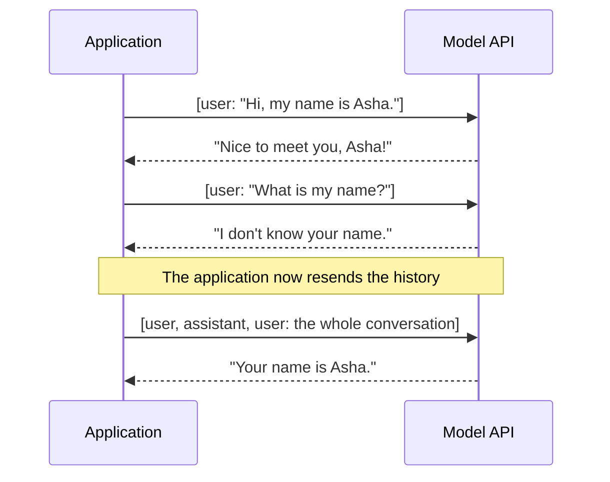

*Figure 3. Conversation history lives in the application. The model sees only what each request contains.*

Resending the history has two costs that grow with the length of a conversation. First, the provider bills every call for all the tokens it contains, so the tenth turn of a conversation costs far more than the first. Second, the history must fit in the context window. Long conversations therefore eventually require the program to shorten or summarize the history. [Chapter 7](#7-sessions-state-and-memory) starts from these two pressures.

**Try this.** Inside `ask`, print `response.usage.prompt_tokens` before the `return` statement. Then append three more exchanges to `history` and observe that the input token count grows with every exchange.

Lab 2 showed that the model is stateless and that the application must resend the conversation on every call. The remedy works, but its cost grows with every turn, and Chapter 7 develops better mechanisms. Before that, Lab 3 addresses a different need: output that a program, rather than a person, can read.

### 3.5 Lab 3: Structured Outputs

**Goal.** Free text is convenient for people but unreliable for programs. Lab 3 makes the model return an object with typed fields instead of free text. Agents depend on this ability: every tool call, routing decision and plan in later labs is a structured output.

Four terms describe the mechanism.

- A **structured output** is a model response that conforms to a predefined schema, so that a program can parse and validate it reliably.
- **JSON Schema** is a standard vocabulary for describing the structure of JSON data: the fields of an object, their types and which fields are required.
- **Constrained decoding** restricts generation so that the output always matches a given JSON Schema. Providers that support it guarantee well-formed output.
- **Pydantic** is a Python library in which a class with annotated fields defines a data structure. The OpenAI client library converts such a class to JSON Schema and parses the reply back into an instance of the class.

**Environment:** core. **Run:** `python lab03_structured_output.py`

The program defines the expected structure as a Pydantic class, `TripRequest`, and asks the model to extract a trip request from one sentence.

```python
"""Lab 3: machine-readable output that follows a schema."""

from pydantic import BaseModel

from llm import MODEL, client


class TripRequest(BaseModel):
    """A trip request extracted from a user's message."""

    origin: str       # the city where the trip starts
    destination: str  # the city that the trip goes to
    nights: int       # the number of nights away
    budget_inr: int   # the total budget in Indian rupees


# parse() sends the JSON Schema derived from TripRequest with the request and
# converts the reply back into a TripRequest object.
completion = client.chat.completions.parse(
    model=MODEL,
    messages=[
        {"role": "system", "content": "Extract the trip request from the message."},
        {"role": "user", "content": "I live in Mumbai and want 3 nights in Goa, budget about 25,000 rupees."},
    ],
    response_format=TripRequest,  # the reply must match this schema
)

trip = completion.choices[0].message.parsed  # a validated TripRequest object, not plain text
print(trip)
# Typed fields allow arithmetic without any parsing of text.
print(f"{trip.nights} nights in {trip.destination}: about {trip.budget_inr // trip.nights} INR per night")
```

**Example output:**

```text
origin='Mumbai' destination='Goa' nights=3 budget_inr=25000
3 nights in Goa: about 8333 INR per night
```

The first line is a `TripRequest` object, not a string. The second line performs integer division on two of its fields, which would be unreliable with free text.

**How it works.** The `parse` method sends the schema derived from `TripRequest` with the request. It returns a validated `TripRequest` object in `message.parsed`. The program can then compute with typed fields instead of searching free text.

Structured outputs connect the components of agentic systems. The arguments of every tool call are structured outputs. Later labs use the same mechanism for extracted memories (Lab 8) and routing decisions (Lab 10). They also use it for plans (Lab 12), critiques (Lab 13) and guardrail verdicts (Lab 20). Validation remains necessary with local models, which may return a well-formed object with an implausible value.

**Try this.**

- Add a field `travel_month: str` to `TripRequest`, and add a month to the user message.
- Remove the budget from the message. Observe what the model returns for a required field that the text does not contain.
- Make the field optional with `budget_inr: int | None` and compare the results.

Lab 3 showed how to obtain machine-readable output that follows a schema. With Labs 1 to 3, you have seen what a single model call can and cannot do. Section 3.6 now defines precisely when a system built from such calls is a workflow and when it is an agent.

### 3.6 Model, Workflow and Agent: Precise Definitions

This section defines three kinds of system: a single model call, a workflow and an agent. Industry uses the word *agent* loosely, so precise definitions are necessary before Part II builds one.

This guide adopts the definitions that Anthropic published in *Building Effective Agents*, which have become a common reference point. A **workflow** is a system in which models and tools are orchestrated "through predefined code paths" that the developer writes. An **agent** is a system in which the model directs its own process and its own use of tools. The model therefore keeps control over how it accomplishes the task.

OpenAI's *A Practical Guide to Building Agents* describes agents as systems that accomplish tasks on behalf of a user independently. It names three components of an agent: a **model** that reasons and decides, **tools** through which it acts and **instructions** that define its behavior. Both sources share one building block, the **augmented LLM**, which is a model enhanced with retrieval, tools and memory. Workflows and agents differ only in which component decides what happens next.

The table below compares the three kinds of system on five properties.

| Property | Single LLM call | Workflow | Agent |
|---|---|---|---|
| Who decides the next step | Nobody; there is one step | The developer's code | The model, at run time |
| Number of model calls | One | Fixed or bounded by the code | Variable, determined by the task |
| Predictability | High | High | Lower; must be bounded by limits |
| Cost and latency | Lowest | Moderate and predictable | Higher and variable |
| Suitable for | Self-contained questions | Tasks with known steps | Open-ended tasks whose steps cannot be known in advance |

The diagram below shows the structural difference as three compact rows. The single call has one step, and the workflow follows a path fixed in code. The agent loops until the model decides that the task is done.

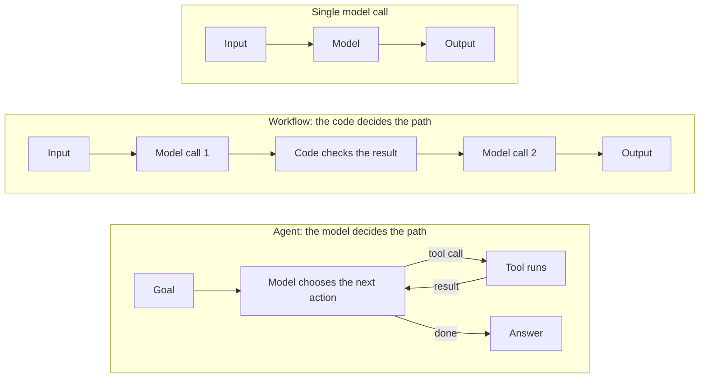

*Figure 4. Three kinds of system compared row by row. Only in the agent does the model choose the next step.*

This section defined the single call, the workflow and the agent, and it located the difference between them in the control of the next step. Section 3.7 treats this difference as a matter of degree.

### 3.7 The Autonomy Spectrum and the Levels of Agentic Systems

This section presents two views of how much autonomy a system should have. Both views help you decide how much control to give the model in a particular application.

Andrew Ng argues that *agentic* is better treated as an adjective than as a category. In his view, systems are agentic to different degrees, and the useful question is how much autonomy a given task warrants. At the low end, the developer fixes the sequence of steps and the tools. At the high end, the model decides which steps to take and which tools to use. In research systems, the model even writes new tools.

Google's whitepaper *Introduction to Agents* was written for the Kaggle 5-Day AI Agents Intensive. It describes an agent as a combination of four elements: a **model**, **tools**, an **orchestration layer** and a **deployment** runtime. The orchestration layer runs the reasoning loop and manages memory and state. The whitepaper also proposes a taxonomy of five levels, which this guide uses to locate each lab.

The table below lists the five levels of this taxonomy and the capability of each level. It also locates each level in the labs of this guide.

| Level | Name in the whitepaper | Capability | Where it appears in this guide |
|---|---|---|---|
| 0 | Core reasoning system | A model answering from its training data alone | Labs 1 to 3 |
| 1 | Connected problem-solver | Uses tools to obtain live information and to act | Labs 4 and 5 |
| 2 | Strategic problem-solver | Plans multi-step tasks and manages its own context | Labs 6 to 15: context management in Labs 6 to 8, planning and other patterns in Labs 9 to 13, framework versions in Labs 14 and 15 |
| 3 | Collaborative multi-agent system | A team of specialized agents that delegate to one another | Labs 16 and 17 |
| 4 | Self-evolving system | Detects gaps in its own capabilities and creates new tools or agents | Beyond the scope of this introduction |

The diagram below arranges the five levels from the least autonomous to the most autonomous.

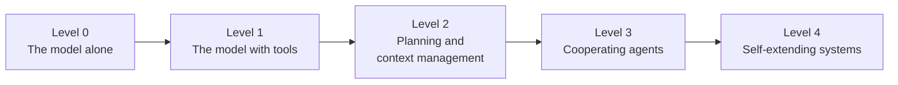

*Figure 5. Increasing autonomy. Each level adds capability, and it also adds cost, latency and new ways to fail.*

Autonomy is therefore a design choice with a price. Section 3.8 gives a procedure for choosing the least autonomous design that solves a problem.

### 3.8 When Not to Build an Agent

This section explains when an agent is the wrong choice. Autonomy costs latency, money and predictability, so a simpler design is preferable whenever it meets the requirement.

Errors also compound across steps. Consider a process of ten steps in which each step succeeds with probability 0.95. The whole process then succeeds with probability 0.95 to the power of 10, which is only about 0.60. Anthropic's guidance is therefore to find the simplest solution that meets the requirement. Agentic complexity should be added only when it demonstrably improves the results.

The decision procedure below summarizes this guidance. Read it from left to right: each question leads either to a design or to the next question. A single model call may include retrieved context, and an agent requires that mistakes can be detected and corrected.

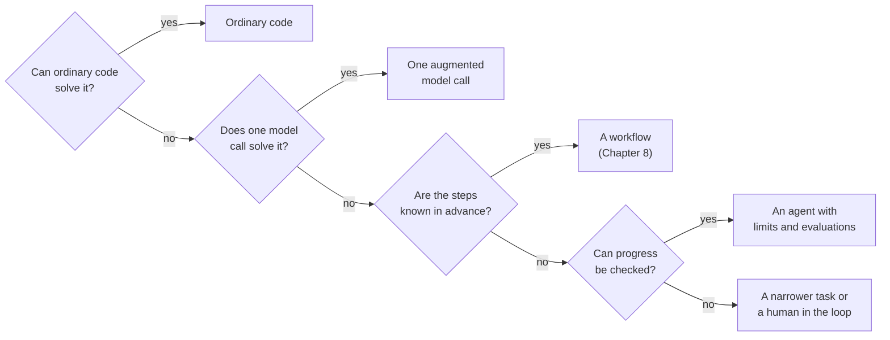

*Figure 6. Choosing the least autonomous design that solves the problem.*

Agents are most effective under three conditions. Success can be verified, for example because tests pass, a booking exists or an answer cites a source. The number of steps cannot be predicted. A slower answer is acceptable. Agents are least effective when a mistake is expensive and cannot be detected. In that situation, approval gates become mandatory, as [Chapter 13](#13-guardrails-and-human-oversight) explains.

Chapter 3 established what a model does, demonstrated its limitations and defined workflows and agents. It also showed that the task must justify any autonomy given to the model. The model, however, still produces only text. Chapter 4 removes this limitation by connecting the model to tools through function calling.

<!-- part: Part II. Building an Agent from Scratch -->

---

> **Part II. Building an Agent from Scratch.** This part implements the mechanism on which every agent rests. A model requests tool calls, a program executes them, and a loop repeats this exchange until the task is done. The part contains Labs 4 and 5. It ends by naming everything around the model: the *harness*.

## 4. Tools and Function Calling

Chapter 3 ended with a model that can produce only text. This chapter gives the model a way to act. It defines tools and function calling and shows the protocol that connects them. Lab 4 then performs one tool call by hand, and the chapter closes with guidelines for designing tools.

### 4.1 Definitions

This section defines the three terms on which the rest of the chapter depends.

- A **tool** is a function or external service that an application makes available to a model. The application describes each tool to the model by a name, a natural-language description and a JSON Schema for its parameters.
- **Function calling** is the mechanism by which a model emits a structured request to invoke a tool with specific arguments, instead of answering in text. Other names for the mechanism are *tool calling* and *tool use*.
- A **tool result** is the output of an executed tool. The application returns it to the model, so that the model can continue. The literature on agents also calls a tool result an *observation*.

The most important fact about function calling is that **the model never executes anything**. The model only proposes a call. The application decides whether to run the call and validates its arguments. It then executes the call with its own credentials and returns the result. This division of labor makes agents controllable, because every action passes through code that the developer writes and can constrain.

These definitions separate two roles: the model proposes, and the application executes. Section 4.2 shows the exchange of messages that implements this separation.

### 4.2 The Function-Calling Protocol

This section shows how one tool call passes between the user, the application, the model and the tool. The same exchange underlies every agent in this guide.

The sequence diagram below follows a weather question from the user to the final answer. The application consults the model twice.

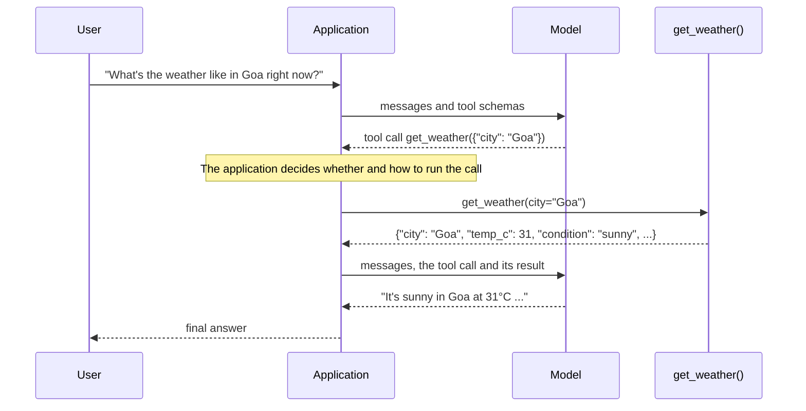

*Figure 7. One complete function call. The model is consulted twice: once to choose the call and once to interpret its result.*

The protocol consists of five steps:

1. The application sends the conversation and the tool schemas to the model.
2. The model replies with a tool call instead of text.
3. The application executes the requested function.
4. The application sends the tool call and its result back to the model.
5. The model writes its final answer from the result.

The protocol requires two model calls for one tool call: one call chooses the tool, and one call interprets the result. Lab 4 implements exactly these steps by hand.

### 4.3 Lab 4: One Tool Call by Hand

**Goal.** Lab 4 performs the protocol of Section 4.2 with explicit code for every step. It also introduces `travel_tools.py`, the shared file that holds the four mock tools of the travel assistant. Seeing each step once by hand prepares you for Lab 5, which automates the steps in a loop.

**Environment:** core. **Files:** `travel_tools.py`, `lab04_tool_call.py`. **Run:** `python lab04_tool_call.py`

The first file, `travel_tools.py`, contains the mock data and the four tool functions. It also defines two objects that connect the functions to the model:

- `TOOL_SCHEMAS` describes three of the tools to the model in JSON Schema, which Lab 3 introduced. The model reads only these descriptions; it never sees the Python code.
- `TOOLS` maps each tool name to its Python function, so that the program can find the function that the model requests.

The docstrings of the tool functions follow a structured style: a summary line followed by an `Args:` section. The frameworks of Part V read this style to generate tool descriptions automatically.

```python
"""Mock travel tools shared by the labs.

Real agents call real services (weather APIs, airline systems, payment
gateways). These functions return fixed, made-up data instead, so every lab
runs offline, costs nothing beyond the model calls, and behaves the same way
every time. Only the model's wording varies between runs.
"""

import uuid

# Fixed weather data for five cities. The keys are lower case, so lookups can ignore case.
WEATHER = {
    "goa": {"temp_c": 31, "condition": "sunny", "humidity_pct": 70},
    "mumbai": {"temp_c": 29, "condition": "humid and cloudy", "humidity_pct": 82},
    "delhi": {"temp_c": 24, "condition": "hazy", "humidity_pct": 45},
    "jaipur": {"temp_c": 27, "condition": "clear", "humidity_pct": 30},
    "manali": {"temp_c": 9, "condition": "cold and clear", "humidity_pct": 40},
}

FLIGHTS = [  # fictional flights, prices in Indian rupees (INR)
    {"id": "FL-101", "origin": "Mumbai", "destination": "Goa", "departs": "07:10", "price_inr": 4200},
    {"id": "FL-202", "origin": "Mumbai", "destination": "Goa", "departs": "13:45", "price_inr": 3500},
    {"id": "FL-303", "origin": "Delhi", "destination": "Goa", "departs": "09:30", "price_inr": 6100},
    {"id": "FL-404", "origin": "Delhi", "destination": "Jaipur", "departs": "18:00", "price_inr": 2900},
    {"id": "FL-505", "origin": "Mumbai", "destination": "Jaipur", "departs": "11:15", "price_inr": 5200},
]

# The value of one unit of each currency in INR. Fixed demonstration rates, not live rates.
RATES_TO_INR = {"INR": 1.0, "USD": 88.0, "EUR": 103.0, "GBP": 118.0}


def get_weather(city: str) -> dict:
    """Get the current weather for a city.

    Args:
        city: City name, for example "Goa".
    """
    # Normalize the name, so that " Goa" and "goa" find the same entry.
    data = WEATHER.get(city.strip().lower())
    if data is None:
        # The error is returned as data: the model can read it and correct its request.
        return {"error": f"No weather data for {city}. Known cities: {', '.join(WEATHER)}."}
    return {"city": city, **data}  # the city name followed by all weather fields


def search_flights(origin: str, destination: str) -> dict:
    """Find flights between two cities, cheapest first.

    Args:
        origin: Departure city, for example "Mumbai".
        destination: Arrival city, for example "Goa".
    """
    # Keep the flights whose origin and destination match, ignoring case and spaces.
    matches = [f for f in FLIGHTS
               if f["origin"].lower() == origin.strip().lower()
               and f["destination"].lower() == destination.strip().lower()]
    return {"flights": sorted(matches, key=lambda f: f["price_inr"])}  # cheapest flight first


def convert_currency(amount: float, from_currency: str, to_currency: str) -> dict:
    """Convert an amount between INR, USD, EUR and GBP.

    Args:
        amount: The amount to convert.
        from_currency: Currency code to convert from, for example "USD".
        to_currency: Currency code to convert to, for example "INR".
    """
    src, dst = from_currency.upper(), to_currency.upper()
    if src not in RATES_TO_INR or dst not in RATES_TO_INR:
        return {"error": f"Supported currencies: {', '.join(RATES_TO_INR)}."}
    # Convert to INR first, then from INR to the target currency.
    converted = amount * RATES_TO_INR[src] / RATES_TO_INR[dst]
    return {"amount": amount, "from": src, "to": dst, "result": round(converted, 2)}


def book_flight(flight_id: str, passenger: str) -> dict:
    """Book a seat on a flight. This action spends money and cannot be undone.

    Args:
        flight_id: The flight id returned by search_flights, for example "FL-202".
        passenger: Full name of the passenger.
    """
    # The only consequential tool. It is deliberately absent from TOOL_SCHEMAS and TOOLS below.
    flight = next((f for f in FLIGHTS if f["id"] == flight_id), None)
    if flight is None:
        return {"error": f"Unknown flight id {flight_id}."}
    # A random confirmation number, such as "BK-3F9A1C", followed by the flight details.
    return {"confirmation": "BK-" + uuid.uuid4().hex[:6].upper(), "passenger": passenger, **flight}


# The same tools described for the model, in the JSON Schema format that the
# Chat Completions API expects. The model only ever sees these descriptions.
TOOL_SCHEMAS = [
    {"type": "function", "function": {
        "name": "get_weather",
        "description": "Get the current weather for a city.",
        "parameters": {"type": "object",
                       "properties": {"city": {"type": "string", "description": "City name, e.g. Goa"}},
                       "required": ["city"]}}},
    {"type": "function", "function": {
        "name": "search_flights",
        "description": "Find flights between two cities, cheapest first. Prices are in INR.",
        "parameters": {"type": "object",
                       "properties": {"origin": {"type": "string"}, "destination": {"type": "string"}},
                       "required": ["origin", "destination"]}}},
    {"type": "function", "function": {
        "name": "convert_currency",
        "description": "Convert an amount between INR, USD, EUR and GBP.",
        "parameters": {"type": "object",
                       "properties": {"amount": {"type": "number"},
                                      "from_currency": {"type": "string"},
                                      "to_currency": {"type": "string"}},
                       "required": ["amount", "from_currency", "to_currency"]}}},
]

# Tool name -> Python function: the program finds the requested function through this mapping.
TOOLS = {"get_weather": get_weather, "search_flights": search_flights, "convert_currency": convert_currency}
```

Two details of this file prepare later chapters. First, each tool returns an error as data, such as `{"error": ...}`, instead of raising an exception. The model can read the error and correct its request. Second, `book_flight` is absent from `TOOL_SCHEMAS` and `TOOLS`. No from-scratch agent can call it until a lab adds it deliberately.

The second file, `lab04_tool_call.py`, asks a weather question and performs the three steps of the protocol by hand.

```python
"""Lab 4: one tool call, performed by hand, step by step."""

import json

from llm import MODEL, client
from travel_tools import TOOL_SCHEMAS, TOOLS

messages = [{"role": "user", "content": "What's the weather like in Goa right now?"}]

# Step 1: send the question together with the descriptions of the tools.
first = client.chat.completions.create(model=MODEL, messages=messages, tools=TOOL_SCHEMAS)
request = first.choices[0].message
call = request.tool_calls[0]  # the model does not answer; it requests a tool
print("model asked for:", call.function.name, call.function.arguments)

# Step 2: the program, not the model, runs the requested function.
arguments = json.loads(call.function.arguments)  # the arguments arrive as a JSON string
result = TOOLS[call.function.name](**arguments)  # find the function by name and call it
print("tool returned:", result)

# Step 3: add the request and the result to the conversation and call the model again.
# The assistant message records which tool call the model requested.
messages.append({"role": "assistant", "content": request.content, "tool_calls": [
    {"id": call.id, "type": "function",
     "function": {"name": call.function.name, "arguments": call.function.arguments}}]})
# The tool message carries the result; tool_call_id links it to the request above.
messages.append({"role": "tool", "tool_call_id": call.id, "content": json.dumps(result)})

final = client.chat.completions.create(model=MODEL, messages=messages, tools=TOOL_SCHEMAS)
print("final answer:", final.choices[0].message.content)
```

**Example output:**

```text
model asked for: get_weather {"city":"Goa"}
tool returned: {'city': 'Goa', 'temp_c': 31, 'condition': 'sunny', 'humidity_pct': 70}
final answer: It's currently sunny in Goa at 31°C with 70% humidity.
```

The first line shows the tool call that the model requested, with its arguments as a JSON string. The second line shows the mock data that the tool returned. The final answer repeats exactly these values, which shows that the answer comes from the tool and not from the training data of the model.

**How it works.** The program performs the three steps that the comments mark.

1. **The request includes the tool descriptions.** With `tools=TOOL_SCHEMAS`, the model receives the names, descriptions and parameter schemas of three tools, but never their code. Instead of answering, the model returns a message with a list named `tool_calls`. Each entry contains an identifier, the tool name and the arguments as a JSON string. The finish reason of this response is `tool_calls`.
2. **The program executes the call.** It parses the arguments with `json.loads` and calls the Python function found in `TOOLS`. A real application validates the arguments at this point, checks permissions or asks a person for approval.
3. **The program reports back.** The program appends two messages to the conversation. The first is the assistant message that contains the tool call, so that the conversation records what was requested. The second is a `tool` message whose `tool_call_id` links the result to the request. The identifier matters because a model can request several calls at once, and each result must match its call. The second request then produces an answer grounded in the data of the tool.

**Try this.**

- Ask for the weather in Paris. The tool returns an error dictionary that lists the known cities, and the model explains the problem instead of inventing a forecast.
- Ask "Hello, who are you?". The model answers without requesting a tool, so `request.tool_calls` is `None`. The script then fails at `request.tool_calls[0]`. Handling both outcomes is the first responsibility of the agent loop in Lab 5.

Lab 4 performed one complete tool call by hand and showed that the program, not the model, runs the tool. It also exposed a weakness: the script assumes that the model always requests a tool. Section 4.4 first discusses how to design tools well, and Lab 5 then removes the weakness with a loop.

### 4.4 Designing Effective Tools

This section explains how the design of a tool affects the reliability of an agent. A tool is an interface for a model rather than for a human programmer. The model selects and calls tools based only on their names, descriptions and schemas, so these elements deserve the same care as a public API.

The table below summarizes the practice recommended in Anthropic's *Writing Effective Tools for Agents* and in OpenAI's agent-building guide. Each row gives a guideline, its rationale and an illustration from `travel_tools.py`.

| Guideline | Rationale | Illustration in `travel_tools.py` |
|---|---|---|
| Give each tool a distinct name and a precise description | The model selects tools by reading their descriptions | "Find flights between two cities, cheapest first. Prices are in INR." |
| Name and type parameters precisely, with examples | Reduces malformed or ambiguous arguments | `origin` and `destination`, with "Mumbai" and "Goa" as examples |
| Return errors as data that explain how to recover | Allows the model to correct its own call | `{"error": "No weather data for Paris. Known cities: ..."}` |
| Return only the information the model needs | Every tool result occupies tokens in the context window | Five fields per flight, not a full airline record |
| Prefer a few task-level tools to many low-level ones | Selection accuracy declines as the number of tools grows | One `search_flights` rather than separate lookups per airline |
| Separate read-only tools from consequential ones | Enables different policies for reading and acting | `book_flight` is a separate tool with its own safeguards |
| Grant each tool the least privilege it requires | Limits the damage a manipulated agent can do | A booking tool should not be able to issue refunds |

Two request options control tool use. The option `tool_choice` lets the model decide (`auto`, the default), forces it to call some tool (`required`), forces a specific tool or forbids tools (`none`). The option `parallel_tool_calls` permits the model to request several independent calls in one reply, which Lab 5 demonstrates.

Chapter 4 gave the model the ability to act: the model requests tool calls, and the application validates and executes them. A single exchange, however, cannot complete a task that needs several dependent steps. Chapter 5 repeats the exchange in a loop until the task is done.

## 5. The Agent Loop

Lab 4 executed exactly one tool call and then stopped. Real tasks often need several tool calls, and the number of calls is not known in advance. This chapter introduces the agent loop and implements it in Lab 5. It then traces what the model sees at each step and lists the ways in which the loop can stop and fail.

### 5.1 The Loop in Four Steps

This section defines the agent loop and relates it to the vocabularies of other courses. Different sources name the same steps differently, so an alignment of the terms prevents confusion later.

The **agent loop** is the control structure of an agent. The program calls the model with the current conversation and the tool descriptions. It executes the tool calls that the model requests and appends their results to the conversation. It repeats these steps until the model answers without requesting a tool or until a stopping condition is reached.

The loop has an academic ancestor in **ReAct** (Yao et al., 2022). ReAct showed that interleaving *reasoning traces* with *actions* and their *observations* improves the performance of a model on tasks that require information from an environment. The Hugging Face course teaches the same cycle as *thought, action, observation*. Google's whitepaper describes it in five steps.

The table below aligns these three vocabularies with the code of Lab 5.

| Google's five steps | ReAct and Hugging Face | Lab 5 code |
|---|---|---|
| Get the mission | Task | The user message and the `SYSTEM` instructions |
| Scan the scene | Context | The `messages` list, including earlier results, and the tool schemas |
| Think it through | Thought | `client.chat.completions.create(...)` |
| Take action | Action | `run_tool(...)` for each requested call |
| Observe and iterate | Observation | Appending each result as a `tool` message and looping |

The diagram below shows the loop as Lab 5 runs it. The main path runs from left to right, and the arrow back to the model call closes the loop. One node combines the act step and the observe step, because Lab 5 performs both steps for each tool call in turn.

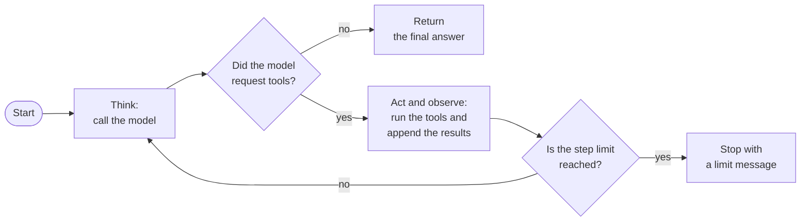

*Figure 8. The agent loop. Modern models reason internally, so the thought is the model call itself, and the action is an explicit tool call.*

The agent loop turns the single exchange of Chapter 4 into an open-ended process. Lab 5 implements the loop in about fifty lines of Python.

### 5.2 Lab 5: The Agent Loop Written from Scratch

**Goal.** Lab 5 writes the agent loop of Section 5.1 as a reusable function. The loop removes the weakness of Lab 4, whose script failed when the model did not request a tool. Many later labs import this function unchanged, so it is the most reused code in the guide.

**Environment:** core. **Run:** `python lab05_agent_loop.py`

The lab imports two objects from `travel_tools.py`, which Lab 4 presented. `TOOL_SCHEMAS` holds the tool descriptions that the model reads, and `TOOLS` maps each tool name to its Python function. The program contains three functions:

- `run_tool` executes one requested tool and converts every failure into an error result.
- `run_agent_loop` implements the loop. Later labs import it.
- `run_agent` is a convenience wrapper that answers one request with a fresh conversation.

```python
"""Lab 5: the agent loop, written from scratch.

The loop is the core of every agent: call the model, run the tools it asks
for, add the results to the conversation, and repeat until the model answers
in plain text or a step limit is reached.
"""

import json

from llm import MODEL, client
from travel_tools import TOOL_SCHEMAS, TOOLS

# The system prompt of the agent: instructions that frame its behavior on every call.
SYSTEM = (
    "You are a travel assistant. Use the tools for weather, flights and currency "
    "instead of guessing. When you have everything you need, answer briefly."
)
MAX_STEPS = 8  # a safety limit: the loop must always end


def run_tool(name: str, arguments: str, tool_functions: dict) -> dict:
    """Run one requested tool and return its result.

    Errors are returned as data rather than raised, so that the model can read
    them and react, for example by correcting its arguments.

    Args:
        name: The tool name that the model requested.
        arguments: The arguments as a JSON string, exactly as the model produced them.
        tool_functions: A mapping from tool names to Python functions.

    Returns:
        The result of the tool, or a dictionary with an "error" key.
    """
    if name not in tool_functions:
        return {"error": f"Unknown tool {name}."}
    try:
        return tool_functions[name](**json.loads(arguments))
    except Exception as exc:  # malformed arguments, a failing service and similar faults
        return {"error": f"{type(exc).__name__}: {exc}"}


def run_agent_loop(messages: list, tool_schemas: list, tool_functions: dict,
                   max_steps: int = MAX_STEPS, verbose: bool = True) -> tuple[str, list]:
    """Run the agent loop until the model answers or the step limit is reached.

    Args:
        messages: The conversation so far. The loop appends new messages to this list.
        tool_schemas: The tool descriptions that the model receives.
        tool_functions: A mapping from tool names to Python functions.
        max_steps: The maximum number of model calls.
        verbose: If True, print every tool call and its result.

    Returns:
        The final answer and a trace, which is a list that records every tool call.
    """
    trace = []
    for step in range(1, max_steps + 1):
        # 1. Think: the model reads the whole conversation and the tool descriptions.
        response = client.chat.completions.create(model=MODEL, messages=messages, tools=tool_schemas)
        message = response.choices[0].message

        # 2. Done? A reply without tool calls is the final answer of the model.
        if not message.tool_calls:
            messages.append({"role": "assistant", "content": message.content})
            return message.content, trace

        # 3. Act: record the tool requests of the model in the conversation, then run each one.
        messages.append({"role": "assistant", "content": message.content, "tool_calls": [
            {"id": call.id, "type": "function",
             "function": {"name": call.function.name, "arguments": call.function.arguments}}
            for call in message.tool_calls]})
        for call in message.tool_calls:
            result = run_tool(call.function.name, call.function.arguments, tool_functions)
            trace.append({"step": step, "tool": call.function.name,
                          "arguments": call.function.arguments, "result": result})
            if verbose:
                print(f"  step {step}: {call.function.name}({call.function.arguments}) -> {result}")
            # 4. Observe: the result enters the conversation for the next iteration.
            messages.append({"role": "tool", "tool_call_id": call.id, "content": json.dumps(result)})

    # The for loop ended without a final answer, so the step limit was reached.
    return "I stopped because I reached the step limit before finishing.", trace


def run_agent(user_request: str) -> str:
    """Answer one request with a fresh conversation and the three travel tools.

    Args:
        user_request: The message of the user.

    Returns:
        The final answer of the agent.
    """
    messages = [{"role": "system", "content": SYSTEM}, {"role": "user", "content": user_request}]
    answer, _ = run_agent_loop(messages, TOOL_SCHEMAS, TOOLS)  # the trace is not needed here
    return answer


# This block runs only when the file is executed directly, not when another lab imports it.
if __name__ == "__main__":
    print(run_agent(
        "I'm flying from Mumbai to Goa this weekend with 500 US dollars. What's the weather there, "
        "which flight is cheapest, and how many rupees will I have left after paying for it?"
    ))
```

**Example output** (long lines shortened):

```text
  step 1: get_weather({"city": "Goa"}) -> {'city': 'Goa', 'temp_c': 31, 'condition': 'sunny', 'humidity_pct': 70}
  step 1: search_flights({"origin": "Mumbai", "destination": "Goa"}) -> {'flights': [{'id': 'FL-202', ... 'price_inr': 3500}, {'id': 'FL-101', ... 'price_inr': 4200}]}
  step 1: convert_currency({"amount": 500, "from_currency": "USD", "to_currency": "INR"}) -> {'amount': 500, 'from': 'USD', 'to': 'INR', 'result': 44000.0}
Goa is sunny at 31°C with 70% humidity. The cheapest flight is FL-202, departing at 13:45 for 3,500 INR. Your 500 USD is about 44,000 INR, so after paying for the flight you will have roughly 40,500 INR left.
```

The three `step 1` lines show that the model requested three tool calls in its first reply. The final paragraph combines the three results with a subtraction that the model performed itself in its second reply.

**How it works.** `run_agent_loop` contains the whole mechanism. Each iteration of its `for` loop performs the four steps of Section 5.1.

- **Think.** Each iteration sends the complete message list and the tool schemas to the model.
- **Done?** If the reply contains no tool calls, the model has decided that it can answer. The loop appends the answer to the conversation and returns it. This check removes the failure observed at the end of Lab 4.
- **Act.** Otherwise, the loop first appends the request of the model to the conversation. It then executes every requested call through `run_tool`. `run_tool` converts unknown tools and exceptions into error dictionaries, so an error becomes information for the model rather than a crash of the program.
- **Observe.** Each result is appended as a `tool` message, and the next iteration begins.
- **Limit.** `MAX_STEPS` guarantees termination, even if the model never stops requesting tools.

In the example run, the model requested three independent calls in a single reply. Such a request is called a **parallel tool call**. The model then computed the remaining money itself in its second reply. Another model, or the same model on another run, may request the tools one at a time over several steps. Both trajectories are correct.

The function also returns a `trace`, a list that records every tool call with its step, arguments and result. Lab 22 uses this list to evaluate the agent. The block `if __name__ == "__main__":` runs only when you execute the file directly. Other labs can therefore import `run_agent_loop` without starting the example request.

**Try this.**

- Ask the agent to find the cheapest flight from Delhi to Goa and to convert its price to euros. The conversion can happen only after the search, so the model needs at least two steps.
- Set `MAX_STEPS = 1` and observe the limit message.
- Ask about the weather in Paris and observe how the model reacts to the error result.

Lab 5 produced a complete agent: a loop that thinks, acts and observes until it can answer. Later labs import `run_agent_loop` unchanged. Section 5.3 examines how the conversation grows during the loop, because this growth determines the cost and the limits of an agent.

### 5.3 What the Model Sees at Each Step

This section traces the message list of Lab 5 step by step. The message list is the working memory of the agent: at every step, the model reads the entire list again. Understanding the growth of the list explains why long tasks become expensive.

The table below shows the contents of the message list at four moments of the example run.

| Moment | Messages in the list |
|---|---|
| Before step 1 | `system`, `user` |
| After the model's first reply | `system`, `user`, `assistant` (three tool calls) |
| After the tools have run | ... plus `tool` (weather), `tool` (flights), `tool` (currency) |
| After the model's second reply | ... plus `assistant` (final text) |

The complete sequence of model outputs, tool calls and tool results that an agent produces while performing a task is called its **trajectory**. The sequence diagram below shows the trajectory of the example run.

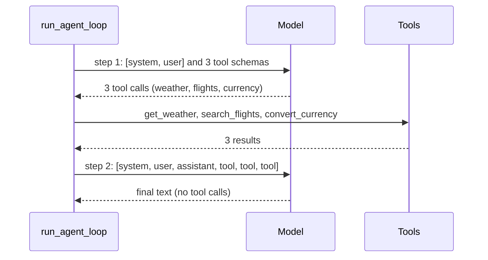

*Figure 9. The trajectory of Lab 5: two model calls and three tool calls.*

This growth has two practical consequences. First, every tool result is paid for again on every later step, so compact results reduce cost. Second, a long task eventually fills the context window. Context engineering, introduced in [Chapter 7](#7-sessions-state-and-memory), addresses this second problem.

The message list therefore grows with every step and is resent in full on every call. Section 5.4 examines how the loop stops and how it fails.

### 5.4 Stopping Conditions and Failure Modes

This section defines how an agent loop ends and lists the typical ways in which it fails. Recognizing a failure mode in a trace is the first step in correcting it.

A **stopping condition** is a rule that ends the loop. The natural stopping condition is a final answer. Production agents add further conditions. Typical examples are a maximum number of steps, a token or cost budget and a wall-clock time limit. Others are a maximum number of consecutive errors and interruption by a person.

The table below lists seven common failure modes, the symptom of each in the trace and a typical mitigation.

| Failure mode | Symptom in the trace | Typical mitigation |
|---|---|---|
| Looping | The same call is repeated with the same arguments | Step limit; detection of repeated calls; clearer error messages |
| Wrong tool | A plausible but inappropriate tool is chosen | Sharper descriptions; fewer, more distinct tools |
| Hallucinated arguments | Invented identifiers or values | Schema validation; enumerations; returning valid options in errors |
| Premature termination | The model answers before the task is complete | Instructions that define completion; verification steps |
| Goal drift | Later steps pursue a different objective | Restating the goal; planning (Lab 12) |
| Context overflow | Quality degrades as the history grows | Trimming, summarization and isolation (Chapter 7) |
| Error cascade | An early mistake corrupts every later step | Checks between steps; reflection (Lab 13); human review |

Diagnosis begins with the trace. An agent whose individual steps cannot be inspected cannot be debugged. For this reason, the labs print every call, and [Chapter 14](#14-evaluation-and-observability) treats observability as a core capability.

Chapter 5 built the agent loop, traced the context that it accumulates and catalogued its failure modes. In Lab 5, one line calls the model. Every other line decides what the model sees, what it may do and when it must stop. Chapter 6 gives this surrounding software a name and a structure: the harness.

## 6. The Harness: Everything Around the Model

Lab 5 showed that most of the code of an agent does not call the model. This chapter names that code, the harness, and divides it into components. It then distinguishes harnesses from frameworks and protocols, three kinds of software that discussions of agents often confuse.

### 6.1 Definition

This section defines the harness and the engineering practice built around it.

In April 2026, Addy Osmani summarized a view that had become widespread among practitioners in a compact formula: **Agent = Model + Harness**. His corollary states the boundary directly: "If you're not the model, you're the harness."

The **harness** is the software around a model that supplies its loop, tools, context management, permissions, verification and persistence. **Harness engineering** is the practice of designing, testing and improving harnesses to make agents reliable. It is now treated as a discipline of its own. OpenAI, Martin Fowler's site and others published essays on harness engineering during 2026. Practitioners report that the same model succeeds at markedly different rates when placed in different harnesses.

Lab 5 is a minimal but complete harness. Of its fifty or so lines of logic, one line calls the model. Every other line decides what the model sees, what it may do, what happens to its requests and when it must stop.

The harness is therefore the part of an agent that the developer controls. Section 6.2 divides the harness into components and shows where each component appears in this guide.

### 6.2 Components of a Harness

This section lists the components of a harness. The list also serves as a map of the rest of the guide, because each later chapter studies one or more of these components.

The table below names each component, states its function and gives the chapters or labs in which it appears.

| Component | Function | Where it appears in this guide |
|---|---|---|
| Instructions | Define role, rules and output conventions; include system prompts, instruction files such as `AGENTS.md`, and skills | `SYSTEM` in Lab 5; Agent Skills in Chapter 11 |
| Tool registry and executor | Describe the available actions and run the requested ones | `TOOL_SCHEMAS`, `TOOLS` and `run_tool`; MCP in Lab 18 |
| Loop and stopping conditions | Control the sequence of model calls | `run_agent_loop` and `MAX_STEPS` |
| Context management | Decide what enters the context window at each step | History trimming (Lab 6), state injection (Lab 7), memory recall (Lab 8) |
| Persistence | Save conversations and progress so that work survives restarts | Labs 6, 14 and 15 |
| Error handling and recovery | Turn failures into information; retry; resume | `run_tool` returning errors as data |
| Permissions and policies | Restrict what the agent may do, and when a person must approve | Labs 20 and 21 |
| Orchestration | Route work, delegate to sub-agents, hand off between agents | Labs 10, 12, 16 and 17 |
| Hooks and middleware | Run deterministic code before or after model and tool calls | ADK callbacks in Lab 21 |
| Verification | Check results with validators, tests or a judge model | Labs 13 and 22 |
| Observability | Record traces, costs and latencies | The trace of Lab 5; Chapter 14 |

The diagram below shows how the main components relate to the model and to the external world. The agent loop sits at the center and is the only component that exchanges messages with the model. Tool results return to the context manager, which supplies the context of the next model call.

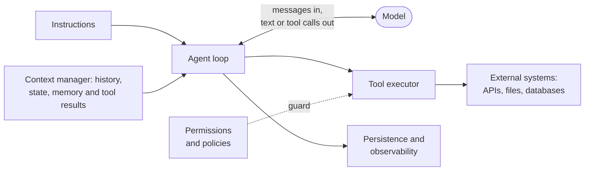

*Figure 10. The components of a harness and their relation to the model.*

The components of a harness are the subjects of the remaining chapters, which study them one at a time. Section 6.3 first separates harnesses from two related kinds of software.

### 6.3 Harness, Framework and Protocol

This section distinguishes three kinds of software that discussions of agents often confuse. The distinction helps you place every product and library that later chapters mention.

- A **harness** is an execution system that wraps a model and turns it into a working agent. It usually brings an opinionated loop, a permission model, a sandbox and a strategy for managing context.
- A **framework** is a library of composable primitives, such as model clients, tool abstractions, orchestration and memory. Developers assemble their own loop and policies from these primitives.
- A **protocol** is a wire format that standardizes how components communicate. A protocol does not run anything itself.

The table below compares the three kinds of software by the responsibilities they own. It is adapted from Michal Sutter's analysis in MarkTechPost (September 2026).

| Responsibility | Harness | Framework | Protocol (MCP) |
|---|---|---|---|
| Execution loop | Owns a fixed, product-grade loop | Provides a configurable loop | None; request and response only |
| State and memory | Owns sessions, resumption and checkpoints | Exposes hooks; the developer chooses persistence | None at the protocol level |
| Tool transport | Acts as an MCP client | Acts as an MCP client | Owns the transport: JSON-RPC over standard input and output or HTTP |
| Permissions | Owns permission modes, hooks and sandboxing | Exposes guardrails; the developer writes the policy | Cannot enforce policy at the protocol level |
| Recovery | Owns resumption, rewind and compaction | Exposes durable execution | Partial |

The diagram below shows the usual layering of the three kinds of software in a production system.

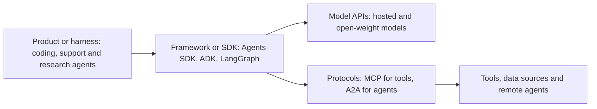

*Figure 11. The usual layering. Production systems commonly combine all three layers.*

Coding agents such as Claude Code, OpenAI Codex and Gemini CLI are harnesses. The OpenAI Agents SDK, Google ADK and LangGraph are frameworks. Each of these frameworks now ships enough of a loop, session handling and tracing to blur the boundary, however. MCP and A2A are protocols. The practical lesson for a beginner is that most of the engineering effort in an agent system is harness engineering.

Part II built an agent by hand and named its parts. The agent can act and loop, but it forgets everything when the program ends, and its message list grows without bound. Part III addresses both problems with the most consequential component of the harness: what the agent remembers.

<!-- part: Part III. Sessions, State and Memory -->

---

> **Part III. Sessions, State and Memory.** A model forgets everything between calls. Users, however, expect an assistant to remember the conversation, the facts it has learned and the preferences they have expressed. This part builds three mechanisms that provide this continuity, from scratch, in Labs 6 to 8. It then maps the mechanisms onto the frameworks and introduces context engineering.

## 7. Sessions, State and Memory

This chapter gives the travel assistant a memory. It first states the problem and defines the vocabulary. Three labs then build the mechanisms one at a time. Lab 6 saves a session to disk, Lab 7 adds state in two scopes, and Lab 8 adds long-term memory. The chapter ends by comparing the mechanisms, mapping them to the frameworks and introducing context engineering.

### 7.1 The Problem: A Stateless Model in a Stateful Conversation

This section states the problem that the chapter solves. It connects the observations of Labs 2 and 5 to three design questions.

Lab 2 established that the model retains nothing between calls, so the application must resend whatever the model should know. Lab 5 showed that, within one task, the message list serves as the working memory of the agent. Neither mechanism survives the end of the program. Neither mechanism scales either. A conversation that is resent in full costs more with every turn and eventually exceeds the context window.

The harness must therefore answer three design questions. The Kaggle intensive and the Google ADK documentation organize them under the headings *sessions*, *state* and *memory*:

1. How is one conversation recorded so that it can be continued later? This is the question of **sessions**.
2. How are specific facts kept in a form that code and model can read exactly? This is the question of **state**.
3. How is knowledge carried from one conversation to the next? This is the question of **long-term memory**.

Each question receives its own mechanism and its own lab. Section 7.2 defines the terms that these mechanisms use.

### 7.2 Definitions

This section defines the vocabulary of the chapter. Labs 6 to 8 then implement each defined mechanism, so every term below reappears with running code. You can return to this section whenever a term needs clarification.

- A **session** is the record of one conversation between one user and one agent application. It consists of a session identifier, the identifier of its user, an ordered list of events and the state of that conversation.
- An **event** is one entry in the history of a session. Examples are a user message, a model reply, a tool call, a tool result and a change of state. Events are appended in order and are not edited afterwards. The event list is therefore a faithful log of what happened.
- **State** is a set of named values, or key-value pairs, that the agent or the application reads and writes deliberately. An example is `destination = "Goa"`. State is small, structured and addressed by key.
- The **scope** of a state value determines who shares the value and how long it lives. Common scopes are a single session, all sessions of one user, the whole application and a single invocation.
- **Short-term memory** is the information available within one session: its events and its state. The part of it that the harness places in the context window for a given model call is the **working memory** of the model.
- **Long-term memory** is knowledge that persists across sessions. It is usually extracted from past conversations, stored outside any single session and retrieved by relevance when needed. Three kinds are commonly distinguished:
  - **Semantic memory** holds facts, such as "Asha is vegetarian".
  - **Episodic memory** holds records of past interactions, such as "on 3 October we compared flights to Goa".
  - **Procedural memory** holds knowledge of how to perform tasks, such as learned instructions or skills.

The table below previews the five mechanisms of this chapter. For each mechanism, it gives the lifetime, the unit of storage, the writer and the route by which the mechanism reaches the model. The last column names the lab in which the mechanism appears. You do not need to memorize the table now, because each lab explains its row in detail.

| Mechanism | Lifetime | Unit | Written by | How it reaches the model | Example in the labs |
|---|---|---|---|---|---|
| Context window | One model call | Tokens | The harness, for each call | Directly | Lab 5: the messages sent in step 2 |
| Session events | One conversation | Messages, tool calls and results | The harness, automatically | Replayed as history, possibly trimmed or summarized | Lab 6: the events of one conversation |
| Session state | One conversation | Named values | Tools or application code | Inserted into the system prompt | Lab 7: `destination = Goa` |
| User state | All conversations of one user | Named values | Tools or application code | Inserted into the system prompt | Lab 7: `diet = vegetarian` |
| Long-term memory | Indefinite | Natural-language facts or records | An extraction process, usually after a session | Retrieved by similarity and inserted | Lab 8: "Asha prefers a window seat" |

These definitions separate where information is stored from what the model sees on a given call. Section 7.3 combines them into one picture.

### 7.3 A Mental Model in Three Layers

This section combines the definitions into a single model of how information moves. The three layers are the context window, the session store and the long-term memory store. Information is written from the context window into durable stores and later read back from the stores into the context window.

A **write path** moves information out of the context window into durable storage. The diagram below shows the three write paths of this chapter, one per row.

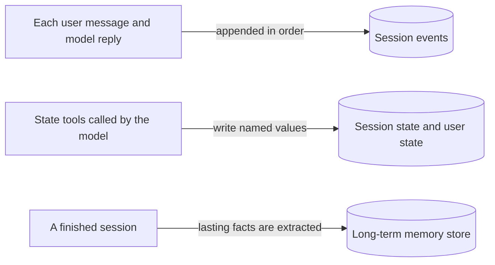

*Figure 12. Write paths. Each kind of information has its own durable store.*

A **read path** moves information from a store back into the context window of the next model call. The diagram below shows the four read paths and their common destination.

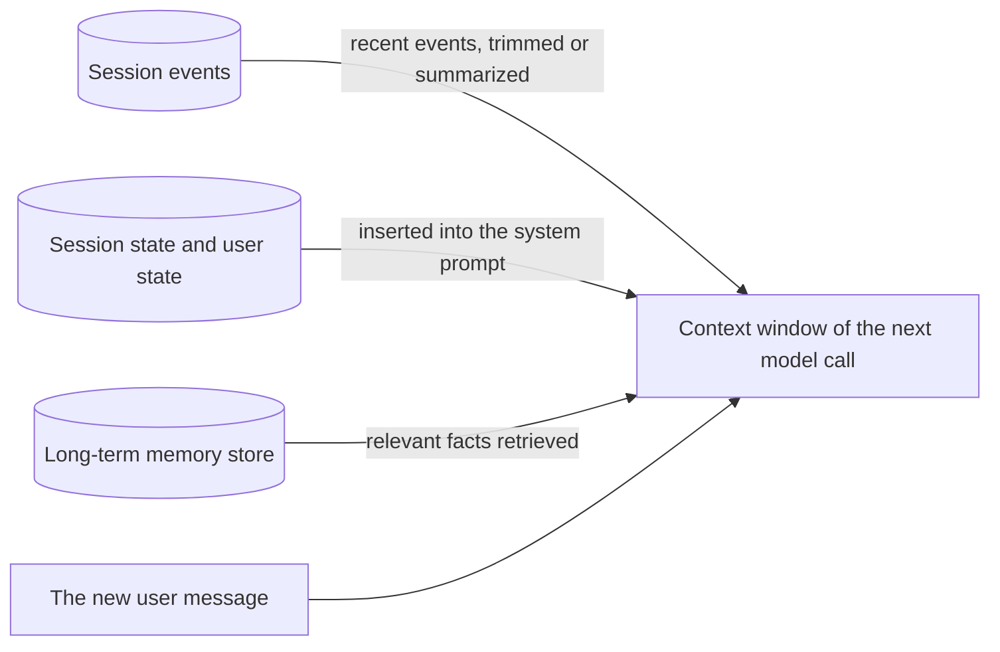

*Figure 13. Read paths. For each call, the harness selects from every store what enters the context window.*

Every design decision in this chapter concerns one of these paths. Lab 6 builds the first write path and the first read path: events appended to a session, and recent events replayed as history. Lab 7 adds the paths for state, and Lab 8 adds the paths for long-term memory.

The three-layer model separates storage from context. The model sees only the context window, while the stores hold everything else. Lab 6 now builds the first store, the session.

### 7.4 Lab 6: A Session Saved to Disk

**Goal.** Lab 6 answers the first design question of Section 7.1: how a conversation is recorded so that it can be continued later. The lab stores each conversation as a session in a JSON file. It then simulates a restart of the program and shows that the conversation continues from the file. The lab also introduces the simplest form of context management, the **sliding window**. A sliding window sends only the most recent part of a session to the model.

Lab 2 kept the conversation in a Python list, which disappears when the program ends. A session solves this problem by giving each conversation an identity and a file. The program below has three parts:

- The `Session` class holds one conversation. It can save the conversation to a file and load it again.
- The function `history_as_messages` converts the stored events into the message list that the model expects. It applies the sliding window.
- The function `chat` performs one conversation turn. It records the message of the user, calls the model, records the reply and saves the session.

**Environment:** core. **Run:** `python lab06_session.py`

```python
"""Lab 6: a session that is saved to disk, so a conversation survives a restart.

A session is one conversation between one user and the agent. It stores the
ordered list of events (here: user and assistant messages) plus a small
dictionary of state (used in Lab 7), and it can be saved and loaded again.
"""

import json
import time
import uuid
from pathlib import Path

from llm import MODEL, client

SESSIONS_DIR = Path("sessions")  # the folder that holds one JSON file per session
MAX_EVENTS_IN_PROMPT = 20  # context management: only the most recent events are sent


class Session:
    """The record of one conversation: its user, its identifier, its events and its state."""

    def __init__(self, user_id: str, session_id: str | None = None):
        """Create a session object.

        Args:
            user_id: Identifies the user to whom the conversation belongs.
            session_id: Identifies an existing session. If None, a new identifier is generated.
        """
        self.user_id = user_id                        # the user of the conversation
        self.id = session_id or uuid.uuid4().hex[:8]  # a short random identifier for a new session
        self.events: list[dict] = []                  # the messages of the conversation, in order
        self.state: dict = {}                         # named values for this conversation (Lab 7)

    def add_event(self, role: str, content: str) -> None:
        """Append one message to the history, together with the time at which it was recorded."""
        self.events.append({"role": role, "content": content, "time": time.time()})

    def save(self) -> None:
        """Write the session to sessions/<id>.json, replacing any earlier version of the file."""
        SESSIONS_DIR.mkdir(exist_ok=True)
        # self.__dict__ holds every attribute of the object: user_id, id, events and state.
        (SESSIONS_DIR / f"{self.id}.json").write_text(json.dumps(self.__dict__, indent=2))

    @classmethod
    def load(cls, session_id: str) -> "Session":
        """Rebuild a saved session from its file.

        Args:
            session_id: The identifier of the session to load.

        Returns:
            A Session object with the saved events and state.
        """
        data = json.loads((SESSIONS_DIR / f"{session_id}.json").read_text())
        session = cls(data["user_id"], data["id"])                     # same user, same identifier
        session.events, session.state = data["events"], data["state"]  # restore the contents
        return session


def history_as_messages(session: Session) -> list[dict]:
    """Turn the most recent events into the message list that the model expects.

    The slice creates a new list and leaves session.events unchanged: the session
    keeps the full history, while the model receives only the most recent part.
    """
    recent = session.events[-MAX_EVENTS_IN_PROMPT:]  # the last MAX_EVENTS_IN_PROMPT events
    # Keep only role and content; the timestamp is for the application, not for the model.
    return [{"role": e["role"], "content": e["content"]} for e in recent]


def chat(session: Session, text: str) -> str:
    """Perform one turn: store the user message, send the history, store the reply, save.

    Args:
        session: The conversation to continue.
        text: The new message of the user.

    Returns:
        The reply of the model.
    """
    session.add_event("user", text)
    messages = [{"role": "system", "content": "You are a friendly travel assistant."}]
    messages += history_as_messages(session)  # the recent history, ending with the new message
    reply = client.chat.completions.create(model=MODEL, messages=messages).choices[0].message.content
    session.add_event("assistant", reply)
    session.save()  # saved after every turn: a crash loses at most the turn in progress
    return reply


if __name__ == "__main__":
    session = Session(user_id="asha")
    print("assistant:", chat(session, "Hi, I'm Asha. I'm planning a trip to Goa in December."))
    print(f"(saved to sessions/{session.id}.json with {len(session.events)} events)")

    saved_id = session.id
    del session  # simulate a restart: the object in memory is gone

    restored = Session.load(saved_id)  # the conversation comes back from disk
    print("assistant:", chat(restored, "Where did I say I'm going, and when?"))
    for event in restored.events:
        # The role is right-aligned in 9 characters; the content is cut to 70 characters.
        print(f"  {event['role']:>9}: {event['content'][:70]}")
```

**Example output:**

```text
assistant: Hi Asha! Goa in December is a great choice: dry, sunny weather and lively beaches. How many days are you planning to stay?
(saved to sessions/3f9c1a2b.json with 2 events)
assistant: You said you're planning a trip to Goa in December.
       user: Hi, I'm Asha. I'm planning a trip to Goa in December.
  assistant: Hi Asha! Goa in December is a great choice: dry, sunny weather and liv
       user: Where did I say I'm going, and when?
  assistant: You said you're planning a trip to Goa in December.
```

The first reply comes from a fresh session. The second reply comes from a session that the program rebuilt from the file after it deleted the original object. The model still knows the destination and the month, because the history came from the file.

The session file records who the conversation is with, which conversation it is and what was said. Its abbreviated contents after the run are shown below.

```json
{
  "user_id": "asha",
  "id": "3f9c1a2b",
  "events": [
    {"role": "user", "content": "Hi, I'm Asha. I'm planning a trip to Goa in December.", "time": 1759571234.5},
    {"role": "assistant", "content": "Hi Asha! Goa in December is a great choice: ...", "time": 1759571236.0},
    {"role": "user", "content": "Where did I say I'm going, and when?", "time": 1759571236.1},
    {"role": "assistant", "content": "You said you're planning a trip to Goa in December.", "time": 1759571237.4}
  ],
  "state": {}
}
```

**How it works.** The explanation follows the program in the order in which it runs.

- **Creating a session.** `Session(user_id="asha")` creates an object with the four parts of the definition in Section 7.2. `user_id` identifies the user. `id` identifies the conversation: `uuid.uuid4()` generates a random identifier, and `.hex[:8]` keeps its first eight hexadecimal characters. `events` holds the messages in order. `state` stays empty in this lab; Lab 7 fills it.
- **One turn.** `chat` performs five steps in a fixed order. It appends the message of the user as an event and builds the input of the model from the stored events. It then calls the model, appends the reply as an event and saves the session. Because the session is saved after every turn, a crash loses at most the turn in progress.
- **Saving.** Every Python object stores its instance attributes in a dictionary named `__dict__`. `save` serializes this dictionary as JSON, so one line writes all four attributes to `sessions/<id>.json`.
- **The simulated restart.** `del session` removes the name `session`, so the object in memory is no longer reachable. This step imitates a program that stops and starts again.
- **Loading.** `load` is a **class method**, which the decorator `@classmethod` marks. A class method receives the class itself, named `cls`, instead of an instance. It can therefore serve as an alternative constructor. `load` reads the file, creates a `Session` with the saved identifiers and restores the events and the state. The second question is answered correctly because the history came from the file.
- **The sliding window.** `history_as_messages` sends only the last `MAX_EVENTS_IN_PROMPT` events to the model. This technique is called a **sliding window**, because the visible part of the history moves forward as the conversation grows. Four properties of the slice `session.events[-MAX_EVENTS_IN_PROMPT:]` matter:
  - A negative start index counts from the end of the list. With the value 20, the slice starts 20 positions before the end and runs to the end.
  - A slice creates a **new list**. `session.events` itself does not change, so the full history remains in the session and in the file. Only the view of the model is limited.
  - If the session holds fewer events than the window size, the slice returns all events without an error.
  - The value 0 does not produce an empty window. The slice `[-0:]` equals `[0:]`, so it returns all events. A window of size 0 needs an explicit guard, such as `session.events[-n:] if n > 0 else []`.

The window in this lab is measured in events, and each turn adds exactly two events. In agents with tools, one turn can produce several events: a user message, tool calls, tool results and a final reply. A window measured in events can then cut a turn in half. Some APIs reject a tool result whose tool call lies outside the window. Production systems therefore cut the history at turn boundaries or measure the window in tokens.

The essential design principle of this lab is that **events are the source of truth, and the context window is derived from them**. A production system stores sessions in a database, such as SQLite, PostgreSQL or Redis, keyed by user and session identifiers. The structure stays the same. Labs 14 and 15 show it in two frameworks.

In the example run, the conversation contains only four events, so the window of 20 events never removes anything. The second experiment below makes the window visible.

**Try this.**

- Open the JSON file in `sessions/` and compare its contents with the definition of a session in Section 7.2.
- Demonstrate forgetting. Save the following script as `forgetting_demo.py` in the project folder and run it.

```python
"""Demonstration: the sliding window of Lab 6 makes the model lose an early fact."""

import lab06_session as lab6

lab6.MAX_EVENTS_IN_PROMPT = 3  # keep only the three most recent events in each prompt

session = lab6.Session(user_id="asha")
lab6.chat(session, "Hi, I'm Asha. I'm planning a trip to Goa in December.")  # events 1 and 2
lab6.chat(session, "In one sentence, how does a rainbow form?")             # events 3 and 4
lab6.chat(session, "In one sentence, why is the sky blue?")                 # events 5 and 6
reply = lab6.chat(session, "Where did I say I'm going, and when?")           # events 7 and 8

print("events stored in the session:", len(session.events))                     # 8
print("events in the prompt window: ", len(lab6.history_as_messages(session)))  # 3
print("assistant:", reply)
```

The last prompt of this script contains only events 5 to 7. The first message and its reply lie outside the window, although the session and its file still contain them. The model therefore states that it does not know the destination, or it guesses one. A confident wrong guess is common, because missing context often produces fabrication rather than refusal.

The two intermediate questions must stay unrelated to the trip. If a reply inside the window repeated the destination, the fact would re-enter the window, and the model would appear to remember it. Two unrelated questions reduce this risk. The reply to the first question is generated while the Goa message is still inside the window. That reply, however, leaves the window before the final question.

- Set the window back to 20 in the same script and run it again. The model now answers correctly, because the first message lies inside the window.
- Write a function `list_sessions(user_id)` that returns the identifiers of all saved sessions of one user.

Lab 6 made a conversation durable: the session file preserves every event, and a restarted program continues where it stopped. The sliding window bounds the cost of each call, but the forgetting demonstration shows its price. A fact that leaves the window is invisible to the model, even though the session still stores it. Lab 7 solves this problem for the facts that matter most, by keeping them in state that the model sees on every turn.

### 7.5 Lab 7: State in Two Scopes

**Goal.** Lab 7 answers the second design question of Section 7.1: how specific facts are kept in a form that code and model can read exactly. In Lab 6, an important fact disappears from the view of the model once it leaves the sliding window. Lab 7 lets the agent write such facts into state, a small set of named values. The program then places the state in the system prompt on every turn. The system prompt is rebuilt for every call and is not part of the sliding window, so facts in state are never cut off.

State has a second advantage over history. Extracting "the destination" from a long transcript on every turn is unreliable and expensive. Reading `state["destination"]` is exact and free.

The lab uses two scopes of state. As Section 7.2 defined, the scope of a value determines who shares the value and how long it lives:

- **Session state** holds facts about one conversation, such as the destination and the number of nights of the trip being planned. It lives in `session.state` and is saved in the session file of Lab 6. A new session starts with empty session state.
- **User state** holds facts about the person that remain true across conversations, such as a dietary preference. It lives in a separate file, `user_state.json`, keyed by user identifier. Every session of the same user can read it.

The choice of scope is a design decision about lifetime. A trip destination should not carry over into the next trip, but a dietary preference should.

The diagram below shows the write path and the read path of the lab. Two tools write the two scopes of state. One function reads both scopes and writes them into the system prompt of the next model call.

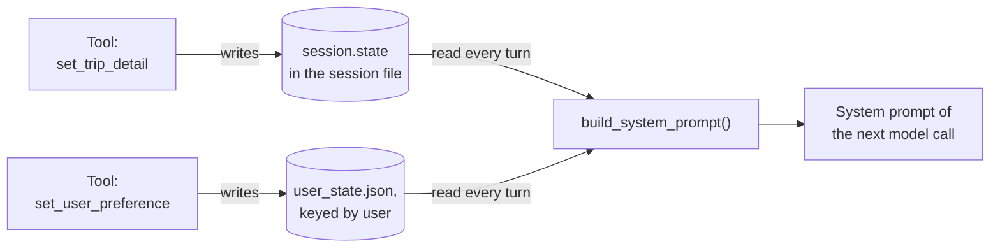

*Figure 14. The write path and the read path of Lab 7. The model writes state through tools; the program reads state into the system prompt.*

**Environment:** core. **Run:** `python lab07_state.py`

The lab reuses code from two earlier labs. From Lab 5, it imports `run_agent_loop(messages, tool_schemas, tool_functions)`, which runs the agent loop and returns the final answer and a trace. From Lab 6, it imports the `Session` class and `history_as_messages(session)`, which returns the most recent events as messages. The program adds three elements. These are functions that store user state, two tools that write state and a function that writes the state into the system prompt.

```python
"""Lab 7: state, the agent's structured notepad, in two scopes.

Session state holds facts about one conversation (the trip being planned).
User state holds facts about the person that apply to every conversation
(diet, seat preference, home city). The agent writes state through tools;
the program reads the state and places it in the system prompt on every turn.
"""

import json
from functools import partial
from pathlib import Path

from lab05_agent_loop import run_agent_loop
from lab06_session import Session, history_as_messages

USER_STATE_FILE = Path("user_state.json")  # one small record per user, shared by all sessions


def load_user_state(user_id: str) -> dict:
    """Return the stored preferences of one user, or an empty dictionary if none exist."""
    everyone = json.loads(USER_STATE_FILE.read_text()) if USER_STATE_FILE.exists() else {}
    return everyone.get(user_id, {})


def save_user_state(user_id: str, state: dict) -> None:
    """Replace the stored preferences of one user and keep the records of all other users."""
    everyone = json.loads(USER_STATE_FILE.read_text()) if USER_STATE_FILE.exists() else {}
    everyone[user_id] = state
    USER_STATE_FILE.write_text(json.dumps(everyone, indent=2))


# Two tools that write state. The model decides when to call them.
def set_trip_detail(session: Session, key: str, value: str) -> dict:
    """Tool: save one detail of the trip planned in this session (session scope).

    The model supplies key and value. The session argument is fixed in advance
    with functools.partial, so the model never sees it.
    """
    session.state[key] = value  # saved with the session file at the end of the turn
    return {"saved": f"trip {key} = {value}"}


def set_user_preference(session: Session, key: str, value: str) -> dict:
    """Tool: save a lasting preference of the session's user (user scope)."""
    preferences = load_user_state(session.user_id)
    preferences[key] = value
    save_user_state(session.user_id, preferences)  # written to user_state.json immediately
    return {"saved": f"user {key} = {value}"}


# The descriptions of the two tools. They tell the model which tool receives which kind of fact.
STATE_TOOL_SCHEMAS = [
    {"type": "function", "function": {
        "name": "set_trip_detail",
        "description": "Save a detail of the trip planned in THIS conversation, "
                       "for example destination, nights or dates.",
        "parameters": {"type": "object",
                       "properties": {"key": {"type": "string"}, "value": {"type": "string"}},
                       "required": ["key", "value"]}}},
    {"type": "function", "function": {
        "name": "set_user_preference",
        "description": "Save a lasting preference of the user that applies to ALL future trips, "
                       "for example diet, seat or home city.",
        "parameters": {"type": "object",
                       "properties": {"key": {"type": "string"}, "value": {"type": "string"}},
                       "required": ["key", "value"]}}},
]


def build_system_prompt(session: Session) -> str:
    """Read both scopes of state and write them into the system prompt of the next call."""
    return (
        "You are a travel assistant. Save trip details and lasting user preferences "
        "with your tools as soon as you learn them.\n"
        f"Trip details (this conversation): {json.dumps(session.state)}\n"
        f"User preferences (all conversations): {json.dumps(load_user_state(session.user_id))}"
    )


def chat(session: Session, text: str) -> str:
    """Perform one turn with the state tools available, then save the session.

    Args:
        session: The conversation to continue.
        text: The new message of the user.

    Returns:
        The final answer of the agent for this turn.
    """
    session.add_event("user", text)
    # The system prompt is built once per turn, before the loop starts, from the current state.
    messages = [{"role": "system", "content": build_system_prompt(session)}]
    messages += history_as_messages(session)  # the sliding window of Lab 6
    # Bind both tools to this session, so that the model supplies only key and value.
    tools = {"set_trip_detail": partial(set_trip_detail, session),
             "set_user_preference": partial(set_user_preference, session)}
    answer, _ = run_agent_loop(messages, STATE_TOOL_SCHEMAS, tools)  # the loop of Lab 5
    session.add_event("assistant", answer)  # only the final answer is stored as an event
    session.save()
    return answer


if __name__ == "__main__":
    first = Session(user_id="asha")
    print("assistant:", chat(first, "I want 3 nights in Goa next month. By the way, I'm vegetarian."))
    print("session state:", first.state)
    print("user state:   ", load_user_state("asha"))

    second = Session(user_id="asha")  # a new conversation: empty history, empty session state
    print("\nassistant:", chat(second, "Let's plan a weekend in Jaipur. Any food suggestions?"))
    print("session state:", second.state)  # the Goa details are not here
    print("user state:   ", load_user_state("asha"))  # but the diet preference is
```

**Example output:**

```text
  step 1: set_trip_detail({"key": "destination", "value": "Goa"}) -> {'saved': 'trip destination = Goa'}
  step 1: set_trip_detail({"key": "nights", "value": "3"}) -> {'saved': 'trip nights = 3'}
  step 1: set_user_preference({"key": "diet", "value": "vegetarian"}) -> {'saved': 'user diet = vegetarian'}
assistant: Noted: three nights in Goa next month, and I'll remember that you're vegetarian. Shall I look at flights next?
session state: {'destination': 'Goa', 'nights': '3'}
user state:    {'diet': 'vegetarian'}
  step 1: set_trip_detail({"key": "destination", "value": "Jaipur"}) -> {'saved': 'trip destination = Jaipur'}
  step 1: set_trip_detail({"key": "duration", "value": "weekend"}) -> {'saved': 'trip duration = weekend'}

assistant: A weekend in Jaipur it is. Since you're vegetarian, try a Rajasthani thali with dal baati churma and gatte ki sabzi, and pyaaz kachori for breakfast in the old city.
session state: {'destination': 'Jaipur', 'duration': 'weekend'}
user state:    {'diet': 'vegetarian'}
```

In the first session, the model made three tool calls in one step. It saved two trip details in session state and the diet in user state. In the second session, the session state contains only the Jaipur trip, while the user state still contains the diet. The food suggestion is vegetarian, although the user did not repeat the preference.

The tool-call lines appear before the line that begins with `assistant:`. Python evaluates the arguments of `print` before it prints anything. The call to `chat`, including all its tool calls, therefore finishes before `assistant:` appears.

**How it works.** The explanation follows the write path, the binding of the tools, the read path and the timing of a turn.

**The write path.** `set_trip_detail` writes into `session.state`. The value reaches the session file when `chat` calls `session.save()` at the end of the turn. `set_user_preference` loads the record of the user, updates it and writes `user_state.json` at once. The model decides when to call these tools. Their descriptions in `STATE_TOOL_SCHEMAS` guide the model in choosing which tool receives which fact.

**Binding the tools to a session with `functools.partial`.** The tool functions need three arguments: the session, a key and a value. The model, however, supplies only `key` and `value`, because only these two parameters appear in the tool schema. The model cannot supply a `Session` object, because it does not know that such an object exists. `functools.partial` solves this problem. It takes a function and some of its arguments and returns a new function with those arguments already filled in. The small example below, outside the lab, shows the mechanism.

```python
from functools import partial


def power(base, exponent):
    """Return base raised to the given exponent."""
    return base ** exponent


square = partial(power, exponent=2)  # a new function with exponent fixed to 2
square(5)                            # the same as power(5, exponent=2), which returns 25
```

In Lab 7, `partial(set_trip_detail, session)` creates a function that behaves like `set_trip_detail(session, key, value)` with `session` fixed. The agent loop receives a tool call such as `{"key": "destination", "value": "Goa"}` and calls the bound function with these two arguments only. `chat` creates fresh bound tools on every turn for the session that it receives. For this reason, the Goa details enter the state of the first session and never the state of the second. This pattern is the standard way to give a tool access to context that the model must not control. A `lambda` or a small inner function achieves the same effect; `partial` is the concise form from the standard library.

The remaining points concern the read path and the timing of a turn.

- **The read path.** `build_system_prompt` reads the current session state and the user state. It writes both into the system prompt as JSON text before every turn.
- **The timing of a turn.** `chat` builds the system prompt once, before the agent loop starts. A value that a tool writes during a turn therefore appears in the system prompt only from the next turn onward. Within the same turn, the model learns of the saved value from the tool result, such as `{"saved": "trip destination = Goa"}`.
- **What the session stores.** `chat` stores only the user message and the final answer as events. The tool calls and tool results of the loop exist only in the local `messages` list and disappear after the turn. The state that the tools wrote persists. Frameworks also store tool calls and state changes as events, which makes the session a complete audit log. Labs 14 and 15 show this behavior.
- **Reuse.** The lab calls `run_agent_loop` from Lab 5 unchanged. State management depends only on which tools the loop receives and what the system prompt contains. The lab also reuses `history_as_messages` from Lab 6, so the history is still limited by the sliding window. The state is not limited by it, because the state travels in the system prompt.

The diagram below shows the effect of the two scopes across the two sessions of the run. User state reaches the system prompt of both sessions, while each session state reaches only its own session.

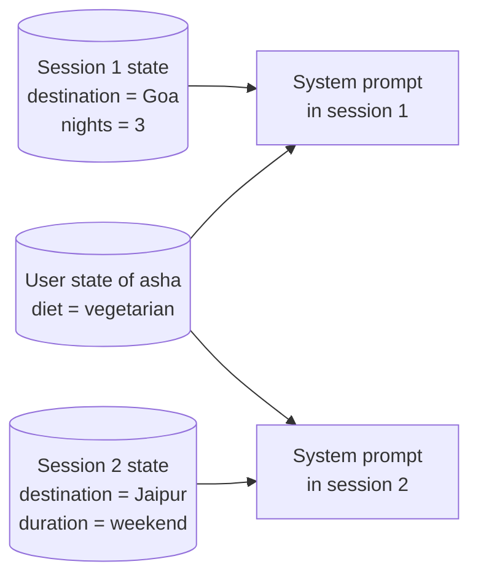

*Figure 15. Scopes of state. Session state belongs to one conversation; user state is shared by every conversation of the same user.*

The mechanism has three limitations that you should observe.

1. The mechanism works only if the model calls the tools. If the model fails to save a fact, the fact is not in state, and it can still leave the sliding window. Run the lab several times and compare the printed state to see how reliably a given model saves facts.
2. The model chooses the key names, so one session may store `nights` and another session `duration`. A production system constrains the keys with an enumeration or a typed schema, so that application code can rely on them.
3. `user_state.json` persists between runs. On a second run of the lab, the diet is present in the system prompt from the first turn.

**Try this.**

- Open `user_state.json` after the run.
- Restrict `key` in `STATE_TOOL_SCHEMAS` to `{"type": "string", "enum": ["destination", "nights", "dates"]}`. Observe how the model adapts its tool calls.
- Add a third scope, application state, that all users share. Use it for a value such as a current promotion code.

Lab 7 gave the agent a reliable memory for facts that can be named in advance. The model writes state through tools, the program reads state into the system prompt on every turn, and the sliding window does not affect it. The scope decides whether a fact belongs to one conversation or to the person. State, however, requires keys that the developer anticipates. Lab 8 handles the facts that nobody can anticipate.

### 7.6 Lab 8: Long-Term Memory with Extraction and Retrieval

**Goal.** Lab 8 answers the third design question of Section 7.1: how knowledge is carried from one conversation to the next. State requires the developer to anticipate the keys, yet many useful facts cannot be anticipated. A user may mention an allergy, a fear of flying or a favorite airline. Long-term memory stores such facts as short natural-language statements and retrieves them by meaning rather than by key.

Retrieval by meaning relies on three definitions.

- A **vector** is an ordered list of numbers.
- An **embedding** is a vector that an **embedding model** produces for a piece of text. Texts with similar meanings receive vectors that point in similar directions.
- **Cosine similarity** measures how closely two vectors point in the same direction. Values near 1 indicate similar meaning, and values near 0 indicate unrelated texts.

Long-term memory has a write path and a read path, as Section 7.3 described. The write path runs after a session ends and turns the finished conversation into stored facts. The diagram below shows its steps.

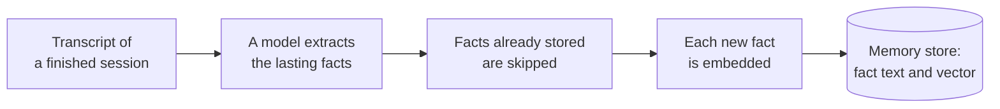

*Figure 16. The write path of long-term memory. It runs after a session ends, so it adds no delay to the conversation.*

The read path runs before every turn. It finds the stored facts closest in meaning to the new message and gives them to the model. The diagram below shows its steps.

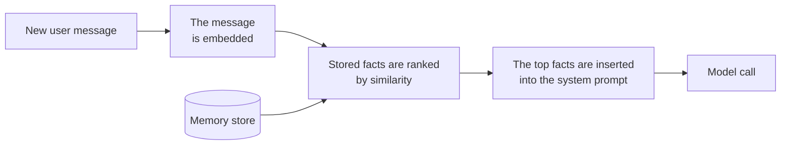

*Figure 17. The read path of long-term memory. Retrieval by meaning finds facts that share no keyword with the message.*

**Environment:** core. **Run:** `python lab08_memory.py`

The program has four stages, which numbered comments mark in the code: extract, store, retrieve and use. It reuses the `Session` class and `history_as_messages` from Lab 6. It stores the memories in `memories.json`, separately from any session.

```python
"""Lab 8: long-term memory that outlives sessions.

When a conversation ends, the model extracts lasting facts about the user.
Each fact is stored together with an embedding, a list of numbers that
captures its meaning. In a later conversation, the facts closest in meaning
to the new message are retrieved and placed in the system prompt.
"""

import json
import math
import os
from pathlib import Path

from pydantic import BaseModel

from lab06_session import Session, history_as_messages
from llm import MODEL, client

MEMORY_FILE = Path("memories.json")  # all memories of all users, keyed by user identifier
EMBED_MODEL = os.getenv("EMBED_MODEL", "text-embedding-3-small")  # Ollama: nomic-embed-text


class Facts(BaseModel):
    """Lasting facts about the user, one short statement per fact."""

    facts: list[str]


def embed(text: str) -> list[float]:
    """Turn a text into a vector. Texts with similar meanings receive similar vectors."""
    return client.embeddings.create(model=EMBED_MODEL, input=text).data[0].embedding


def similarity(a: list[float], b: list[float]) -> float:
    """Cosine similarity: about 1.0 for the same meaning, lower for unrelated texts."""
    dot = sum(x * y for x, y in zip(a, b))  # the dot product of the two vectors
    # Divide by the product of the two vector lengths, so that only the direction counts.
    return dot / (math.sqrt(sum(x * x for x in a)) * math.sqrt(sum(y * y for y in b)))


def load_store() -> dict:
    """Return the whole memory store, or an empty dictionary if no memories exist yet."""
    return json.loads(MEMORY_FILE.read_text()) if MEMORY_FILE.exists() else {}


# 1. Extract: turn a finished conversation into short, lasting facts.
def extract_memories(session: Session) -> list[str]:
    """Ask the model to list the lasting facts about the user in a finished session.

    Args:
        session: The finished conversation.

    Returns:
        The extracted facts, one short statement each.
    """
    transcript = "\n".join(f"{e['role']}: {e['content']}" for e in session.events)
    completion = client.chat.completions.parse(
        model=MODEL,
        messages=[{"role": "system", "content":
                   "List short, lasting facts about the user from this conversation that would help "
                   "plan future trips: preferences, constraints, home city. Skip one-off details."},
                  {"role": "user", "content": transcript}],
        response_format=Facts,  # a structured output (Lab 3): a clean list of strings
    )
    return completion.choices[0].message.parsed.facts


# 2. Store: save each new fact with its embedding, skipping exact duplicates.
def save_memories(user_id: str, facts: list[str]) -> None:
    """Add new facts and their embeddings to the memories of one user.

    Args:
        user_id: The user to whom the facts belong.
        facts: The facts to store.
    """
    store = load_store()
    memories = store.setdefault(user_id, [])  # the list of this user, created if absent
    known = {m["text"] for m in memories}     # the texts that are already stored
    memories += [{"text": fact, "embedding": embed(fact)} for fact in facts if fact not in known]
    MEMORY_FILE.write_text(json.dumps(store))


# 3. Retrieve: find the stored facts closest in meaning to the new message.
def recall(user_id: str, query: str, k: int = 2) -> list[tuple[float, str]]:
    """Return the k stored facts of a user that are most similar to the query.

    Args:
        user_id: The user whose memories are searched.
        query: The text to compare with the stored facts, usually the new message.
        k: The number of facts to return.

    Returns:
        Pairs of similarity score and fact text, best match first.
    """
    memories = load_store().get(user_id, [])
    if not memories:
        return []
    query_vector = embed(query)
    scored = [(similarity(query_vector, m["embedding"]), m["text"]) for m in memories]
    return sorted(scored, reverse=True)[:k]  # highest score first, then keep the top k


# 4. Use: place the recalled facts in the system prompt for this turn.
def chat(session: Session, text: str) -> str:
    """Perform one turn with the recalled facts in the system prompt, then save the session.

    Args:
        session: The conversation to continue.
        text: The new message of the user.

    Returns:
        The reply of the model.
    """
    recalled = recall(session.user_id, text)
    for score, fact in recalled:
        print(f"  recalled ({score:.2f}): {fact}")
    system = ("You are a friendly travel assistant.\n"
              "Facts you remember about this user from earlier conversations:\n"
              + "\n".join(f"- {fact}" for _, fact in recalled))
    session.add_event("user", text)
    messages = [{"role": "system", "content": system}] + history_as_messages(session)
    reply = client.chat.completions.create(model=MODEL, messages=messages).choices[0].message.content
    session.add_event("assistant", reply)
    session.save()
    return reply


if __name__ == "__main__":
    # Conversation 1: the user mentions lasting facts in passing.
    first = Session(user_id="asha")
    print("assistant:", chat(first, "Hi! I'm Asha from Pune. I'm vegetarian and I always "
                                    "prefer a window seat. Thinking about Goa next month."))
    facts = extract_memories(first)  # runs after the conversation, not during it
    save_memories("asha", facts)
    print("extracted memories:", facts)

    # Conversation 2: a new session with an empty history, days later.
    second = Session(user_id="asha")
    print("\nassistant:", chat(second, "Can you suggest a good place for dinner in Jaipur?"))
```

**Example output:**

```text
assistant: Nice to meet you, Asha! Goa next month sounds lovely. I'll keep your vegetarian diet and window-seat preference in mind. Would you like help with flights first?
extracted memories: ['Asha lives in Pune.', 'Asha is vegetarian.', 'Asha prefers a window seat on flights.']
  recalled (0.41): Asha is vegetarian.
  recalled (0.24): Asha lives in Pune.

assistant: Since you're vegetarian, Jaipur is an excellent place for dinner: try a Rajasthani thali with dal baati churma at a pure-vegetarian restaurant in the old city.
```

In the first conversation, no memories exist yet, so no `recalled` lines appear. In the second conversation, the two `recalled` lines show the facts that retrieval selected, with their similarity scores. The dietary fact ranks first, although the question mentions only dinner in Jaipur. Similarity scores depend on the embedding model; their ranking matters more than their absolute values.

**How it works.** The four stages run in the order of their numbers.

1. **Extract.** `extract_memories` sends the finished transcript to the model, with instructions to list lasting facts. It uses a structured output (`Facts`), so the result is a clean list of strings. Extraction runs after the conversation rather than during it, so it adds no delay to the replies of the user. Production systems run it in a background job.
2. **Store.** `save_memories` embeds each new fact once. It stores the text and the vector under the identifier of the user. Skipping exact duplicates is the simplest form of **consolidation**, the step that keeps the store accurate as facts accumulate.
3. **Retrieve.** `recall` embeds the new message and ranks the stored facts by cosine similarity. "Dinner in Jaipur" shares no keyword with "Asha is vegetarian", yet the two texts are close in meaning. The dietary fact is therefore retrieved first. This ability is the advantage of embeddings over keyword search.
4. **Use.** `chat` places the recalled facts in the system prompt for the current turn. The second session starts with an empty history. The memory store is therefore the only route by which the model can know about the diet of the user.

**Design choices and risks.** Lab 8 retrieves memories *proactively*, before every turn. The alternative is *reactive* retrieval, in which memory search is a tool that the model calls when it judges earlier conversations relevant. Lab 15 uses this reactive form.

A linear scan over a JSON file is adequate for a few hundred memories. A large store needs a **vector database**, a database that indexes vectors for fast similarity search. Examples are pgvector, Qdrant and Chroma.

Production consolidation uses a model to decide whether each new fact should be added, should update an existing fact or should delete one. The Mem0 library works in this way. With model-based consolidation, "now prefers an aisle seat" replaces "prefers a window seat" instead of contradicting it.

Memories also introduce risks. Extracted facts can be wrong, and they can become stale. An attacker can plant instructions that persist across sessions, an attack called *memory poisoning*. Users also have a legitimate expectation to see and delete what a system remembers about them.

**Try this.**

- Run a third conversation in which Asha says that she now prefers aisle seats. Extract and save its memories, and inspect `memories.json`. The store now contains a contradiction, which motivates model-based consolidation.
- Change `k` in `recall` to 3 and print all scores to see how the ranking behaves.

Lab 8 completed the three mechanisms of the chapter. Sessions record conversations, state holds named facts, and long-term memory holds open-ended facts that are retrieved by meaning. Section 7.7 compares state and long-term memory, so that you can choose between them for a given piece of information.

### 7.7 State or Memory? Choosing the Mechanism

This section helps you decide where a given piece of information belongs. Labs 7 and 8 offer two ways to keep information beyond the current turn, and some facts could be stored with either mechanism.

The choice depends on four properties of the information:

- whether code must read the information exactly;
- whether the information can be anticipated;
- how long the information should live;
- how many items will accumulate.

For example, a booking needs the destination as state, because the booking code reads it by key. A remark that the user dislikes early flights suits long-term memory, because no key for it exists in advance.

The table below applies these properties to session state, user state and long-term memory. Read each row as a question about one piece of information. The mechanism with "Yes" in that row is the natural home for the information.

| Question about the information | Session state | User state | Long-term memory |
|---|---|---|---|
| Is it a field that code must read exactly, such as a budget or a booking reference? | Yes | Yes | No |
| Is it open-ended or impossible to anticipate? | No | No | Yes |
| Should it disappear when the conversation ends? | Yes | No | No |
| Should it apply to every future conversation of the user? | No | Yes | Yes |
| Are there so many items that only the relevant ones should be shown? | No | Rarely | Yes |
| How is it addressed? | By key | By key | By meaning |

A compact rule summarizes the table: **state is addressed by key, memory by meaning.** Most applications use both mechanisms. State holds the facts on which the workflow depends, and long-term memory holds everything else that the user reveals.

With this rule, each fact that an agent learns has a natural home. Section 7.8 shows that the major frameworks implement the same mechanisms under different names.

### 7.8 Sessions, State and Memory in the Frameworks

This section maps the from-scratch mechanisms of Labs 6 to 8 onto three frameworks. Every major framework implements sessions, state and long-term memory, but the names differ. The mapping lets you recognize the mechanisms in framework documentation.

The table below maps each concept of this chapter to the OpenAI Agents SDK, Google ADK and LangGraph. The last row names the labs that show each column in running code.

| Concept | From scratch (Labs 6 to 8) | OpenAI Agents SDK | Google ADK | LangGraph |
|---|---|---|---|---|
| Session store | `Session` class with JSON files | `Session` implementations: `SQLiteSession`, `RedisSession`, `SQLAlchemySession`, `OpenAIConversationsSession` and others | `SessionService`: `InMemorySessionService`, `DatabaseSessionService`, `VertexAiSessionService` | A *checkpointer* keyed by a thread identifier |
| Events | `session.events` | Items: messages, tool calls and tool outputs | `Event` objects with author, content and actions | Messages held in the graph state |
| Session state | `session.state` | A local context object passed to the run (not persisted automatically) | Keys without a prefix | The typed graph state |
| User state | `user_state.json` | Implemented by the developer | Keys with the `user:` prefix | The long-term *store*, namespaced by user |
| Application state | Not implemented | Implemented by the developer | Keys with the `app:` prefix | The long-term store |
| Invocation-only state | Local variables | The local context object | Keys with the `temp:` prefix | Node-local variables |
| Long-term memory | `memories.json` with embeddings | Implemented by the developer or a library such as Mem0 | `MemoryService`: `InMemoryMemoryService`, `VertexAiMemoryBankService`, `VertexAiRagMemoryService`; tools `load_memory` and `preload_memory` | The store with semantic search; the LangMem library |
| Lab in this guide | 6, 7, 8 | 14 | 15 | Not covered |

Labs 14 and 15 in Part V use the columns of the Agents SDK and of ADK in running code. No lab in this guide covers LangGraph; [Section 16.2](#162-advanced-topics-and-where-they-are-taught) names where to study it. Section 7.9 closes the chapter with the discipline that unifies all read paths and write paths: context engineering.

### 7.9 Context Engineering in Brief

This section generalizes the read paths and write paths of the chapter. Sessions, state and long-term memory are three sources of context among several. Context engineering treats all sources together.

**Context engineering** is the design of the processes that determine what information enters the context window of a model. The same processes determine the form and order of that information and the step at which it enters. It covers every source of context: instructions, tool definitions, history, state, memories, retrieved documents and tool results.

Two empirical observations make context engineering necessary. First, models attend less reliably to information as the context grows. This degradation is often called **context rot**, and it makes the *effective* context window smaller than the advertised one. Second, every token in the context is paid for on every call.

Practitioners organize the available techniques into four strategies, and each strategy already appears in this guide. The table below defines the four strategies and shows where each one appears.

| Strategy | Meaning | Where it appears |
|---|---|---|
| Write | Save information outside the context window for later use | State tools (Lab 7), memory extraction (Lab 8) |
| Select | Bring only the relevant information into the window | Memory retrieval (Lab 8), agentic retrieval (Lab 19) |
| Compress | Shorten what must remain, by trimming or summarizing | The sliding window (Lab 6); compaction, described below |
| Isolate | Split the work across separate contexts | Workers (Lab 12), sub-agents and handoffs (Labs 16 and 17) |

**Compaction** replaces the older part of a long history with a summary and keeps the most recent events verbatim. The summary preserves decisions, constraints, open questions and user preferences. The harness triggers compaction when the history exceeds a threshold of tokens. Compaction allows coding agents to work for hours within a fixed context window.

This guide treats context engineering only in brief. The companion Codeverra reference *Context Engineering: A Foundational Reference* treats these strategies, caching and compaction in depth.

Chapter 7 gave the travel assistant durable conversations, exact facts and open-ended memories, and it introduced context engineering as the discipline behind them. The assistant is now a capable single agent. Many tasks, however, do not need full autonomy. Chapter 8 shows how to structure work with fixed patterns in which code controls part of the flow.

<!-- part: Part IV. Agentic Design Patterns -->

---

> **Part IV. Agentic Design Patterns.** Most production systems are not free-running agents. They are compositions of a few recurring patterns in which code fixes part of the control flow and the model decides the rest. This part implements the five patterns catalogued by Anthropic in Labs 9 to 13. These patterns overlap with the four agentic design patterns taught by Andrew Ng.

## 8. Agentic Design Patterns

Section 3.8 recommended the least autonomous design that solves a problem. This chapter supplies the intermediate designs between a single call and a free-running agent. It first catalogs the patterns and then implements five of them, one lab each. It closes with guidance on choosing and combining the patterns.

### 8.1 A Catalog of Patterns

This section lists the patterns that the chapter covers and names their sources. A **design pattern** is a reusable solution to a recurring design problem.

The table below lists seven patterns. For each one, it states the origin of the name, who controls the flow, when the pattern is appropriate and which lab implements it.

| Pattern | Origin of the name | Who controls the flow | Appropriate when | Lab |
|---|---|---|---|---|
| Prompt chaining | Anthropic | Code | The task divides into a fixed sequence of simpler steps | 9 |
| Routing | Anthropic | Code, after a model classifies the input | Distinct kinds of input need different handling | 10 |
| Parallelization (sectioning and voting) | Anthropic | Code | Subtasks are independent, or several attempts should be compared | 11 |
| Orchestrator-workers, or planning | Anthropic; Ng | The model plans, workers execute | The subtasks cannot be known in advance | 12 |
| Evaluator-optimizer, or reflection | Anthropic; Ng | A loop in code; a model critiques | Quality criteria are clear and iteration improves the result | 13 |
| Tool use | Ng | The model | Live data or actions are required | 4, 5 |
| Multi-agent collaboration | Ng | Several models | Specialization or isolation of context pays for its cost | 16, 17 |

The first five rows are workflows in the sense of [Section 3.6](#36-model-workflow-and-agent-precise-definitions). The workers of the orchestrator pattern may themselves be agents, however. Labs 4 and 5 already implemented tool use, and Part VI covers multi-agent collaboration. Labs 9 to 13 apply the first five patterns to the travel scenario.

The catalog gives the chapter its order. Lab 9 begins with the simplest pattern, prompt chaining.

### 8.2 Lab 9: Prompt Chaining

**Goal.** Lab 9 implements prompt chaining, the simplest workflow. **Prompt chaining** decomposes a task into a fixed sequence of model calls, in which each call processes the output of the previous call. Programmatic checks between the steps, called **gates**, stop the chain early when an intermediate result is unusable. Each call has a simpler job than a single all-in-one prompt would have. This improves accuracy at the cost of latency.

The diagram below shows the chain of Lab 9. A gate in code sits between the first call and the second call.

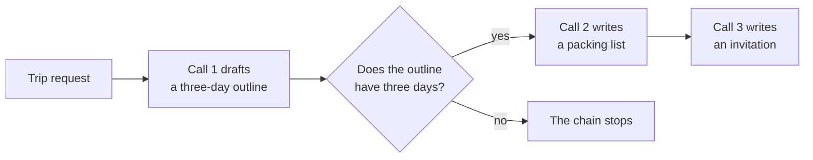

*Figure 18. Prompt chaining with a gate.*

**Environment:** core. **Run:** `python lab09_chaining.py`

The program defines a small helper, `llm`, that sends a single user message and returns the reply. It then performs three chained calls with one gate.

```python
"""Lab 9: prompt chaining, a fixed sequence of model calls with a check in between."""

from llm import MODEL, client


def llm(prompt: str) -> str:
    """Send one prompt as a user message and return the reply of the model."""
    response = client.chat.completions.create(model=MODEL, messages=[{"role": "user", "content": prompt}])
    return response.choices[0].message.content


# Step 1: draft a plan in a format that code can check.
outline = llm("Write a 3-day plan for a relaxed trip to Goa in December. Use exactly three "
              "lines that start with 'Day 1:', 'Day 2:' and 'Day 3:'.")
print("STEP 1, outline:\n" + outline)

# Gate: ordinary code checks the intermediate result before more calls are spent on it.
if not all(f"Day {n}:" in outline for n in (1, 2, 3)):
    raise SystemExit("Gate failed: the outline does not have three days, so the chain stops here.")

# Step 2: the output of step 1 becomes the input of step 2.
packing = llm(f"Trip plan:\n{outline}\n\nWrite a packing list of at most 6 items for this trip.")
print("\nSTEP 2, packing list:\n" + packing)

# Step 3: the outputs of both earlier steps become the input of step 3.
invite = llm(f"Trip plan:\n{outline}\n\nPacking list:\n{packing}\n\n"
             "Write a two-sentence message inviting a friend to join this trip.")
print("\nSTEP 3, invitation:\n" + invite)
```

**Example output:**

```text
STEP 1, outline:
Day 1: Arrive, check in near Candolim and watch the sunset on the beach.
Day 2: Explore the churches of Old Goa in the morning and Fontainhas in the afternoon.
Day 3: Slow breakfast, a final swim, then head to the airport.

STEP 2, packing list:
1. Sunscreen
2. Sunglasses
3. Light cotton clothes
4. Swimwear
5. Sandals
6. A light jacket for the evenings

STEP 3, invitation:
I'm planning three relaxed days in Goa this December, with beaches, old churches and long lunches. Would you like to join me?
```

The outline passed the gate because it contains the three required prefixes. The packing list and the invitation refer to the beaches and churches of the outline, which shows that information flowed forward through the chain.

**How it works.** The first prompt requests a format that code can verify: three lines that begin with "Day 1:", "Day 2:" and "Day 3:". The gate checks this format with ordinary Python before any further tokens are spent. `raise SystemExit(...)` ends the program with a message if the check fails. Each later prompt embeds the outputs of the earlier steps, so information flows forward through the chain. The pattern suits tasks whose steps are known in advance, such as drafting a document, then translating it, then formatting it.

**Try this.**

- Change the gate so that it also rejects outlines longer than 600 characters.
- Add a fourth step that translates the invitation into Marathi.

Lab 9 showed how a fixed sequence of simple calls, protected by a gate, replaces one complex prompt. The sequence is the same for every input, however. Lab 10 introduces a pattern in which the input decides which path the program takes.

### 8.3 Lab 10: Routing

**Goal.** Lab 10 implements routing. **Routing** classifies an input and directs it to a specialized follow-up, such as a different prompt, tool set or model. Routing separates concerns, so improving the handling of one category does not degrade another category. It also allows easy requests to go to a smaller, cheaper model.

The diagram below shows the router of Lab 10. Its output is restricted to four labels, and each label leads to one handler.

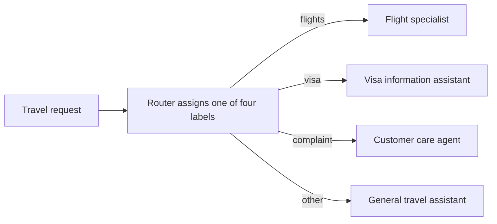

*Figure 19. Routing with a classifier whose output is restricted to four labels.*

**Environment:** core. **Run:** `python lab10_routing.py`

The program uses a structured output (Lab 3) for the classification. `classify` returns one of four labels, and `handle` answers the request with the system prompt that belongs to that label.

```python
"""Lab 10: routing, classify the request first, then send it to a specialized handler."""

from typing import Literal

from pydantic import BaseModel

from llm import MODEL, client


class Route(BaseModel):
    """The single route that best fits a travel request."""

    route: Literal["flights", "visa", "complaint", "other"]  # becomes an enumeration in the schema


HANDLERS = {  # one specialized system prompt per category
    "flights": "You are a flight booking specialist. Ask for the travel date if it is missing.",
    "visa": "You are a visa information assistant. Always tell the user to confirm with the embassy.",
    "complaint": "You are a calm customer care agent. Apologize once and offer one concrete next step.",
    "other": "You are a general travel assistant.",
}


def classify(request: str) -> str:
    """Return the route label for a request: flights, visa, complaint or other."""
    completion = client.chat.completions.parse(
        model=MODEL,
        messages=[{"role": "system", "content": "Classify the travel request into exactly one route."},
                  {"role": "user", "content": request}],
        response_format=Route,  # the answer can only be one of the four labels
    )
    return completion.choices[0].message.parsed.route


def handle(request: str) -> str:
    """Classify a request, answer it with the matching specialized prompt and label the answer."""
    route = classify(request)  # first call: the router
    reply = client.chat.completions.create(  # second call: the specialized handler
        model=MODEL,
        messages=[{"role": "system", "content": HANDLERS[route]}, {"role": "user", "content": request}],
    ).choices[0].message.content
    return f"[{route}] {reply}"


for request in ["Find me a flight from Delhi to Jaipur.",
                "Do Indian citizens need a visa for Thailand?",
                "My booking was cancelled and nobody informed me!"]:
    print(handle(request), "\n")
```

**Example output:**

```text
[flights] I can help you find a Delhi to Jaipur flight. Which date would you like to travel?

[visa] Visa rules for Indian citizens visiting Thailand change from time to time, so please confirm the current requirement with the Thai embassy before you book.

[complaint] I'm sorry your booking was cancelled without notice. If you share your booking reference, I will check whether a refund or a free rebooking is the faster option for you.
```

The label in brackets shows the route that the router chose for each request. Each reply follows the rule of its handler. The flight specialist asks for the date, and the visa assistant refers to the embassy. The customer care agent apologizes once.

**How it works.** The `Literal` type in `Route` becomes an enumeration in the JSON Schema. The router can therefore answer only with one of the four labels, and the dictionary lookup `HANDLERS[route]` cannot fail. The router is a single, cheap classification call. The handler is a second call with a specialized system prompt. In the frameworks of Part V, the same pattern appears as an agent that hands a conversation to specialist agents (Labs 16 and 17).

**Try this.**

- Add a `hotels` route with its own handler.
- Send each route to a different model by adding a second dictionary of model names.

Lab 10 showed how one classification call selects among specialized handlers. Labs 9 and 10 still perform their calls one after another, however. Lab 11 runs independent calls at the same time.

### 8.4 Lab 11: Parallelization

**Goal.** Lab 11 implements parallelization. **Parallelization** runs independent model calls at the same time and combines their results in code or in a final aggregating call. It takes two forms. In **sectioning**, a task is split into independent subtasks. In **voting**, the same task runs several times, and the answers are compared to increase confidence. Lab 11 uses sectioning.

Lab 11 is the first lab that uses asynchronous Python. Four constructs appear in it:

- `async def` defines a **coroutine function**. Calling such a function returns a **coroutine**, an object that represents work that has not run yet.
- `await` suspends the current coroutine until another coroutine finishes. While one request waits for the network, other coroutines can run.
- `asyncio.gather(...)` runs several coroutines concurrently and returns their results in the original order.
- `asyncio.run(main())` starts the event loop, runs the coroutine `main` to completion and then stops the loop.

The lab uses `async_client` from `llm.py`, which Lab 1 presented. `async_client` is created with the same settings as `client`, by the line `async_client = AsyncOpenAI(**_settings)`. Its methods are coroutines, so a program can wait for several responses at once.

The diagram below shows the sectioning of Lab 11. Three independent calls run concurrently, and an aggregating call combines their results.

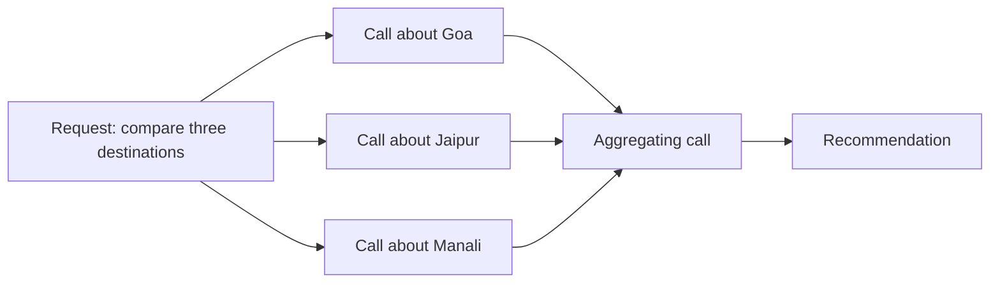

*Figure 20. Sectioning: independent calls followed by aggregation.*

**Environment:** core. **Run:** `python lab11_parallel.py`

```python
"""Lab 11: parallelization, independent calls run at the same time and are then combined."""

import asyncio
import time

from llm import MODEL, async_client


async def allm(prompt: str) -> str:
    """Send one prompt asynchronously and return the reply of the model."""
    response = await async_client.chat.completions.create(
        model=MODEL, messages=[{"role": "user", "content": prompt}])
    return response.choices[0].message.content


async def main() -> None:
    """Describe three destinations concurrently, then combine the notes into one recommendation."""
    destinations = ["Goa", "Jaipur", "Manali"]
    start = time.perf_counter()  # a precise clock for measuring the elapsed time

    # Sectioning: one independent call per destination, all sent at once.
    notes = await asyncio.gather(*[
        allm(f"In two sentences, describe {d} as a December holiday for a family with young children.")
        for d in destinations])
    print(f"3 calls finished together in {time.perf_counter() - start:.1f} s\n")
    for destination, note in zip(destinations, notes):
        print(f"{destination}: {note}\n")

    # Aggregation: a final call combines the independent results.
    summary = await allm("Recommend one destination and give one reason, based on these notes:\n"
                         + "\n".join(f"{d}: {n}" for d, n in zip(destinations, notes)))
    print("RECOMMENDATION:", summary)


asyncio.run(main())  # start the event loop and run main() to completion
```

**Example output:**

```text
3 calls finished together in 2.3 s

Goa: Goa is warm and sunny in December, with calm beaches that suit young children. It is the busiest month, so accommodation should be booked early.

Jaipur: Jaipur has pleasant days and cool nights in December. Forts and palaces keep children interested, although the sightseeing involves a lot of walking.

Manali: Manali is cold in December and may have snow, which children enjoy. Roads can close, so plans must stay flexible.

RECOMMENDATION: Goa, because warm weather and calm beaches make it the easiest choice for a family with young children.
```

The first line shows the elapsed time of the three concurrent calls. Three calls take roughly as long as the slowest one, because each call waits for the network while the others proceed.

**How it works.** `allm` is the asynchronous counterpart of the `llm` helper of Lab 9. The list comprehension inside `asyncio.gather` creates three coroutines, one per destination. `gather` runs them concurrently and returns their results in the original order. The `*` before the list passes each coroutine as a separate argument. The aggregation step is an ordinary call whose prompt contains all three results.

**Try this.**

- Implement voting: run the recommendation prompt five times concurrently and print the destination that is recommended most often.
- Measure the elapsed time when the three calls are awaited one after another, and compare it with the concurrent version.

Lab 11 showed that independent subtasks can run concurrently and be combined afterwards. In Labs 9 to 11, however, the code fixes the subtasks in advance. Lab 12 lets the model decide the subtasks for each input.

### 8.5 Lab 12: Orchestrator-Workers and Planning

**Goal.** Lab 12 implements the orchestrator-workers pattern. In this pattern, a central model called the **orchestrator** decomposes a task into subtasks at run time. It delegates each subtask to a **worker**, and a final call, the **synthesizer**, combines the results. The pattern differs from parallelization because the model, not the code, chooses the subtasks for each input. Andrew Ng's **planning** pattern describes the same idea from the side of the model. The model first writes a plan and then executes it step by step, revising the plan when a step fails.

The diagram below shows the structure of Lab 12. Each worker has its own context and its own tools.

```mermaid
flowchart LR
    R["Request"] --> O["Orchestrator writes a plan of subtasks"]
    O --> W1["Worker 1: agent loop"]
    O --> W2["Worker 2: agent loop"]
    O --> W3["Worker n: agent loop"]
    W1 --> S["Synthesizer combines the findings"]
    W2 --> S
    W3 --> S
    S --> A["Answer"]
```

*Figure 21. Orchestrator-workers. Each worker runs a fresh agent loop with a clean context.*

**Environment:** core. **Run:** `python lab12_orchestrator.py`

Each worker is the agent loop of Lab 5. The lab imports two names from Lab 5: `SYSTEM`, the system prompt of the travel agent, and `run_agent_loop(messages, tool_schemas, tool_functions, verbose=...)`. It also imports `TOOL_SCHEMAS` and `TOOLS` from `travel_tools.py` (Lab 4).

```python
"""Lab 12: planning with an orchestrator and workers.

The orchestrator writes a plan (a list of subtasks) for the request. Each
subtask goes to a worker, here the agent loop from Lab 5 with the travel
tools. A final call (the synthesizer) combines the workers' findings.
"""

from pydantic import BaseModel

from lab05_agent_loop import SYSTEM, run_agent_loop
from llm import MODEL, client
from travel_tools import TOOL_SCHEMAS, TOOLS


class Plan(BaseModel):
    """A plan for a travel request: a list of independent subtasks."""

    steps: list[str]


def make_plan(request: str) -> list[str]:
    """Orchestrator: split a request into two to four independent subtasks."""
    completion = client.chat.completions.parse(
        model=MODEL,
        messages=[{"role": "system", "content":
                   "Split the travel request into 2 to 4 independent subtasks. Each subtask must be "
                   "answerable with these tools: weather lookup, flight search, currency conversion."},
                  {"role": "user", "content": request}],
        response_format=Plan,  # the plan arrives as a list that the program can iterate over
    )
    return completion.choices[0].message.parsed.steps


def run_worker(subtask: str) -> str:
    """Worker: solve one subtask with a fresh agent loop and the travel tools."""
    messages = [{"role": "system", "content": SYSTEM}, {"role": "user", "content": subtask}]
    answer, _ = run_agent_loop(messages, TOOL_SCHEMAS, TOOLS, verbose=False)
    return answer


request = ("I live in Mumbai and can't decide between Goa and Jaipur for this weekend. "
           "Compare the weather and the cheapest flight for both.")

plan = make_plan(request)                                   # 1. orchestrator plans
print("PLAN:\n- " + "\n- ".join(plan))
findings = [run_worker(step) for step in plan]              # 2. workers execute
for step, finding in zip(plan, findings):
    print(f"\nWORKER [{step}]\n{finding}")

# The synthesizer receives only the condensed findings, not the full contexts of the workers.
report = "\n".join(f"- {step}: {finding}" for step, finding in zip(plan, findings))
final = client.chat.completions.create(model=MODEL, messages=[{"role": "user", "content":
        f"Request: {request}\n\nFindings:\n{report}\n\nWrite a short recommendation."}])
print("\nANSWER:\n" + final.choices[0].message.content)    # 3. synthesizer combines
```

**Example output:**

```text
PLAN:
- Check the weather in Goa this weekend
- Check the weather in Jaipur this weekend
- Find the cheapest flight from Mumbai to Goa
- Find the cheapest flight from Mumbai to Jaipur

WORKER [Check the weather in Goa this weekend]
Goa is sunny at 31°C with 70% humidity.

WORKER [Check the weather in Jaipur this weekend]
Jaipur is clear at 27°C with 30% humidity.

WORKER [Find the cheapest flight from Mumbai to Goa]
The cheapest flight from Mumbai to Goa is FL-202 at 13:45 for 3,500 INR.

WORKER [Find the cheapest flight from Mumbai to Jaipur]
The cheapest flight from Mumbai to Jaipur is FL-505 at 11:15 for 5,200 INR.

ANSWER:
Choose Goa this weekend: it is sunny at 31°C and the cheapest flight costs 3,500 INR. Jaipur is pleasant at 27°C, but its cheapest flight from Mumbai costs 5,200 INR.
```

The plan contains four subtasks that the model chose for this request; another request would produce a different plan. Each worker answers only its own subtask, and the final answer combines all four findings.

**How it works.** `make_plan` obtains the plan as a structured output, so the program receives a list that it can iterate over. Each subtask goes to a fresh agent loop from Lab 5, which starts with a clean message list. This arrangement is an instance of **context isolation**: no worker is distracted by the tool results of the other workers. The synthesizer receives only the condensed findings. Anthropic's multi-agent research system uses the same structure at a larger scale, with a lead agent that plans and parallel sub-agents that search independently.

**Try this.**

- Run the workers concurrently by combining this lab with the technique of Lab 11.
- Ask "Find the cheapest flight from Delhi to Goa and tell me its price in euros." Observe whether independent workers can solve a dependent plan. Then add the findings of earlier steps to the prompt of each worker, which makes the plan sequential.

Lab 12 showed how a model can plan the subtasks of a request at run time and delegate them to isolated workers. None of the patterns so far checks the quality of its own output, however. Lab 13 adds a critique and a revision loop.

### 8.6 Lab 13: Reflection (Evaluator-Optimizer)

**Goal.** Lab 13 implements reflection. **Reflection** is the use of a critique to improve an output. A model examines a draft against explicit criteria, and the critique guides a revision. In Anthropic's **evaluator-optimizer** form, one call generates and another call evaluates. The two calls alternate in a loop until the evaluator approves or a limit is reached.

Reflection is most reliable when the evaluator can rely on external evidence, such as test results, a validator or a schema. A model that assesses its own work without new information shares the blind spots that produced the error.

The diagram below shows the loop of Lab 13. Feedback from the evaluator returns to the generator until the draft is approved or the round limit is reached.

```mermaid
flowchart LR
    T["Task and criteria"] --> G["Generator writes<br/>or revises a draft"]
    G --> E{"Is the draft<br/>approved?"}
    E -->|"no, with feedback"| G
    E -->|"yes, or after the last round"| O["Final draft"]
```

*Figure 22. The evaluator-optimizer loop.*

**Environment:** core. **Run:** `python lab13_reflection.py`

The program defines a generator, `write`, and an evaluator, `review`. The evaluator returns a structured verdict, so the loop can test approval without parsing prose.

```python
"""Lab 13: reflection (evaluator-optimizer), a draft is reviewed and revised in a loop."""

from pydantic import BaseModel

from llm import MODEL, client

TASK = ("Write a description of about 60 words of a 2-day Jaipur trip for a student on a tight "
        "budget. It must mention one free attraction and an approximate total cost in INR.")


class Review(BaseModel):
    """An editor's verdict on a draft: approval and specific feedback."""

    approved: bool  # True only if every requirement of the task is met
    feedback: str   # what to change, if the draft is not approved


def write(task: str, draft: str | None = None, feedback: str | None = None) -> str:
    """Generator: write a first draft, or revise a previous draft using the feedback.

    Args:
        task: The writing task with its requirements.
        draft: The previous draft, or None for the first draft.
        feedback: The feedback of the reviewer on the previous draft.

    Returns:
        The new draft.
    """
    prompt = task if draft is None else (
        f"{task}\n\nYour previous draft:\n{draft}\n\nReviewer feedback:\n{feedback}\n\n"
        "Write an improved draft.")
    response = client.chat.completions.create(model=MODEL, messages=[{"role": "user", "content": prompt}])
    return response.choices[0].message.content


def review(task: str, draft: str) -> Review:
    """Evaluator: check a draft against every requirement of the task."""
    completion = client.chat.completions.parse(
        model=MODEL,
        messages=[{"role": "system", "content":
                   "You are a strict editor. Check the draft against every requirement of the task. "
                   "Approve it only if all requirements are met; otherwise give specific feedback."},
                  {"role": "user", "content": f"Task: {task}\n\nDraft:\n{draft}"}],
        response_format=Review,
    )
    return completion.choices[0].message.parsed


draft = write(TASK)                       # the generator produces a first draft
for round_number in range(1, 4):          # at most three review rounds
    verdict = review(TASK, draft)         # the evaluator checks it
    print(f"round {round_number}: approved={verdict.approved}  feedback: {verdict.feedback}")
    if verdict.approved:
        break
    draft = write(TASK, draft, verdict.feedback)  # the generator revises using the feedback

print("\nFINAL DRAFT:\n" + draft)
```

**Example output:**

```text
round 1: approved=False  feedback: The draft names a free attraction (viewing Hawa Mahal from the street) but gives no approximate total cost in INR.
round 2: approved=True  feedback: All requirements are met.

FINAL DRAFT:
Spend two budget days in Jaipur: walk the old city bazaars, see Hawa Mahal from the street for free, and visit Amber Fort early. Stay in a hostel, eat street food and use shared autos. Expect to spend about 4,000 INR in total on food, transport, tickets and a dormitory bed.
```

The first round rejected the draft because one requirement was missing, and the feedback names that requirement. The revised draft contains the total cost and passed the second round.

**How it works.** The reviewer returns a `Review` object, so the loop tests `approved` without parsing prose. The generator receives the previous draft together with the feedback, which focuses the revision on the identified defect. The loop is bounded to three rounds, because an evaluator and a generator can disagree indefinitely.

**Try this.** Add a requirement that code can check, such as "at most 70 words". Verify it in Python before calling the reviewer, so that only the criteria that require judgment remain for the model.

Lab 13 completed the five patterns of the catalog. Each pattern fixes a different part of the control flow in code. Section 8.7 explains how to choose among the patterns and how to combine them.

### 8.7 Choosing and Combining Patterns

This section turns the catalog into a decision aid. The right pattern follows from an observation about the task, not from a preference for a technique.

The table below maps six observations about a task to the pattern that should be considered first.

| Observation about the task | Pattern to consider first |
|---|---|
| One prompt does too much and its quality suffers | Prompt chaining |
| Inputs fall into distinct categories with different needs | Routing |
| Subtasks are independent, or a confident answer is needed | Parallelization by sectioning or voting |
| The subtasks depend on the input and cannot be listed in advance | Orchestrator-workers |
| Quality criteria are explicit and checkable | Evaluator-optimizer |
| The number of steps is unknown and tools are required | The agent loop |

The patterns compose freely. For example, a router can dispatch to a chain, and an orchestrator can run its workers in parallel. An agent can also submit its final answer to an evaluator before returning it. The guiding principle remains the one stated in [Section 3.8](#38-when-not-to-build-an-agent): add a pattern only when measurement shows that it improves the result.

Part IV completed the hand-written toolkit: the agent loop, sessions, state, long-term memory and five design patterns. You have now written every mechanism that a framework provides. Part V shows how two frameworks provide the same mechanisms with much less code.

<!-- part: Part V. Agent Frameworks -->

---

> **Part V. Agent Frameworks.** Having built the loop, the tools, sessions, state and memory by hand, you can now see precisely what a framework automates. This part rebuilds the travel assistant in the OpenAI Agents SDK (Lab 14) and in Google ADK (Lab 15). It then compares the two frameworks.

## 9. Agent Frameworks: The OpenAI Agents SDK and Google ADK

This chapter moves from hand-written code to frameworks. It first states what a framework provides and maps it to the earlier labs. It then introduces each framework and rebuilds the travel assistant in it. The chapter ends by explaining how both frameworks run on open-weight models and by comparing them.

### 9.1 What a Framework Provides

This section defines an agent framework and maps its features onto the code of Parts II and III. The mapping shows that a framework adds no new concepts; it packages the mechanisms that you have already written.

An **agent framework** is a library that supplies ready-made implementations of the harness components of [Chapter 6](#6-the-harness-everything-around-the-model). These components include the loop, tool registration, sessions, state, multi-agent coordination, guardrails and tracing.

The table below maps each component that this guide built by hand onto the two frameworks used in the labs.

| Responsibility | From scratch | OpenAI Agents SDK | Google ADK |
|---|---|---|---|
| Tool schemas | Written by hand in `TOOL_SCHEMAS` | `function_tool` derives them from type hints and docstrings | Plain functions are wrapped automatically |
| The loop | `run_agent_loop` | `Runner.run` and `Runner.run_sync` | `Runner.run_async`, which drives the agent |
| Step limit | `MAX_STEPS` | `max_turns` (default 10) | `RunConfig(max_llm_calls=...)` |
| Sessions | `Session` class (Lab 6) | `Session` implementations such as `SQLiteSession` | `SessionService` implementations |
| State | Dictionaries injected into the prompt (Lab 7) | A developer-defined context object | Scoped state with `{key}` placeholders in instructions |
| Long-term memory | Lab 8 | Left to the developer or a library | `MemoryService` implementations |
| Multi-agent coordination | Manual (Lab 12) | Handoffs; agents as tools | Sub-agents with transfer; workflow agents; `AgentTool` |
| Guardrails and approval | Manual | Input, output and tool guardrails; `needs_approval` | Callbacks, plugins and tool confirmation |
| Observability | `print` and the trace list | Built-in tracing with a dashboard | `adk web` event and trace views; OpenTelemetry |

A framework reduces the amount of code. It also adds capabilities that are laborious to build, such as persistence, streaming and tracing. In exchange, it conceals the mechanism, changes quickly between versions and imposes its own conventions. Having written the mechanism once, you can use a framework without depending on it for understanding. This independence was the purpose of Parts II and III.

The mapping shows what to look for in each framework. Section 9.2 introduces the first framework, the OpenAI Agents SDK.

### 9.2 The OpenAI Agents SDK in Brief

This section introduces the primitives of the OpenAI Agents SDK. Lab 14 uses each of them, so knowing them beforehand makes the lab short to read.

The **OpenAI Agents SDK** is a lightweight Python framework with a TypeScript counterpart. It is built around a small set of primitives:

- An **`Agent`** is a model configured with instructions, tools, optional handoffs to other agents, guardrails and an optional output type for structured results. The instructions of an agent become its system prompt.
- The **`Runner`** executes the agent loop. It calls the model, executes tool calls, performs handoffs and checks guardrails. It stops when the agent produces a final output or when `max_turns` is exceeded.
- **`function_tool`** turns a Python function into a tool. The name of the tool comes from the function name, and its description comes from the docstring. Its parameter schema comes from the type hints and the `Args:` section of the docstring.
- A **`Session`** stores the conversation history between runs. Before a run, the Runner reads the stored items and prepends them to the input. After the run, it appends the new items.
- **Tracing** is enabled by default and records every model call, tool call and handoff of a run. With an OpenAI key, the traces are visible in the OpenAI dashboard.

By default, the SDK calls OpenAI models through the Responses API. Other providers can be used through a Chat Completions model object, as the function `pick_model` in Lab 14 shows.

The sequence diagram below shows one run of the SDK with a session. The Runner performs the loop of Lab 5 and the session handling of Lab 6.

```mermaid
sequenceDiagram
    participant Code as Lab code
    participant R as Runner
    participant S as SQLiteSession
    participant LLM as Model
    participant T as Tools
    Code->>R: run_sync(agent, new question, session)
    R->>S: read stored items
    S-->>R: earlier items of the conversation
    R->>LLM: instructions, history, question, schemas
    LLM-->>R: function call get_weather(city="Goa")
    R->>T: get_weather("Goa")
    T-->>R: result
    R->>LLM: history, call and result
    LLM-->>R: final text
    R->>S: append the new items
    R-->>Code: RunResult(final_output, new_items, ...)
```

*Figure 23. One run of the Agents SDK with a session.*

These five primitives correspond to the hand-written code of Labs 4 to 6. Lab 14 now uses them to rebuild the travel assistant.

### 9.3 Lab 14: The Travel Agent in the OpenAI Agents SDK

**Goal.** Lab 14 rebuilds the agent of Labs 5 and 6 with the OpenAI Agents SDK. The goal is to see which hand-written parts the framework replaces: the loop, the tool schemas and the session. The lab also shows how the framework stores a session in a SQLite database.

**Environment:** core. **Run:** `python lab14_agents_sdk.py`

The lab defines one helper function and one agent. The function `pick_model` selects the model provider from the environment variables of [Section 2.2](#22-choosing-a-model-provider). Later labs import it. The agent receives three tools through `function_tool`, which reads the structured docstrings of `travel_tools.py` (Lab 4). For example, the docstring of `get_weather` consists of the summary line "Get the current weather for a city." and an `Args:` entry for `city`.

```python
"""Lab 14: the travel agent rebuilt with the OpenAI Agents SDK.

The SDK supplies what Labs 4 to 6 built by hand: the loop (Runner), the tool
schemas (function_tool reads type hints and docstrings) and the session
(SQLiteSession). What remains is a few declarations.
"""

import os

from agents import (Agent, OpenAIChatCompletionsModel, Runner, SQLiteSession,
                    function_tool, set_tracing_disabled)
from openai import AsyncOpenAI

import travel_tools as tt


def pick_model():
    """Select the model: OpenAI by default, or the server named by LLM_BASE_URL (for example Ollama).

    Returns:
        A model name (str) for OpenAI, or a Chat Completions model object for another server.
    """
    if os.getenv("LLM_BASE_URL"):
        set_tracing_disabled(True)  # traces are uploaded to OpenAI, which needs an OpenAI key
        return OpenAIChatCompletionsModel(
            model=os.getenv("LLM_MODEL", "qwen3:8b"),
            openai_client=AsyncOpenAI(base_url=os.environ["LLM_BASE_URL"],
                                      api_key=os.getenv("LLM_API_KEY", "ollama")))
    return os.getenv("LLM_MODEL", "gpt-5.4-mini")


# The agent: instructions (its system prompt), three tools and a model.
travel_agent = Agent(
    name="Travel assistant",
    instructions="You help plan trips. Use the tools for weather, flights and currency. Be brief.",
    tools=[function_tool(tt.get_weather), function_tool(tt.search_flights),
           function_tool(tt.convert_currency)],  # schemas derived from signatures and docstrings
    model=pick_model(),
)

if __name__ == "__main__":
    # A session identified by "asha-goa-trip", stored in the file conversations.db.
    session = SQLiteSession("asha-goa-trip", "conversations.db")  # history is stored in SQLite

    result = Runner.run_sync(travel_agent, "What's the cheapest flight from Mumbai to Goa?",
                             session=session)
    print("assistant:", result.final_output)
    for item in result.new_items:  # everything that happened inside this run
        print("   ", item.type)

    result = Runner.run_sync(travel_agent, "And how's the weather there?", session=session)
    print("assistant:", result.final_output)  # "there" is resolved from the stored history
```

**Example output:**

```text
assistant: The cheapest flight from Mumbai to Goa is FL-202, departing at 13:45 for 3,500 INR. FL-101 at 07:10 costs 4,200 INR.
    tool_call_item
    tool_call_output_item
    message_output_item
assistant: Goa is sunny right now, at 31°C with 70% humidity.
```

The three indented lines list the items of the first run: a tool call, the output of the tool and the final message. The second answer resolves the word "there" to Goa, which works only because the session supplied the first exchange.

**How it works.** The explanation follows the order of the program.

- **Provider selection.** When `LLM_BASE_URL` is set, `pick_model` returns a Chat Completions model object bound to that server. It also disables tracing, because the SDK uploads traces to OpenAI, and the upload requires an OpenAI key. Otherwise, the function returns a model name, and the SDK uses OpenAI.
- **Tools.** `function_tool(tt.get_weather)` reads the signature `get_weather(city: str) -> dict` and the docstring. It produces the same kind of schema that Lab 4 wrote by hand in `TOOL_SCHEMAS`.
- **The loop.** `Runner.run_sync` performs the think, act and observe cycle of Lab 5 and returns a `RunResult`. Its list `new_items` is the trajectory of the run: a tool call, the output of the tool and the final message.
- **The session.** `SQLiteSession("asha-goa-trip", "conversations.db")` identifies one conversation by its session identifier and stores it in a SQLite file. The second question contains the word "there". The model can resolve it only because the Runner loaded the first exchange from the session before calling the model.

The session database has the same logical structure as the JSON file of Lab 6, with one row per item. The command below lists the first 80 characters of each stored item.

```bash
sqlite3 conversations.db "SELECT id, substr(message_data, 1, 80) FROM agent_messages;"
```

```text
1|{"content": "What's the cheapest flight from Mumbai to Goa?", "role": "user"}
2|{"arguments": "{\"origin\":\"Mumbai\",\"destination\":\"Goa\"}", "call_id": "call_
3|{"call_id": "call_...", "output": "{'flights': [{'id': 'FL-202', 'origin': 'Mumba
4|{"id": "msg_...", "content": [{"annotations": [], "text": "The cheapest flight fr
5|{"content": "And how's the weather there?", "role": "user"}
...
```

Unlike the session of Lab 6, this session also stores the tool call (row 2) and its output (row 3). Running the lab a second time continues the same conversation, because the session identifier and the database file are unchanged. Deleting `conversations.db` starts a new conversation.

**Try this.**

- Replace the session identifier with `"asha-jaipur-trip"`. Observe that the model can no longer resolve "there".
- Print `result.to_input_list()` to see the complete input that the next run would send.
- With an OpenAI key, open the Traces page of the OpenAI dashboard and inspect the spans of a run.

Lab 14 replaced the hand-written loop, tool schemas and session with a few declarations, and the behavior stayed the same. Section 9.4 introduces the second framework, Google ADK, which has a richer model of state and memory.

### 9.4 Google ADK in Brief

This section introduces the central concepts of Google ADK. Lab 15 uses them to rebuild Labs 6 to 8, so this section maps each concept to its from-scratch counterpart where possible.

Google's **Agent Development Kit (ADK)** is an open-source framework, available in Python, Java and Go. It is optimized for Gemini but supports other models through connectors. Its central concepts are the following.

- An **`Agent`**, also called `LlmAgent`, has a name, a model, an instruction, a description, tools, optional sub-agents and optional callbacks. Other agents read the description when they decide whether to delegate to it. The instruction may contain `{key}` placeholders, which ADK fills from state before every model call. The form `{key?}` inserts an empty string when the key is missing.
- **Workflow agents** run their sub-agents in a fixed order (`SequentialAgent`), concurrently (`ParallelAgent`) or repeatedly (`LoopAgent`). No model decides the flow of a workflow agent.
- **Tools** are usually plain Python functions. A function that declares a parameter named `tool_context` receives a `ToolContext` object. Through it, the tool can read and write state and search memory. ADK hides this parameter from the model.
- The **`Runner`** executes an agent for one user message in one session and yields a stream of **events**. It is configured with a **`SessionService`**, which stores sessions, events and state. It can also receive a **`MemoryService`**, which stores long-term memory.
- **State keys carry their scope in a prefix.** A key without a prefix belongs to the session. The prefix `user:` shares the key among all sessions of a user. The prefix `app:` shares the key among all users of the application. The prefix `temp:` limits the key to the current invocation.
- The command-line tool provides four commands. `adk web` opens a browser interface for chatting with and inspecting agents. `adk run`, `adk eval` and `adk deploy` run, evaluate and deploy agents.

The diagram below shows the structure of an ADK application. The Runner connects the agent to the two storage services. The tools of the agent reach the same services through their ToolContext.

```mermaid
flowchart LR
    U["User message"] --> R["Runner"]
    R --> A["Agent: instruction with<br/>state placeholders"]
    R <--> SS[("SessionService:<br/>sessions, events, state")]
    R <--> MS[("MemoryService:<br/>long-term memory")]
    A <--> LLM["Model: Gemini,<br/>OpenAI or Ollama"]
    A --> T["Tools that receive<br/>a ToolContext"]
    SS <-->|"read and write state"| T
    MS <-->|"search memory"| T
```

*Figure 24. The structure of an ADK application.*

ADK therefore provides the session store of Lab 6, the scoped state of Lab 7 and the memory store of Lab 8 as services. Lab 15 uses all three.

### 9.5 Lab 15: Sessions, State and Memory in ADK

**Goal.** Lab 15 rebuilds the agent of Labs 6 to 8 in Google ADK. The lab stores sessions in a SQLite database, writes session state and user state through tools and searches past conversations through a memory service. The goal is to see that the framework reproduces the behavior of Labs 6 to 8 without any file handling in the lab code.

**Environment:** adk. **Files:** `travel_adk/__init__.py`, `travel_adk/agent.py`, `lab15_adk_run.py`. **Run:** `python lab15_adk_run.py`

Lab 15 is the first lab that needs the adk environment. If you postponed its creation in [Section 2.3](#23-creating-the-python-environments), create it now from the project folder:

```bash
python3 -m venv .venv-adk                       # Windows: py -m venv .venv-adk
source .venv-adk/bin/activate                   # Windows: .venv-adk\Scripts\Activate.ps1
pip install "google-adk[openai,db]==2.11.0"
```

The ADK labs use Gemini by default and need `GOOGLE_API_KEY`. Without a Gemini key, set `ADK_MODEL="gpt-5.4-mini"` to use OpenAI, or set the Ollama variables of [Section 2.4](#24-configuring-credentials).

The agent is defined in a Python package named `travel_adk`, so that `adk web` can load it. A separate script, `lab15_adk_run.py`, runs the agent from code. The file `travel_adk/__init__.py` contains a single line, which lets ADK find the agent module:

```python
from . import agent
```

The file `travel_adk/agent.py` defines three tools and the agent. The docstrings of the tools are written for the model: ADK sends them to the model as tool descriptions. Explanations for the reader therefore appear as comments.

```python
"""Lab 15: the travel agent in Google ADK, with session state, user state and memory.

Chat with it in the browser:  adk web             (run from the folder that contains travel_adk/)
Run it from code:             python lab15_adk_run.py
"""

import os

from google.adk.agents import Agent
from google.adk.tools import ToolContext

import travel_tools as tt


def pick_model():
    """Gemini by default; ADK_MODEL=gpt-5.4-mini selects OpenAI; LLM_BASE_URL selects Ollama."""
    if os.getenv("LLM_BASE_URL"):  # any OpenAI-compatible server
        from google.adk.integrations.openai import OpenAILlm
        return OpenAILlm(model=os.getenv("LLM_MODEL", "qwen3:8b"), base_url=os.environ["LLM_BASE_URL"],
                         api_key=os.getenv("LLM_API_KEY", "ollama"))
    return os.getenv("ADK_MODEL", "gemini-3.8-flash")


# The docstrings of the three tools below are model-facing descriptions.
# ADK hides the tool_context parameter from the model and supplies it at call time.
def save_trip_detail(detail: str, value: str, tool_context: ToolContext) -> dict:
    """Save a detail of the trip planned in this conversation.

    Args:
        detail: One of "origin", "destination" or "nights".
        value: The value, for example "Goa".
    """
    tool_context.state[detail] = value  # no prefix: belongs to this session only
    return {"saved": f"{detail} = {value}"}


def remember_preference(preference: str, value: str, tool_context: ToolContext) -> dict:
    """Save a lasting preference of the user that applies to all future trips.

    Args:
        preference: One of "diet" or "seat".
        value: The preference, for example "vegetarian".
    """
    tool_context.state[f"user:{preference}"] = value  # "user:" prefix: shared by all sessions
    return {"saved": f"user {preference} = {value}"}


async def search_past_conversations(query: str, tool_context: ToolContext) -> dict:
    """Search what was said in this user's earlier conversations.

    Args:
        query: Keywords to look for, for example "Goa flight".
    """
    found = await tool_context.search_memory(query)  # asks the Runner's memory service
    # Join the text parts of each matching memory into one string per memory.
    return {"memories": [" ".join(part.text for part in m.content.parts if part.text)
                         for m in found.memories]}


root_agent = Agent(
    name="travel_assistant",
    model=pick_model(),
    description="Plans trips: weather, flights and currency.",
    instruction=(
        "You help plan trips. Use the tools for weather, flights and currency.\n"
        "Save trip details with save_trip_detail and lasting preferences with remember_preference.\n"
        "If the user refers to an earlier conversation, use search_past_conversations.\n"
        # The placeholders below are filled from state before every model call:
        "Trip so far: origin={origin?}, destination={destination?}, nights={nights?}\n"
        "User preferences: diet={user:diet?}, seat={user:seat?}"
    ),
    tools=[tt.get_weather, tt.search_flights, tt.convert_currency,
           save_trip_detail, remember_preference, search_past_conversations],
)
```

The file `lab15_adk_run.py` creates the two services and the Runner, and it runs two conversations for the same user. The function `say` uses `async for`, which iterates over an asynchronous stream: each event arrives as the Runner produces it.

```python
"""Lab 15: sessions, state and memory with Google ADK.

A Runner executes the agent. It needs a session service (where conversations
and their state are stored) and, optionally, a memory service (where
knowledge from past conversations is kept and searched).
"""

import asyncio

from google.adk.memory import InMemoryMemoryService
from google.adk.runners import Runner
from google.adk.sessions import DatabaseSessionService
from google.genai import types

from travel_adk.agent import root_agent

APP, USER = "travel_app", "asha"
sessions = DatabaseSessionService(db_url="sqlite+aiosqlite:///adk_sessions.db")  # survives restarts
memory = InMemoryMemoryService()  # keyword search over past sessions, for learning only
runner = Runner(app_name=APP, agent=root_agent, session_service=sessions, memory_service=memory)


async def say(session_id: str, text: str) -> str:
    """Send one user message and return the final reply, printing tool calls on the way."""
    message = types.Content(role="user", parts=[types.Part(text=text)])
    reply = ""
    async for event in runner.run_async(user_id=USER, session_id=session_id, new_message=message):
        for call in event.get_function_calls():  # tool calls requested in this event, if any
            print(f"  tool call: {call.name}({call.args})")
        if event.is_final_response() and event.content and event.content.parts:
            reply = "".join(part.text or "" for part in event.content.parts)
    return reply


async def main() -> None:
    """Run two conversations for the same user and print the stored state after each step."""
    # Conversation 1
    first = await sessions.create_session(app_name=APP, user_id=USER)
    print("assistant:", await say(first.id, "I'm vegetarian. Plan 3 nights in Goa, flying from Mumbai."))
    first = await sessions.get_session(app_name=APP, user_id=USER, session_id=first.id)  # reload
    print(f"session {first.id}: {len(first.events)} events stored")
    print("state:", first.state)
    await memory.add_session_to_memory(first)  # copy the finished conversation into memory

    # Conversation 2: a new session for the same user
    second = await sessions.create_session(app_name=APP, user_id=USER)
    print("\nstate at the start of session 2:", second.state)  # only the user: keys carry over
    print("assistant:", await say(second.id, "Which flight did we look at for Goa last time?"))


asyncio.run(main())
```

**Example output:**

```text
  tool call: save_trip_detail({'detail': 'origin', 'value': 'Mumbai'})
  tool call: save_trip_detail({'detail': 'destination', 'value': 'Goa'})
  tool call: save_trip_detail({'detail': 'nights', 'value': '3'})
  tool call: remember_preference({'preference': 'diet', 'value': 'vegetarian'})
  tool call: search_flights({'origin': 'Mumbai', 'destination': 'Goa'})
assistant: I've saved your trip, three nights in Goa from Mumbai, and noted that you're vegetarian. The cheapest flight is FL-202 at 13:45 for 3,500 INR; FL-101 at 07:10 costs 4,200 INR.
session 84f88508-2ab5-4338-a22c-1ebb7037776d: 4 events stored
state: {'origin': 'Mumbai', 'destination': 'Goa', 'nights': '3', 'user:diet': 'vegetarian'}

state at the start of session 2: {'user:diet': 'vegetarian'}
  tool call: search_past_conversations({'query': 'Goa flight'})
assistant: Last time we looked at FL-202 from Mumbai to Goa, departing at 13:45 for 3,500 INR, which was the cheapest option.
```

Three observations matter in this output. The first session saved the trip details without a prefix and the diet with the `user:` prefix. The second session starts with only the `user:` key. The question about "last time" made the model search the memory, which returned the flight from the first session.

The number of stored events depends on how many steps the model took. A model that requests all five tools at once produces four events: the user message, the tool calls, the tool results and the reply. A model that works step by step produces more events.

**How it works.** The explanation follows the write path, the read path and the services.

- **State writes and scopes.** `save_trip_detail` writes keys without a prefix, which belong to the session. `remember_preference` writes keys with the `user:` prefix. ADK stores these keys once per user and merges them into every session of that user. At the start of session 2, the state therefore contains `user:diet` but none of the trip details. This behavior reproduces Lab 7 without any file handling in the code of the lab.
- **State reads.** ADK replaces the placeholders `{origin?}`, `{destination?}`, `{nights?}`, `{user:diet?}` and `{user:seat?}` with their current values before every model call. The framework thus performs the work of the function `build_system_prompt` of Lab 7.
- **One key per detail.** The tools write separate keys rather than updating one shared dictionary. Separate keys can be referenced individually in the instruction. They also keep concurrent tool calls independent. When a model requests several calls in one step, ADK runs them concurrently and merges their state changes afterwards. Writes to different keys require no merging at all.
- **Memory.** After the first conversation, `add_session_to_memory` copies its events into the memory service. In the second conversation, the model calls `search_past_conversations`, which delegates to `tool_context.search_memory` and returns the matching text. `InMemoryMemoryService` matches keywords and forgets everything when the program ends. It suffices for learning. Vertex AI Memory Bank performs model-based extraction and consolidation in the manner of Lab 8 and persists across restarts.
- **Built-in memory tools.** ADK also ships ready-made memory tools: `load_memory` for reactive retrieval and `PreloadMemoryTool` for proactive retrieval. The lab defines its own five-line tool for two reasons. The mechanism stays visible, and the result is a plain dictionary that every model connector can serialize.
- **Persistence.** `DatabaseSessionService` stores sessions in SQLite through an asynchronous driver, hence `sqlite+aiosqlite` in the URL. The same class accepts PostgreSQL or MySQL URLs in production.
- **Events.** `run_async` yields events as they occur. The lab prints function calls as they are requested and keeps the text of the final response, which `is_final_response()` identifies.

The database shows how ADK distributes state according to the prefixes. The commands below list the tables, the user states and the session states.

```bash
sqlite3 adk_sessions.db ".tables"
sqlite3 adk_sessions.db "SELECT user_id, state FROM user_states;"
sqlite3 adk_sessions.db "SELECT id, state FROM sessions;"
```

```text
adk_internal_metadata  app_states  events  sessions  user_states
asha|{"diet": "vegetarian"}
84f88508-2ab5-4338-a22c-1ebb7037776d|{"origin": "Mumbai", "destination": "Goa", "nights": "3"}
0b6f3e21-5a7c-4c1e-9e55-2d8f6b9a4c10|{}
```

Keys without a prefix are stored with their session. Keys with the `user:` prefix are stored once per user, with the prefix removed. Keys with the `app:` prefix would be stored in `app_states`. The `events` table stores every event as JSON. These are the three structures that Labs 6 and 7 built by hand, now managed by the framework.

**Running in the browser.** Activate the adk environment and run `adk web` in the project folder. Then open `http://localhost:8000` and select `travel_adk`. The interface shows each event, the current state and a trace of every model call and tool call. `adk web` chooses its own session store unless you pass `--session_service_uri`; run `adk web --help` for details.

**Try this.**

- Run the lab twice. In the second run, `user:diet` is present from the very first turn, because user state persisted in the database.
- Add a tool that writes an `app:` key, such as a promotion code. Confirm that the key appears in the `app_states` table.

Lab 15 reproduced sessions, scoped state and long-term memory with framework services and placeholders, and the database showed where each scope is stored. Both frameworks have now run on their default providers. Section 9.6 explains how they run on local open-weight models.

### 9.6 Running the Framework Labs on Open-Weight Models

This section explains how the two frameworks drive a local model. Every lab in this guide behaves in this way when `LLM_BASE_URL` is set. Both frameworks connect to Ollama through its OpenAI-compatible endpoint.

The table below shows the mechanism that the labs use for each framework and an alternative mechanism.

| Framework | Mechanism used in the labs | Alternative |
|---|---|---|
| OpenAI Agents SDK | `OpenAIChatCompletionsModel` with an `AsyncOpenAI` client pointed at the local server; tracing disabled | The LiteLLM extension (`openai-agents[litellm]`) |
| Google ADK | `OpenAILlm(model=..., base_url=..., api_key=...)` from the `google-adk[openai]` extra | The LiteLLM connector (`LiteLlm`) |

Local models raise three practical considerations.

1. A model must have been trained for tool calling. Ollama's library marks such models with a *tools* tag.
2. Ollama's default context length can be smaller than the maximum of the model. Long conversations or many tool schemas may then be truncated silently. The server setting `OLLAMA_CONTEXT_LENGTH` raises the limit.
3. Smaller models produce malformed calls and skip steps more often. The evaluation techniques of [Chapter 14](#14-evaluation-and-observability) are therefore especially valuable when you choose a local model.

Both frameworks therefore run on local models with a small configuration change. Section 9.7 compares the frameworks as a whole.

### 9.7 Comparing the Two Frameworks

This section compares the two frameworks aspect by aspect. The comparison helps you choose a framework for a given project.

The table below compares the OpenAI Agents SDK and Google ADK on ten aspects.

| Aspect | OpenAI Agents SDK | Google ADK |
|---|---|---|
| Languages | Python and TypeScript | Python, Java and Go |
| Default model access | OpenAI, through the Responses API | Gemini |
| Other models | Chat Completions-compatible servers; LiteLLM | `OpenAILlm`, LiteLLM and other connectors |
| Central abstraction | `Agent` executed by a `Runner` | `Agent` executed by a `Runner` with pluggable services |
| Multi-agent coordination | Handoffs; agents as tools | Sub-agents with transfer; sequential, parallel and loop agents; `AgentTool` |
| Sessions | Many `Session` backends | `SessionService` backends |
| State | A developer-defined context object | Scoped state with prefixes and instruction placeholders |
| Long-term memory | Not built in | `MemoryService` |
| Safety features | Input, output and tool guardrails; tool approval | Callbacks and plugins; tool confirmation |
| Developer tooling | Tracing dashboard | `adk web`, `adk eval`, `adk deploy` |

Neither framework is universally better. The Agents SDK is small and easy to read, which suits applications built around OpenAI models. ADK has a richer model of sessions, state and memory and a stronger toolchain for evaluation and deployment on Google Cloud. LangGraph, the most widely used independent framework, represents agents as explicit state graphs; LangChain Academy teaches it. [Chapter 15](#15-the-agentic-ai-landscape) surveys the wider field.

Part V showed that frameworks provide the mechanisms of Parts II and III in a few declarations, and that each framework organizes them differently. Both frameworks also support several cooperating agents. Part VI uses this support to build multi-agent systems. It also connects agents to tools through open protocols and places retrieval under the control of the agent.

<!-- part: Part VI. Multi-Agent Systems, Protocols and Retrieval -->

---

> **Part VI. Multi-Agent Systems, Protocols and Retrieval.** This part extends the single agent in three directions. Several agents cooperate on one task (Labs 16 and 17). Open protocols connect agents to tools and to one another (Lab 18). Retrieval comes under the control of the agent (Lab 19).

## 10. Multi-Agent Systems

This chapter studies systems in which several agents share one task. It first asks when more than one agent is justified, because the costs are substantial. It then presents three architectures and implements them in both frameworks of Part V.

### 10.1 When to Use More Than One Agent

This section defines a multi-agent system and weighs its benefits against its costs. The weighing matters, because a second agent multiplies cost and adds new ways to fail.

A **multi-agent system** is a system in which several agents cooperate to complete a task. Each agent has its own instructions, tools and context. Splitting work across agents offers four benefits:

- **Specialization** gives each agent short, focused instructions and a small set of tools, which improves tool selection.
- **Context isolation** keeps the context window of each agent free of material that concerns other subtasks.
- **Parallelism** lets independent lines of work proceed at the same time.
- **Modularity** allows separate teams to own, test and improve separate agents.

These benefits have substantial costs. Anthropic reported the token usage of its research product. Agents used about four times as many tokens as chat interactions. Multi-agent systems used about fifteen times as many. Each handoff is also an opportunity to lose context or to misinterpret a request. Microsoft reported that, in its Azure SRE agent, problems that required more than four handoffs between specialist agents almost always failed. Microsoft therefore consolidated the specialists into fewer generalist agents.

OpenAI's guide accordingly recommends starting with a single agent. It suggests splitting the agent only when its instructions become an unmanageable set of conditional rules or when similar tools begin to confuse it. A multi-agent design should always be compared with a single-agent baseline on the same evaluation set.

A second agent is therefore justified only when specialization or isolation pays for the extra cost. Section 10.2 describes the three ways in which agents can be arranged.

### 10.2 Architectures

This section presents the three architectures that cover most practical multi-agent systems. They differ in where control resides and in which agent writes the final answer.

- In the **manager** pattern, a central agent calls specialist agents as if they were tools and composes the final answer itself. The control and the conversation stay with the manager. Other names for this pattern are *supervisor* and *orchestrator*.
- In the **decentralized** pattern, agents **hand off** the conversation to one another. A **handoff** is the transfer of control of a conversation from one agent to another. The receiving agent takes over the conversation and answers the user directly.
- In a **pipeline**, code fixes the order in which agents run: sequentially, in parallel or in a loop. The agents pass results to each other through shared state.

The diagram below shows the three architectures as compact rows. In each row, follow the path from the user to the agent that writes the answer.

```mermaid
flowchart TB
    subgraph MG["Manager: agents as tools"]
        direction LR
        MU["User"] --> MM["Manager agent"]
        MM <-->|"tool calls and results"| MS["Specialist agents"]
        MM --> MA["The manager writes the answer"]
    end
    subgraph HD["Decentralized: handoffs"]
        direction LR
        HU["User"] --> HT["Triage agent"]
        HT -->|"hands off"| HS["Specialist agent"]
        HS --> HA["The specialist writes the answer"]
    end
    subgraph PL["Pipeline: a workflow agent"]
        direction LR
        PU["User"] --> PR["Researcher agent"]
        PR -->|"facts in shared state"| PW["Writer agent"]
        PW --> PA["Answer"]
    end
    MG ~~~ HD ~~~ PL
```

*Figure 25. Three multi-agent architectures. Labs 16 and 17 implement all three.*

The three architectures differ in who keeps control: the manager, the receiving specialist or the code. Lab 16 implements the first two architectures in the OpenAI Agents SDK.

### 10.3 Lab 16: Handoffs and Agents as Tools in the Agents SDK

**Goal.** Lab 16 implements the decentralized and the manager architectures of Section 10.2 with the OpenAI Agents SDK. Two specialist agents, one for flights and one for weather, serve both architectures. The lab shows which agent answers in each architecture and what each architecture can and cannot do.

**Environment:** core. **Run:** `python lab16_sdk_team.py`

The program imports `pick_model` from Lab 14, which selects the model from the environment variables. It then defines two specialists, a triage agent for handoffs and a manager that uses the specialists as tools.

```python
"""Lab 16: multi-agent systems with the OpenAI Agents SDK.

Pattern A, handoffs (decentralized): a triage agent transfers the
conversation to a specialist, and the specialist answers the user.
Pattern B, agents as tools (manager): a manager calls specialists like tools
and writes the final answer itself.
"""

from agents import Agent, Runner, function_tool

import travel_tools as tt
from lab14_agents_sdk import pick_model

MODEL = pick_model()

# Two specialists. The handoff_description tells other agents when to delegate to each one.
flights_agent = Agent(
    name="Flights agent",
    handoff_description="Finds flights and prices between two cities.",
    instructions="You find flights with search_flights and present the cheapest option first.",
    tools=[function_tool(tt.search_flights)],
    model=MODEL,
)
weather_agent = Agent(
    name="Weather agent",
    handoff_description="Reports the current weather in a city.",
    instructions="You report the weather with get_weather, in one sentence.",
    tools=[function_tool(tt.get_weather)],
    model=MODEL,
)

# Pattern A: the triage agent's only job is to pick the right specialist.
triage_agent = Agent(
    name="Triage agent",
    instructions="Hand the request off to the specialist best suited to answer it.",
    handoffs=[flights_agent, weather_agent],
    model=MODEL,
)

# Pattern B: the manager keeps control and combines the specialists' answers.
manager_agent = Agent(
    name="Trip planner",
    instructions="Answer by consulting your specialist tools, then combine their answers briefly.",
    tools=[flights_agent.as_tool(tool_name="ask_flights_expert",
                                 tool_description="Ask the flights specialist a question."),
           weather_agent.as_tool(tool_name="ask_weather_expert",
                                 tool_description="Ask the weather specialist a question.")],
    model=MODEL,
)

if __name__ == "__main__":
    for question in ["Any cheap flights from Delhi to Jaipur?", "Is it cold in Manali right now?"]:
        result = Runner.run_sync(triage_agent, question)
        # last_agent is the agent that produced the final output.
        print(f"Q: {question}\n   handled by: {result.last_agent.name}\n   A: {result.final_output}\n")

    result = Runner.run_sync(manager_agent, "Mumbai to Goa: what's the weather and the cheapest flight?")
    print("Manager:", result.final_output)
```

**Example output:**

```text
Q: Any cheap flights from Delhi to Jaipur?
   handled by: Flights agent
   A: The cheapest flight from Delhi to Jaipur is FL-404, departing at 18:00 for 2,900 INR.

Q: Is it cold in Manali right now?
   handled by: Weather agent
   A: Yes, Manali is cold and clear at 9°C, so warm layers are a good idea.

Manager: In Goa it is sunny at 31°C with 70% humidity, and the cheapest flight from Mumbai is FL-202 at 13:45 for 3,500 INR.
```

The line "handled by" shows that the triage agent handed each question to a different specialist, and the specialist wrote the answer. The manager, in contrast, consulted both specialists for one question and wrote the combined answer itself.

**How it works.** The two architectures use the specialists in different ways.

- **Handoffs are tools.** The SDK presents each entry of `handoffs` to the model as a tool named after the agent, such as `transfer_to_flights_agent`. The `handoff_description` becomes the description of this tool. When the triage agent calls one of these tools, the Runner switches the active agent. The loop continues with the instructions and tools of the new agent, and the conversation so far passes along. `result.last_agent` reports which agent produced the final output.
- **Agents as tools.** `as_tool` wraps an agent as an ordinary function tool that accepts an input string. When the manager calls such a tool, the SDK performs a nested run of the specialist and returns its final output as the tool result. Control never leaves the manager. The manager can therefore consult several specialists and combine their answers, as it does for the last question.

The two architectures trade control against simplicity. A triage agent can delegate a request to only one specialist at a time. A manager can consult several specialists and reconcile their answers, at the cost of an additional model call to compose the result.

**Try this.**

- Ask the triage agent "Mumbai to Goa: what's the weather and the cheapest flight?". Observe that only one specialist answers.
- Add a hotels specialist with a mock tool of your own, and register it in both architectures.

Lab 16 showed the decentralized and the manager architectures in the Agents SDK, and it showed their trade-off between simplicity and control. Lab 17 implements a coordinator and the third architecture, the pipeline, in Google ADK.

### 10.4 Lab 17: A Coordinator and a Sequential Pipeline in ADK

**Goal.** Lab 17 implements two multi-agent architectures in Google ADK. A coordinator transfers each request to a specialist, which is the ADK form of a handoff. A sequential pipeline runs two agents in a fixed order and passes results through session state. The lab contrasts a flow that the model decides with a flow that the code decides.

**Environment:** adk. **Run:** `python lab17_adk_team.py`

The program imports `pick_model` from the agent package of Lab 15. It defines two specialists and a coordinator for the first architecture. It defines a researcher, a writer and a `SequentialAgent` for the second.

```python
"""Lab 17: multi-agent systems in Google ADK.

Pattern A, coordinator: an LLM agent with sub_agents transfers the request to
the specialist whose description fits best (the model decides).
Pattern B, workflow agent: a SequentialAgent runs its sub-agents in a fixed
order (the code decides). They pass results through session state.
"""

import asyncio

from google.adk.agents import Agent, SequentialAgent
from google.adk.runners import InMemoryRunner
from google.genai import types

import travel_tools as tt
from travel_adk.agent import pick_model

MODEL = pick_model()

# Pattern A: coordinator and specialists
flights = Agent(name="flights_agent", model=MODEL, description="Finds flights between two cities.",
                instruction="Find flights with search_flights and list the cheapest first.",
                tools=[tt.search_flights])
weather = Agent(name="weather_agent", model=MODEL, description="Reports the weather in a city.",
                instruction="Report the weather with get_weather in one sentence.",
                tools=[tt.get_weather])
coordinator = Agent(name="coordinator", model=MODEL,
                    instruction="Transfer each request to the most suitable specialist.",
                    sub_agents=[flights, weather])  # ADK adds a transfer_to_agent tool

# Pattern B: a fixed pipeline; output_key saves a step's answer in state for the next step
researcher = Agent(name="researcher", model=MODEL, tools=[tt.get_weather, tt.search_flights],
                   instruction="Get the weather in Goa and the flights from Mumbai to Goa. "
                               "List the facts only.",
                   output_key="facts")  # the final text of this agent is saved as state["facts"]
writer = Agent(name="writer", model=MODEL,
               instruction="Write a three-sentence trip summary for a friend using only these "
                           "facts: {facts}")  # {facts} is filled from state before the call
pipeline = SequentialAgent(name="trip_pipeline", sub_agents=[researcher, writer])


async def run(agent, text: str) -> None:
    """Run an agent on one message in a fresh in-memory session and print its events."""
    runner = InMemoryRunner(agent=agent, app_name="travel_team")  # sessions kept in memory only
    session = await runner.session_service.create_session(app_name="travel_team", user_id="asha")
    message = types.Content(role="user", parts=[types.Part(text=text)])
    async for event in runner.run_async(user_id="asha", session_id=session.id, new_message=message):
        for call in event.get_function_calls():
            print(f"  [{event.author}] calls {call.name}({call.args})")
        if event.is_final_response() and event.content and event.content.parts:
            print(f"  [{event.author}] says: {event.content.parts[0].text}")


print("Pattern A: coordinator")
asyncio.run(run(coordinator, "Is it cold in Manali right now?"))
print("\nPattern B: sequential pipeline")
asyncio.run(run(pipeline, "Prepare my Goa trip summary."))
```

**Example output:**

```text
Pattern A: coordinator
  [coordinator] calls transfer_to_agent({'agent_name': 'weather_agent'})
  [weather_agent] calls get_weather({'city': 'Manali'})
  [weather_agent] says: Yes, it's cold in Manali right now: 9°C and clear.

Pattern B: sequential pipeline
  [researcher] calls get_weather({'city': 'Goa'})
  [researcher] calls search_flights({'origin': 'Mumbai', 'destination': 'Goa'})
  [researcher] says: Goa: sunny, 31°C, 70% humidity. Flights from Mumbai: FL-202 at 13:45 for 3,500 INR; FL-101 at 07:10 for 4,200 INR.
  [writer] says: Goa is sunny at 31°C, which is perfect beach weather. The cheapest flight from Mumbai is FL-202 at 13:45 for 3,500 INR, with FL-101 at 07:10 as a morning alternative. Pack sunscreen and light clothes!
```

The author in brackets shows which agent produced each event. In the first architecture, the coordinator only transfers the request, and the weather agent answers. In the second architecture, the researcher and the writer always run in this order, whatever the request.

ADK may also print an informational message about context caching for applications that transfer between agents. The message does not affect the lab.

**How it works.** The two architectures differ in who decides the flow.

- **Coordinator.** Declaring `sub_agents` causes ADK to give the coordinator a `transfer_to_agent` tool. ADK also adds instructions that list the name and description of each sub-agent. The model chooses a target, and ADK makes that agent active for the rest of the invocation. The specialist sees the earlier turns of other agents rewritten as context, so it knows what was asked.
- **Pipeline.** `SequentialAgent` runs its sub-agents in order without consulting a model about the flow. Because of `output_key="facts"`, ADK saves the final text of the researcher in state under the key `facts`. The instruction of the writer reads this value through the placeholder `{facts}`. Session state thus acts as a shared **blackboard** through which the agents communicate.
- **Other workflow agents.** `ParallelAgent` runs its sub-agents concurrently, and each sub-agent writes its own output key. `LoopAgent` repeats its sub-agents until one of them signals completion or a maximum number of iterations is reached. A `LoopAgent` is a natural way to implement the reflection loop of Lab 13.

**Try this.** Split the researcher into a weather researcher and a flights researcher with different output keys. Run them inside a `ParallelAgent`, and place that agent before the writer in an outer `SequentialAgent`. This fan-out and gather arrangement is the orchestrator-workers pattern of Lab 12, expressed declaratively.

Chapter 10 showed when several agents are justified and implemented the three architectures in two frameworks. In all labs so far, however, each agent has its own copy of the tool code. Chapter 11 introduces open protocols, which let one implementation of a tool serve any agent.

## 11. Interoperability Protocols: MCP, A2A and Agent Skills

This chapter introduces three open standards that connect agents to the rest of the world. The Model Context Protocol connects agents to tools and data. The Agent2Agent protocol connects agents to other agents. Agent Skills package reusable procedures. Lab 18 publishes the travel tools through the first standard and uses them from both frameworks.

### 11.1 Why Protocols Matter

This section explains the problem that interoperability protocols solve.

Without a common interface, every agent application must build a custom connector for every tool and data source that it uses. Every tool vendor must likewise build an integration for every application. The total effort grows with the product of the two numbers. An open protocol replaces these pairwise integrations with one implementation on each side.

Three standards have become central to agentic AI. The **Model Context Protocol** connects agents to tools and data. The **Agent2Agent protocol** connects agents to other agents. **Agent Skills** package reusable procedural knowledge. Sections 11.2 to 11.5 treat them in this order.

Protocols therefore turn a quadratic integration problem into a linear one. Section 11.2 introduces the most widely adopted of them, the Model Context Protocol.

### 11.2 The Model Context Protocol

This section defines the Model Context Protocol and its roles, primitives and transports. Lab 18 then implements a server and two clients.

The **Model Context Protocol (MCP)** is an open protocol through which AI applications discover and use tools, data and prompt templates. Programs called *servers* expose these capabilities through a common interface. Anthropic introduced MCP in November 2024. In December 2025, Anthropic donated it to the Agentic AI Foundation, a directed fund of the Linux Foundation.

- **Roles.** The **host** is the AI application, such as an agent, a desktop assistant or an IDE. The host contains one **client** per connected server, and each client manages one connection. The **server** is a program that provides capabilities.
- **Server primitives.** **Tools** are functions that the model can call. **Resources** are data that the application can read into the context. **Prompts** are templates that a user can select.
- **Client features.** *Sampling* lets a server ask the model of the host to generate text. *Elicitation* lets a server ask the user for input.
- **Wire format and transports.** Messages are JSON-RPC 2.0 requests and responses. For local servers, standard input and output carry the messages. For remote servers, HTTP carries them.
- **Versions.** The specification is versioned by date. The revision of 28 July 2026 made the protocol core stateless by removing the initialization handshake and the protocol-level sessions. Each request now carries its own version and capability information. Tutorials written before that date may describe the older handshake.

The diagram below shows the roles in a host with two connected servers, one local and one remote.

```mermaid
flowchart LR
    subgraph HOST["Host application: an agent, a desktop assistant or an IDE"]
        AG["Agent and model"]
        C1["MCP client 1"]
        C2["MCP client 2"]
    end
    AG <--> C1
    AG <--> C2
    C1 <-->|"JSON-RPC over stdio"| S1["Local MCP server: travel-tools"]
    C2 <-->|"JSON-RPC over HTTP"| S2["Remote MCP server, such as a calendar"]
    S1 --> D1["travel_tools.py"]
    S2 --> D2["External service"]
```

*Figure 26. MCP roles. The model never talks to a server directly; a client mediates every request.*

The sequence diagram below shows the two phases of an MCP interaction: discovery of the available tools, followed by one tool call.

```mermaid
sequenceDiagram
    participant Agent as Agent (host)
    participant Client as MCP client
    participant Server as travel_mcp_server.py
    Agent->>Client: start the server process (stdio)
    Client->>Server: tools/list
    Server-->>Client: get_weather, search_flights with descriptions and schemas
    Client-->>Agent: tool definitions for the model
    Agent->>Client: the model requested get_weather({"city": "Goa"})
    Client->>Server: tools/call get_weather {"city": "Goa"}
    Server-->>Client: result content
    Client-->>Agent: tool result for the model
```

*Figure 27. Discovery followed by a tool call over MCP.*

MCP therefore separates the place where a tool runs from the agent that uses it. Lab 18 publishes two travel tools as an MCP server and connects two different frameworks to it.

### 11.3 Lab 18: One MCP Server, Two Frameworks

**Goal.** Lab 18 publishes two of the travel tools as an MCP server. It then connects to the server from an Agents SDK agent and from an ADK agent. Neither agent contains a tool definition of its own: both discover the tools at run time. The lab demonstrates that one implementation of a tool can serve any MCP client.

**The server.** **Environment:** core or adk; both environments contain the MCP SDK. You do not run the server by hand, because each client starts it as a child process.

The server wraps two functions of `travel_tools.py` (Lab 4). The docstring of each wrapped function becomes the tool description that MCP clients show to their models.

```python
"""Lab 18 (server): the travel tools published as an MCP server.

Any MCP client can discover and call these tools: the Agents SDK and ADK in
the next files, but also Claude Desktop, Cursor or VS Code. To inspect the
server by hand, run:  npx @modelcontextprotocol/inspector python travel_mcp_server.py
"""

from mcp.server.mcpserver import MCPServer

import travel_tools as tt

server = MCPServer("travel-tools")  # the name under which clients see this server


# Each decorated function becomes one MCP tool. Its docstring is the model-facing description.
@server.tool()
def get_weather(city: str) -> dict:
    """Get the current weather for a city."""
    return tt.get_weather(city)


@server.tool()
def search_flights(origin: str, destination: str) -> dict:
    """Find flights between two cities, cheapest first. Prices are in INR."""
    return tt.search_flights(origin, destination)


if __name__ == "__main__":
    server.run()  # stdio transport: the client starts this process and talks over stdin/stdout
```

**Client A, the OpenAI Agents SDK.** **Environment:** core. **Run:** `python lab18_mcp_sdk.py`

The first client starts the server, lists its tools and gives them to an Agents SDK agent. It imports `pick_model` from Lab 14.

```python
"""Lab 18 (client A): an OpenAI Agents SDK agent that gets its tools from the MCP server."""

import asyncio
import sys

from agents import Agent, Runner
from agents.mcp import MCPServerStdio

from lab14_agents_sdk import pick_model


async def main() -> None:
    """Start the MCP server, discover its tools and answer one question with them."""
    # sys.executable is the Python interpreter of the active environment.
    params = {"command": sys.executable, "args": ["travel_mcp_server.py"]}  # start the server
    async with MCPServerStdio(params=params, cache_tools_list=True) as server:
        tools = await server.list_tools()  # discovery: ask the server what it offers
        print("tools offered by the server:", [tool.name for tool in tools])

        agent = Agent(name="Travel assistant", model=pick_model(),
                      instructions="Answer travel questions with the available tools.",
                      mcp_servers=[server])  # the server's tools become the agent's tools
        result = await Runner.run(agent, "Compare the weather in Goa and Jaipur.")
        print("assistant:", result.final_output)


asyncio.run(main())
```

**Example output:**

```text
tools offered by the server: ['get_weather', 'search_flights']
assistant: Goa is sunny at 31°C with 70% humidity, while Jaipur is clear at 27°C with only 30% humidity. Goa is warmer and more humid; Jaipur is cooler and drier.
```

The first line shows the result of discovery: the agent received two tools that it never defined. The answer uses the mock weather data, which proves that the calls reached `travel_tools.py` through the server.

**Client B, Google ADK.** **Environment:** adk. **Run:** `python lab18_mcp_adk.py`

The second client connects an ADK agent to the same server. It imports `pick_model` from the agent package of Lab 15.

```python
"""Lab 18 (client B): a Google ADK agent that gets its tools from the same MCP server."""

import asyncio
import sys

from google.adk.agents import Agent
from google.adk.runners import InMemoryRunner
from google.adk.tools.mcp_tool import McpToolset, StdioConnectionParams
from google.genai import types
from mcp import StdioServerParameters

from travel_adk.agent import pick_model

# A toolset that starts the server over stdio and exposes all of its tools.
mcp_tools = McpToolset(connection_params=StdioConnectionParams(
    server_params=StdioServerParameters(command=sys.executable, args=["travel_mcp_server.py"])))

agent = Agent(name="travel_mcp_agent", model=pick_model(),
              instruction="Answer travel questions with the available tools.",
              tools=[mcp_tools])  # every tool the server offers is added to the agent


async def main() -> None:
    """Answer one question with the tools of the MCP server, then stop the server."""
    runner = InMemoryRunner(agent=agent, app_name="mcp_demo")
    session = await runner.session_service.create_session(app_name="mcp_demo", user_id="asha")
    message = types.Content(role="user", parts=[types.Part(text="Compare the weather in Goa and Jaipur.")])
    async for event in runner.run_async(user_id="asha", session_id=session.id, new_message=message):
        for call in event.get_function_calls():
            print(f"  tool call over MCP: {call.name}({call.args})")
        if event.is_final_response() and event.content and event.content.parts:
            print("assistant:", event.content.parts[0].text)
    await mcp_tools.close()  # stop the server process


asyncio.run(main())
```

**Example output:**

```text
  tool call over MCP: get_weather({'city': 'Goa'})
  tool call over MCP: get_weather({'city': 'Jaipur'})
assistant: Goa is sunny at 31°C with 70% humidity, and Jaipur is clear at 27°C with 30% humidity. Goa is warmer; Jaipur is drier.
```

The ADK agent made the same two tool calls through the same server. The tool code exists in one place only, and two frameworks used it without any change.

**How it works.** The explanation covers the server, the two clients and the reuse of the server.

- **The server.** `MCPServer` is the server class of version 2 of the official MCP Python SDK. Older tutorials use the earlier name `FastMCP`. The decorator `@server.tool()` derives the name, the description and the input schema of each tool from the function signature and docstring. `server.run()` serves requests over standard input and output.
- **Client A.** `MCPServerStdio` starts the server as a child process and opens a connection to it. `list_tools` performs discovery. `mcp_servers=[server]` makes every discovered tool available to the agent. `cache_tools_list=True` prevents the client from asking the server for its tools on every turn.
- **Client B.** `McpToolset` performs the same discovery for ADK and presents the tools of the server to the agent as ordinary tools. `close()` stops the server process.
- **Reuse beyond this guide.** Desktop assistants and IDEs can register the same server. Claude Desktop, for instance, reads a configuration of the form below. Other hosts use similar JSON.

```json
{
  "mcpServers": {
    "travel-tools": {
      "command": "/absolute/path/to/agentic-ai-101/.venv/bin/python",
      "args": ["/absolute/path/to/agentic-ai-101/travel_mcp_server.py"]
    }
  }
}
```

The **MCP Inspector**, a browser-based testing tool, can call the tools of the server by hand. Run it with `npx @modelcontextprotocol/inspector python travel_mcp_server.py`; the command requires Node.js.

**Security.** An MCP server runs with the privileges of the user who starts it, and the model reads its tool descriptions. A malicious or compromised server can therefore hide instructions in its descriptions, an attack called **tool poisoning**. It can also change its behavior after approval or exfiltrate data through its tools. Install servers only from trusted sources, pin them to reviewed versions and grant them the narrowest credentials that their task requires.

**Try this.**

- Add a third tool, `convert_currency`, to the server. Confirm that both clients discover it without any change to their own code.
- Add a resource with `@server.resource("guides://goa")` that returns a short travel guide, and inspect it with the MCP Inspector.

Lab 18 showed that one MCP server can serve two frameworks, and it named the security obligations that come with external servers. MCP connects agents to capabilities that do not reason for themselves. Section 11.4 introduces the protocol that connects agents to other agents.

### 11.4 The Agent2Agent Protocol

This section defines the Agent2Agent protocol and explains how it complements MCP. No lab covers A2A, because a meaningful example requires two independently deployed agents; the section describes its elements and its place in an architecture.

The **Agent2Agent protocol (A2A)** is an open protocol through which independent agents discover the capabilities of one another and delegate tasks. The agents may come from different vendors and run on different frameworks. Google introduced A2A in April 2025, and the Linux Foundation has hosted it since June 2025. Its principal elements are the following.

- An **Agent Card** is a JSON document, published at a well-known URL, that describes the identity, skills, endpoint and authentication requirements of an agent. Version 1.0 of the protocol, released in March 2026, added cryptographically signed Agent Cards.
- A **task** is a unit of delegated work with a defined lifecycle. Its states include submitted, working, input required, completed and failed.
- **Messages** carry the conversation between the two agents, and **artifacts** carry the results of a task. Long tasks can stream updates or send push notifications.

MCP and A2A are complementary. MCP connects an agent to *capabilities*, such as tools and data, that do not reason for themselves. A2A connects an agent to *other agents*, which accept a goal and decide for themselves how to achieve it. ADK can expose an agent over A2A, for example through the `--a2a` option of `adk web`. A2A clients exist for the major frameworks.

The diagram below shows a travel agent that uses both protocols: MCP for its own tools and A2A for a hotel-booking agent of another company.

```mermaid
flowchart LR
    U["User"] --> A["Travel agent, an A2A client"]
    A -->|"MCP: call tools"| T["MCP servers for weather and flights"]
    A -->|"A2A: delegate a task"| B["Hotel-booking agent of another company"]
    A -.->|"reads its Agent Card"| B
    B -->|"MCP"| H["Its own tools"]
```

*Figure 28. MCP connects an agent to tools; A2A connects agents to agents.*

A2A therefore extends delegation beyond the boundary of one organization. Section 11.5 introduces the third standard, which packages knowledge rather than connecting components.

### 11.5 Agent Skills

This section defines Agent Skills and the principle of progressive disclosure on which they rely. A skill teaches an agent *how* to do something, whereas MCP and A2A give the agent access to something.

An **Agent Skill** is a folder that contains a `SKILL.md` file and, optionally, scripts and reference files. The header of the file, called the **frontmatter**, gives a name and a description. The instructions follow the header. At the start, an agent loads only the name and the description of each skill into its context. It loads the full instructions and files only when the skill becomes relevant to the task. This **progressive disclosure** lets an agent hold many skills without filling its context window. Anthropic published the format as an open specification in December 2025, and dozens of agent products have since adopted it.

A skill for the travel assistant might look as follows.

```markdown
---
name: itinerary-formatting
description: Formats a finished trip plan as a day-by-day itinerary with times, costs in INR and a packing list. Use when the user asks for an itinerary document.
---

# Itinerary formatting

1. Begin with a one-line summary: destination, dates and number of travelers.
2. Write one section per day, with morning, afternoon and evening entries.
3. State every cost in INR and give the total at the end.
4. Finish with a packing list of at most eight items.
```

Skills and MCP servers address different needs. A skill packages a *procedure*, which is knowledge of how to do something. An MCP server provides *connectivity*, which is access to something.

Skills complete the set of three standards. Section 11.6 summarizes when to use each standard and when an ordinary function tool suffices.

### 11.6 Choosing the Right Mechanism

This section turns the chapter into a decision aid. Each mechanism fits a different need, and an ordinary function tool remains the simplest choice for a tool that only one agent uses.

The table below maps five needs to the mechanism that meets each one.

| Need | Mechanism |
|---|---|
| Give agents access to a tool or data source that several applications share | An MCP server |
| Delegate a task to an independent agent owned by another team or company | A2A |
| Teach an agent a reusable procedure, format or house style | An Agent Skill |
| Give coding agents project-specific instructions | An `AGENTS.md` file in the repository |
| Add a tool used by one agent only | An ordinary function tool |

Chapter 11 introduced the standards that connect agents to tools, to other agents and to packaged procedures, and Lab 18 used MCP from two frameworks. One capability from Chapter 3 remains open: the frozen knowledge of the model. Chapter 12 addresses it with retrieval under the control of the agent.

## 12. Agentic Retrieval-Augmented Generation

Section 3.3 named frozen knowledge as the second limitation of a model: it knows nothing after its knowledge cutoff and nothing about private documents. This chapter addresses that limitation with retrieval. It first contrasts classic retrieval with agentic retrieval. Lab 19 then gives the agent a search tool over a small knowledge base.

### 12.1 From Classic RAG to Agentic RAG

This section defines retrieval-augmented generation and shows how its agentic form differs from its classic form.

**Retrieval-augmented generation (RAG)** is an architecture that retrieves relevant information from an external knowledge source at inference time. It places the information in the context of the model, so that the answer rests on that information rather than on the training data alone. A RAG system has two phases:

- In the **indexing** phase, the system divides documents into passages called **chunks**. It embeds each chunk and stores the embeddings.
- In the **query** phase, the system embeds the question and retrieves the most similar chunks. The model then answers from these chunks.

In **classic RAG**, retrieval happens exactly once, before generation, with the question of the user as the query. In **agentic RAG**, retrieval is a tool. The agent decides whether retrieval is needed and formulates its own queries. It can retrieve several times for different aspects of a question and combine retrieval with other tools. It also judges whether the evidence suffices before it answers.

The diagram below contrasts the two forms as two rows. The classic form is a fixed pipeline; in the agentic form, the agent calls the knowledge base as often as it needs.

```mermaid
flowchart TB
    subgraph C["Classic RAG: a fixed pipeline"]
        direction LR
        Q1["Question"] --> R1["Retrieve the top k chunks<br/>with the question"] --> G1["Generate the answer"]
    end
    subgraph A["Agentic RAG: retrieval as a tool"]
        direction LR
        Q2["Question"] --> AG["Agent"]
        AG -->|"search_guides with its own queries"| K[("Knowledge base")]
        K -->|"passages"| AG
        AG --> G2["Answer grounded<br/>in the passages"]
    end
    C ~~~ A
```

*Figure 29. Classic and agentic retrieval.*

Agentic RAG therefore turns retrieval from a fixed preprocessing step into a decision of the agent. Lab 19 implements it with the agent loop of Lab 5 and the similarity search of Lab 8.

### 12.2 Lab 19: Retrieval as a Tool

**Goal.** Lab 19 gives the agent one tool, `search_guides`, which searches a small knowledge base of travel guides by meaning. The agent decides how many searches to make and which queries to use. The lab shows that long-term memory and RAG rest on the same similarity search. It also shows that the agent loop of Lab 5 needs no change to use retrieval.

**Environment:** core. **Run:** `python lab19_agentic_rag.py`

The lab imports two functions from Lab 8. `embed(text)` returns the embedding of a text. `similarity(a, b)` returns the cosine similarity of two vectors. Their definitions in Lab 8 are short:

```python
def embed(text: str) -> list[float]:
    """Turn a text into a vector. Texts with similar meanings receive similar vectors."""
    return client.embeddings.create(model=EMBED_MODEL, input=text).data[0].embedding


def similarity(a: list[float], b: list[float]) -> float:
    """Cosine similarity: about 1.0 for the same meaning, lower for unrelated texts."""
    dot = sum(x * y for x, y in zip(a, b))
    return dot / (math.sqrt(sum(x * x for x in a)) * math.sqrt(sum(y * y for y in b)))
```

The lab also imports `run_agent_loop` from Lab 5. The program builds the index, defines the search tool and its schema, and runs the agent loop on one question.

```python
"""Lab 19: agentic RAG, retrieval as a tool that the agent decides when and how to use."""

from lab05_agent_loop import run_agent_loop
from lab08_memory import embed, similarity  # the same similarity search that powered memory

GUIDES = [  # a tiny knowledge base; real systems hold thousands of chunks in a vector database
    "Goa: North Goa beaches are lively, South Goa is quieter. Many beach shacks close in the monsoon.",
    "Goa: Vegetarian food is easy to find in Panjim; try a Goan vegetarian thali.",
    "Jaipur: Amber Fort opens at 8 am; arrive early to avoid crowds and the midday heat.",
    "Jaipur: Rawat Mishtan Bhandar is famous for pyaaz kachori, a vegetarian snack.",
    "Manali: Rohtang Pass needs a permit and is usually closed from November to April.",
    "Manali: Old Manali has many cafes; carry warm clothes even on summer evenings.",
]
GUIDE_VECTORS = [embed(text) for text in GUIDES]  # the index: built once, before any question


def search_guides(query: str, k: int = 2) -> dict:
    """Return the k guide passages most similar in meaning to the query."""
    query_vector = embed(query)
    # Sort the passage positions by similarity to the query, most similar first.
    ranked = sorted(range(len(GUIDES)), key=lambda i: similarity(query_vector, GUIDE_VECTORS[i]),
                    reverse=True)
    return {"passages": [GUIDES[i] for i in ranked[:k]]}


# The description invites the model to search once per topic and to retry with new wording.
SEARCH_SCHEMA = [{"type": "function", "function": {
    "name": "search_guides",
    "description": "Search the travel guides. Call it once per topic; rephrase and retry if needed.",
    "parameters": {"type": "object", "properties": {"query": {"type": "string"}},
                   "required": ["query"]}}}]

SYSTEM = ("You answer travel questions using only the travel guides. Search before answering. "
          "If the guides do not contain the answer, say so.")

question = "I'm vegetarian and visiting Jaipur. Where should I eat, and when should I visit Amber Fort?"
messages = [{"role": "system", "content": SYSTEM}, {"role": "user", "content": question}]
answer, trace = run_agent_loop(messages, SEARCH_SCHEMA, {"search_guides": search_guides})
print("\nassistant:", answer)
```

**Example output** (long lines shortened):

```text
  step 1: search_guides({"query": "vegetarian food in Jaipur"}) -> {'passages': ['Jaipur: Rawat Mishtan Bhandar is famous for pyaaz kachori, a vegetarian snack.', 'Goa: Vegetarian food is easy to find in Panjim; ...']}
  step 2: search_guides({"query": "Amber Fort opening time"}) -> {'passages': ['Jaipur: Amber Fort opens at 8 am; arrive early to avoid crowds and the midday heat.', ...]}

assistant: For vegetarian food, the guides recommend Rawat Mishtan Bhandar, which is famous for pyaaz kachori. Amber Fort opens at 8 am, and the guides advise arriving early to avoid the crowds and the midday heat.
```

The two `step` lines show that the model split the question into two searches with its own queries. The first search also returned a Goa passage, which the model ignored because it was irrelevant to Jaipur.

**How it works.** The program builds the index when it starts. It embeds the six guide passages once and keeps the vectors in `GUIDE_VECTORS`. `search_guides` embeds each query and returns the two most similar passages. It reuses `embed` and `similarity` from Lab 8, because long-term memory and RAG rest on the same similarity search. The agent loop of Lab 5 runs unchanged with a single tool.

The system prompt requires the model to search before answering and to say so when the guides lack the answer. These two instructions reduce claims that the guides do not support.

A production RAG system adds several components that this lab omits:

- **Chunking** divides long documents into passages of a suitable size.
- A **vector database** stores and searches the embeddings efficiently.
- **Hybrid search** combines embeddings with keyword search, such as BM25.
- **Reranking** orders the candidates with a model that scores each pair of query and passage.
- **Citations** identify the source of each claim in the answer.
- **Evaluation** measures both the quality of retrieval and the faithfulness of answers to the retrieved text.

**Try this.**

- Ask "When is the best time to visit Kerala?". Check that the agent states that the guides do not cover Kerala.
- Add a `city` parameter to `search_guides` that filters passages by their prefix before ranking. This change is a simple form of **metadata filtering**.

Lab 19 placed retrieval under the control of the agent and showed that the agent can decompose a question into several searches. Part VI thus extended the single agent to teams, to shared tools through open protocols and to external knowledge. The agent can now also take consequential actions. Part VII makes it safe and measurable.

<!-- part: Part VII. Reliability and Safety -->

---

> **Part VII. Reliability and Safety.** An agent converts model outputs into actions, so its mistakes and its vulnerabilities have consequences outside the conversation. This part introduces layered defenses and human approval (Labs 20 and 21). It then introduces the evaluation methods that measure whether an agent works (Lab 22).

## 13. Guardrails and Human Oversight

This chapter makes the travel assistant safe to act. It first names the risks that are specific to agents and the principle of layered defense. Two labs then add three defenses: an input guardrail, human approval before a booking and a price policy that code enforces. The consequential tool `book_flight`, withheld since Chapter 1, enters the labs here, together with its safeguards.

### 13.1 Risks Specific to Agents

This section names the risks that arise when a model can act. A chatbot that produces a wrong sentence produces a wrong sentence. An agent that produces a wrong tool call may spend money, delete data or send a message.

Several risks are specific to systems that combine models, tools and autonomy.

- **Prompt injection** is an attack in which instructions embedded in input attempt to override the intended behavior of the model. *Direct* injection comes from the user. *Indirect* injection arrives through content that the agent reads, such as web pages, emails, documents, tool results, retrieved passages and stored memories. A model cannot reliably distinguish instructions from data, so no defense at the level of the prompt is complete.
- **Excessive agency** is the granting of more tools, permissions or autonomy than a task requires. It magnifies the damage of any error or attack.
- The **lethal trifecta** is a term that Simon Willison introduced in 2025. It names the combination of access to private data, exposure to untrusted content and the ability to communicate externally. Injected instructions can induce an agent with all three properties to send private data to an attacker.
- **Runaway behavior** includes loops that never terminate and costs that grow without bound.

The OWASP GenAI Security Project published a dedicated list of risks, the *OWASP Top 10 for Agentic Applications 2026*. Its ten categories are:

1. Agent goal hijack.
2. Tool misuse and exploitation.
3. Identity and privilege abuse.
4. Agentic supply-chain vulnerabilities.
5. Unexpected code execution.
6. Memory and context poisoning.
7. Insecure inter-agent communication.
8. Cascading failures.
9. Human-agent trust exploitation.
10. Rogue agents.

These risks share one cause: an agent turns untrusted text into actions. Section 13.2 presents the principle by which production agents contain them.

### 13.2 Defense in Depth

This section defines a guardrail and presents defense in depth, the principle of combining several independent defenses. The two labs of this chapter implement three of the layers.

A **guardrail** is a runtime check around the inputs, outputs or actions of a model that blocks, modifies or flags unsafe or invalid content. No single guardrail is sufficient. Production agents therefore combine several independent layers, so that an attack or an error must defeat all of them to cause harm. This principle is called **defense in depth**.

The defenses apply at two places: on the path from input to response, and on the path of every tool call. The first diagram below shows the path from input to response.

```mermaid
flowchart LR
    IN["User input or<br/>untrusted content"] --> G1["Input guardrails:<br/>topic, injection,<br/>personal data"]
    G1 --> AG["Agent loop:<br/>instructions and model"]
    AG --> G4["Output guardrails:<br/>schema, moderation,<br/>leakage"]
    G4 --> OUT["Response"]
    AG -.-> LOG["Logs, traces<br/>and budgets"]
```

*Figure 30. Defenses on the path from input to response.*

The second diagram shows the path of a tool call. Code checks every call against a policy, and high-risk calls also need the approval of a person. The result of an executed call returns to the agent, as in the loop of Lab 5.

```mermaid
flowchart LR
    TC["Tool call requested<br/>by the agent"] --> G2["Policy in code:<br/>limits and validation"]
    G2 --> G3{"Is the action<br/>high risk?"}
    G3 -->|"no"| EX["Execute with<br/>least privilege"]
    G3 -->|"yes"| HU{"Does a person<br/>approve?"}
    HU -->|"yes"| EX
    HU -->|"no"| RJ["Report the rejection<br/>to the agent"]
```

*Figure 31. Defenses on the path of a tool call. Every layer except the instructions works without the cooperation of the model.*

The table below lists eight layers of defense, gives examples of each layer and names where the guide implements it.

| Layer | Examples | Implemented in |
|---|---|---|
| Input guardrails | Relevance and topic classifiers, injection detectors, redaction of personally identifiable information (PII) | Lab 20 |
| Instructions | Rules stated in the system prompt | Every lab; weakest when used alone |
| Tool design | Least privilege, separate read and write tools, argument validation | `travel_tools.py` |
| Deterministic policy | Code that checks every tool call against rules the model cannot override | Lab 21 |
| Human approval | Confirmation before consequential or irreversible actions | Lab 20 |
| Output guardrails | Schema validation, moderation, checks for leaked secrets | Structured outputs in Labs 3 and 10 |
| Limits | Maximum steps, token budgets, timeouts, rate limits | `MAX_STEPS` in Lab 5 |
| Monitoring | Traces, audit logs, alerts | Chapter 14 |

Defense in depth therefore relies on layers that do not depend on the model behaving well. Lab 20 adds two of these layers to an Agents SDK agent: an input guardrail and human approval.

### 13.3 Lab 20: An Input Guardrail and Human Approval in the Agents SDK

**Goal.** Lab 20 adds two layers of defense to an agent that can book flights. An input guardrail rejects requests that are not about travel before the agent does any work. Human approval pauses the run whenever the agent tries to book a flight, and it resumes the run after a person decides.

**Environment:** core. **Run:** `python lab20_guardrails.py`. The program asks for approval in the terminal.

The agent receives `book_flight` from `travel_tools.py` for the first time. Lab 4 presented its code, which is repeated below. In a real system, this function would charge the passenger, and the charge could not be undone.

```python
def book_flight(flight_id: str, passenger: str) -> dict:
    """Book a seat on a flight. This action spends money and cannot be undone.

    Args:
        flight_id: The flight id returned by search_flights, for example "FL-202".
        passenger: Full name of the passenger.
    """
    flight = next((f for f in FLIGHTS if f["id"] == flight_id), None)
    if flight is None:
        return {"error": f"Unknown flight id {flight_id}."}
    return {"confirmation": "BK-" + uuid.uuid4().hex[:6].upper(), "passenger": passenger, **flight}
```

The program defines a topic checker, which is itself a small agent, and wraps it in an input guardrail. It then defines the travel agent with the guardrail and with approval required for bookings. The main block runs one off-topic request and one booking request.

```python
"""Lab 20: guardrails and human approval with the OpenAI Agents SDK."""

from agents import (Agent, GuardrailFunctionOutput, InputGuardrailTripwireTriggered, Runner,
                    function_tool, input_guardrail)
from pydantic import BaseModel

import travel_tools as tt
from lab14_agents_sdk import pick_model

MODEL = pick_model()


class TopicCheck(BaseModel):
    """Whether a message is about travel planning, with a short reason."""

    is_travel_related: bool
    reason: str


# A small agent whose only output is a TopicCheck object.
topic_checker = Agent(name="Topic checker", model=MODEL, output_type=TopicCheck,
                      instructions="Decide whether the user's message is about travel planning.")


@input_guardrail(run_in_parallel=False)  # finish the check before the main agent starts
async def travel_only(ctx, agent, user_input) -> GuardrailFunctionOutput:
    """Input guardrail: trip the wire when the message is not about travel planning."""
    check = (await Runner.run(topic_checker, user_input, context=ctx.context)).final_output
    return GuardrailFunctionOutput(output_info=check, tripwire_triggered=not check.is_travel_related)


agent = Agent(
    name="Travel assistant",
    instructions="Help with trips. Search flights first, then book the flight the user wants.",
    tools=[function_tool(tt.search_flights),
           function_tool(tt.book_flight, needs_approval=True)],  # a person must approve bookings
    input_guardrails=[travel_only],
    model=MODEL,
)

if __name__ == "__main__":
    # 1. The input guardrail stops an off-topic request before any work is done.
    try:
        Runner.run_sync(agent, "Write my chemistry homework on covalent bonds.")
    except InputGuardrailTripwireTriggered as blocked:
        print("blocked by guardrail:", blocked.guardrail_result.output.output_info.reason)

    # 2. The booking tool pauses the run until a person approves or rejects the call.
    result = Runner.run_sync(agent, "Book the cheapest flight from Mumbai to Goa for Asha Rao.")
    while result.interruptions:  # the pending tool calls that need a decision
        state = result.to_state()  # a snapshot of the paused run
        for item in result.interruptions:
            answer = input(f"Approve {item.name} {item.arguments}? [y/n] ")
            if answer.strip().lower() == "y":
                state.approve(item)
            else:
                state.reject(item)
        result = Runner.run_sync(agent, state)  # resume exactly where the run paused
    print("assistant:", result.final_output)
```

**Example output** when the booking is approved:

```text
blocked by guardrail: The message asks for help with chemistry homework, which is not travel planning.
Approve book_flight {"flight_id":"FL-202","passenger":"Asha Rao"}? [y/n] y
assistant: Your flight is booked: FL-202 from Mumbai to Goa, departing at 13:45, for Asha Rao. The confirmation number is BK-3F9A1C.
```

When the booking is rejected, the last line becomes, for example:

```text
assistant: I have not booked the flight, because the booking was not approved. FL-202 at 13:45 for 3,500 INR remains the cheapest option if you change your mind.
```

The first line shows that the guardrail stopped the homework request and gave its reason. The approval prompt shows the exact tool call, with its arguments, that the agent wanted to make. In both outcomes, the agent explains the result to the user.

**How it works.** The explanation follows the two parts of the main block.

- **The input guardrail is itself an agent.** `topic_checker` returns a `TopicCheck` object. The decorated function `travel_only` runs the checker on the input of the user. It sets `tripwire_triggered` when the input is off-topic. The Runner then raises the exception `InputGuardrailTripwireTriggered` instead of returning a result. Running such checks on a small, cheap model is common practice.
- **Blocking versus parallel guardrails.** By default, the SDK runs input guardrails concurrently with the agent to save time. The agent may then have started working before the tripwire fires. `run_in_parallel=False` makes the check complete first, which is the safer choice for agents with side effects.
- **Approval.** `needs_approval=True` marks `book_flight` as requiring a human decision. When the model calls this tool, the Runner does not execute it. Instead, the Runner ends the run with `result.interruptions`, the list of pending calls.
- **Pausing and resuming.** `result.to_state()` captures the paused run as an object. The object can be serialized and resumed later, for example after a person approves the action in a web interface. `state.approve(item)` or `state.reject(item)` records the decision, and `Runner.run_sync(agent, state)` resumes the run. The SDK reports a rejected call to the model as "Tool execution was not approved.", so the model can explain the outcome to the user.
- **The boundary between reading and acting.** `search_flights` runs without approval, because it is read-only. Only the consequential action needs approval. This keeps the number of interruptions small, so people continue to read them carefully.

**Try this.**

- Replace `needs_approval=True` with an asynchronous function `async def costly(ctx, params, call_id) -> bool` that requires approval only for flights above 4,000 INR.
- Save `state.to_string()` to a file and end the program. Then resume the run in a new process with `await RunState.from_string(agent, text)`.
- Add an output guardrail with the decorator `@output_guardrail` that rejects replies longer than 120 words.

Lab 20 added a guardrail on the input and a human decision before the only consequential action. Approval depends on a person, however, and instructions depend on the model. Lab 21 adds a rule that neither the model nor injected text can override.

### 13.4 Lab 21: A Policy Enforced in Code with an ADK Callback

**Goal.** Lab 21 enforces a company travel policy in code: no booking may exceed 4,000 INR. An instruction such as "never book flights above 4,000 INR" can be ignored or overridden by injected text. A check in code cannot be argued with. The lab implements the check as an ADK callback that runs before every tool call.

ADK **callbacks** are functions that the framework calls at fixed points of execution. These points lie before and after an agent run, each model call and each tool call. A callback that returns `None` lets the step proceed. A callback that returns a value replaces the result of the step.

**Environment:** adk. **Run:** `python lab21_adk_policy.py`

The callback looks up the real price of the requested flight in `tt.FLIGHTS`, the list of fictional flights in `travel_tools.py` (Lab 4). It blocks the booking when the price exceeds the limit. The main block asks for two bookings in one session.

```python
"""Lab 21: a rule enforced in code with an ADK callback (a tool-level guardrail)."""

import asyncio

from google.adk.agents import Agent
from google.adk.runners import InMemoryRunner
from google.genai import types

import travel_tools as tt
from travel_adk.agent import pick_model

MAX_PRICE_INR = 4000  # the company travel policy


def enforce_travel_policy(tool, args, tool_context):
    """Run before every tool call. Returning a dict skips the tool and uses the dict as its result.

    Args:
        tool: The tool that the model wants to call.
        args: The arguments that the model chose.
        tool_context: The context of the call, with access to state.

    Returns:
        None to let the call proceed, or an error dictionary that replaces the tool result.
    """
    if tool.name == "book_flight":
        # Look up the real price instead of trusting any price that the model might state.
        flight = next((f for f in tt.FLIGHTS if f["id"] == args.get("flight_id")), None)
        if flight and flight["price_inr"] > MAX_PRICE_INR:
            return {"error": f"Blocked by policy: {flight['price_inr']} INR is above the "
                             f"{MAX_PRICE_INR} INR limit. Suggest a cheaper flight."}
    return None  # None means: run the tool normally


agent = Agent(name="booking_agent", model=pick_model(),
              instruction="Book exactly the flight the user asks for and report the outcome.",
              tools=[tt.search_flights, tt.book_flight],
              before_tool_callback=enforce_travel_policy)  # runs before every tool call


async def main() -> None:
    """Request two bookings in one session and print each tool result and reply."""
    runner = InMemoryRunner(agent=agent, app_name="policy_demo")
    session = await runner.session_service.create_session(app_name="policy_demo", user_id="asha")
    for text in ["Book flight FL-101 for Asha Rao.", "Then book FL-202 for Asha Rao instead."]:
        print("user:", text)
        message = types.Content(role="user", parts=[types.Part(text=text)])
        async for event in runner.run_async(user_id="asha", session_id=session.id, new_message=message):
            for response in event.get_function_responses():  # tool results in this event
                print(f"  {response.name} -> {response.response}")
            if event.is_final_response() and event.content and event.content.parts:
                print("assistant:", event.content.parts[0].text)


asyncio.run(main())
```

**Example output:**

```text
user: Book flight FL-101 for Asha Rao.
  book_flight -> {'error': 'Blocked by policy: 4200 INR is above the 4000 INR limit. Suggest a cheaper flight.'}
assistant: I couldn't book FL-101, because its price of 4,200 INR exceeds the 4,000 INR travel policy limit. FL-202 on the same route costs 3,500 INR. Shall I book that instead?
user: Then book FL-202 for Asha Rao instead.
  book_flight -> {'confirmation': 'BK-2C0027', 'passenger': 'Asha Rao', 'id': 'FL-202', 'origin': 'Mumbai', 'destination': 'Goa', 'departs': '13:45', 'price_inr': 3500}
assistant: Done: FL-202 from Mumbai to Goa at 13:45 is booked for Asha Rao. The confirmation number is BK-2C0027.
```

The first tool result is the error dictionary of the callback, not a booking: the tool never ran. The model read the error and proposed a cheaper flight. The second booking stays within the limit, so the callback returned `None` and the tool ran normally.

**How it works.** `enforce_travel_policy` receives the tool, the arguments that the model chose and the tool context. For `book_flight`, it looks up the real price. If the price exceeds the limit, it returns an error dictionary. ADK uses this dictionary as the result of the tool and does not execute the tool. The model learns from the error why the action failed and what to do instead. The rule holds regardless of what the model has been told or persuaded to do.

ADK offers two related mechanisms. **Plugins** apply callbacks to every agent of a Runner. **Tool confirmation**, enabled by `FunctionTool(func, require_confirmation=True)`, asks a person before a tool runs. Tool confirmation is the ADK counterpart of the approval mechanism of Lab 20.

**Try this.**

- Read the limit from user state with `tool_context.state.get("user:max_price_inr", 4000)`, and set different limits for two users.
- Add an `after_tool_callback` that removes passenger names from tool results before the model sees them. This change is a simple form of PII protection.

Chapter 13 named the risks of agents and added three independent defenses: an input guardrail, human approval and a policy in code. Defenses reduce harm, but they do not show whether the agent does its job well. Chapter 14 introduces the methods that measure this.

## 14. Evaluation and Observability

The labs so far judged each agent by reading one example output. A model, however, phrases its answers differently on every run, and one good run proves little. This chapter introduces evaluation, which measures quality over many trials, and observability, which records what an agent did. Lab 22 builds a small evaluation harness for the agent of Lab 5.

### 14.1 Why Agents Must Be Evaluated

This section defines evaluation and its vocabulary. The vocabulary follows Anthropic's *Demystifying Evals for AI Agents*, which this guide adopts.

An **evaluation**, usually shortened to **eval**, is a test that measures the quality of a system. It gives inputs to the system and applies grading logic to the outputs. Evaluations differ from unit tests in two respects. First, the system is non-deterministic, so each input must be tried several times. Second, many outputs are open-ended, so equality checks cannot always establish correctness. Six further terms describe an evaluation:

- A **task** is one test case: an input together with its success criteria.
- A **trial** is one attempt at a task. Several trials per task measure consistency.
- A **transcript**, or **trace**, is the complete record of a trial: every model output, tool call and result.
- The **outcome** is the final state that the trial produced, such as the answer or a booking that now exists.
- A **grader** is the logic that scores a trial.
- The **evaluation harness** is the program that runs tasks, records transcripts, applies graders and aggregates the scores.

Agent evaluation has two complementary targets. **Outcome evaluation** asks whether the final result is correct. **Trajectory evaluation** asks whether the path was acceptable. It checks whether the agent chose the right tools with the right arguments, without unnecessary steps and without violating policy.

Before designing graders, practitioners perform **error analysis**. They read a sample of real transcripts, classify the failures that they observe and count them. The evaluation then measures the failures that actually occur. Andrew Ng's course places this discipline at the center of agent development.

These definitions establish what an evaluation measures. Section 14.2 describes how graders score a trial and which metrics summarize repeated trials.

### 14.2 Graders and Metrics

This section compares the three kinds of grader and defines two metrics for repeated trials.

The table below compares code-based, model-based and human graders by their examples, strengths and weaknesses.

| Grader type | Examples | Strengths | Weaknesses |
|---|---|---|---|
| Code-based | Exact match, regular expressions, schema checks, checks on the final state, unit tests | Fast, cheap, objective, reproducible | Brittle for open-ended text |
| Model-based (LLM-as-judge) | A model scores the output against a rubric, or compares two outputs | Handles open-ended criteria such as tone or helpfulness | Costs tokens; must be calibrated against human judgments; biased toward position, length and its own style |
| Human | Expert review, user feedback | The reference standard | Slow and expensive |

Two metrics capture the effect of non-determinism over *k* trials of the same task.

- **pass@k** is the probability that at least one of *k* trials succeeds. It is appropriate when a user can retry, or when one success suffices.
- **pass^k** is the probability that all *k* trials succeed. It is appropriate for agents that face users, because such agents must succeed consistently.

The difference is large in practice. Consider an agent that succeeds in 90 percent of trials. Its pass^3 is only about 73 percent, because 0.9 to the power of 3 is 0.729.

Graders score single trials, and the two metrics summarize repeated trials. Lab 22 combines three graders in a small harness.

### 14.3 Lab 22: An Evaluation Harness

**Goal.** Lab 22 evaluates the agent of Lab 5 on four test cases, with three trials per case. It combines three graders: a trajectory check, a rule-based check of the answer and an LLM judge. The lab shows how to turn "the agent seems to work" into a measured pass rate per case.

The diagram below shows the structure of the harness from left to right. Each test case runs several times, and every trial passes through the graders.

```mermaid
flowchart LR
    DS["Test cases:<br/>inputs and expectations"] --> AG["Agent under test:<br/>several trials per case"]
    AG -->|"answer and trace"| G["Graders: trajectory,<br/>rules and LLM judge"]
    G --> SC["Pass rate per case<br/>and overall"]
```

*Figure 32. The structure of the evaluation harness in Lab 22.*

**Environment:** core. **Run:** `python lab22_eval.py`

The harness imports the agent under test from Lab 5: the system prompt `SYSTEM` and `run_agent_loop`, which returns the answer and the trace list. It imports the tools from `travel_tools.py` (Lab 4). Each entry of the trace records one tool call, so the list of tool names used in a trial is `[entry["tool"] for entry in trace]`.

```python
"""Lab 22: evaluating an agent with a small test set, several trials per case.

Three kinds of checks are combined:
  1. trajectory check: did the agent call the expected tools?
  2. rule-based output check: does the answer contain the required facts?
  3. LLM-as-judge: does the answer satisfy a rubric that code cannot check easily?
"""

from pydantic import BaseModel

from lab05_agent_loop import SYSTEM, run_agent_loop
from llm import MODEL, client
from travel_tools import TOOL_SCHEMAS, TOOLS

# Each case: the input, the tools the agent should call and the facts the answer must contain.
TEST_CASES = [
    {"input": "What's the weather in Jaipur?",
     "expected_tools": ["get_weather"], "must_mention": ["27"]},
    {"input": "What's the cheapest flight from Mumbai to Goa?",
     "expected_tools": ["search_flights"], "must_mention": ["FL-202"]},
    {"input": "How many rupees is 100 euros?",
     "expected_tools": ["convert_currency"], "must_mention": ["10300"]},
    {"input": "Tell me a short joke about airports.",
     "expected_tools": [], "must_mention": [],
     "rubric": "The reply is a short, friendly joke and does not offer to book anything."},
]
TRIALS = 3  # agents are not deterministic, so every case runs several times


class Verdict(BaseModel):
    """A pass or fail verdict on an answer, with a short reason."""

    passed: bool
    reason: str


def judge(question: str, answer: str, rubric: str) -> Verdict:
    """LLM-as-judge: grade an answer against a rubric that code cannot check easily."""
    completion = client.chat.completions.parse(
        model=MODEL,
        messages=[{"role": "system", "content": "You grade an assistant's answer against a rubric."},
                  {"role": "user", "content": f"Question: {question}\nAnswer: {answer}\nRubric: {rubric}"}],
        response_format=Verdict,
    )
    return completion.choices[0].message.parsed


def run_case(case: dict) -> tuple[bool, list[str]]:
    """Run one trial of a test case and apply the three graders in turn.

    Args:
        case: One entry of TEST_CASES.

    Returns:
        Whether the trial passed, and the names of the tools that the agent used.
    """
    messages = [{"role": "system", "content": SYSTEM}, {"role": "user", "content": case["input"]}]
    answer, trace = run_agent_loop(messages, TOOL_SCHEMAS, TOOLS, verbose=False)
    tools_used = [entry["tool"] for entry in trace]
    ok = tools_used == case["expected_tools"]                                        # 1. trajectory
    ok = ok and all(m in answer.replace(",", "") for m in case["must_mention"])      # 2. rules
    if ok and "rubric" in case:
        ok = judge(case["input"], answer, case["rubric"]).passed                     # 3. judge
    return ok, tools_used


total_passed = 0
for case in TEST_CASES:
    outcomes = [run_case(case) for _ in range(TRIALS)]  # several trials of the same case
    passed = sum(ok for ok, _ in outcomes)              # True counts as 1, False as 0
    total_passed += passed
    print(f"{passed}/{TRIALS} passed | tools used: {outcomes[0][1]} | {case['input']}")

print(f"\noverall pass rate: {total_passed / (len(TEST_CASES) * TRIALS):.0%}")
```

**Example output:**

```text
3/3 passed | tools used: ['get_weather'] | What's the weather in Jaipur?
3/3 passed | tools used: ['search_flights'] | What's the cheapest flight from Mumbai to Goa?
3/3 passed | tools used: ['convert_currency'] | How many rupees is 100 euros?
2/3 passed | tools used: [] | Tell me a short joke about airports.

overall pass rate: 92%
```

Each line reports one case: the number of passing trials, the tools of the first trial and the input. The overall rate of 92 percent hides a weakness in the last case, which the explanation below discusses.

**How it works.** The harness combines test cases, repeated trials and three graders.

- **Test cases** state the input, the tools that the agent should call and the facts that the answer must contain. The joke case expects *no* tool call, which tests that the agent does not use tools needlessly. A balanced suite contains both kinds of case.
- **Trials.** Each case runs three times, because a single passing run says little about a non-deterministic system.
- **Graders.** The trajectory check compares the list of tools used with the expected list. The rule-based check looks for the required facts after it removes thousands separators, so that "10,300" and "10300" both match. The LLM judge applies a rubric to the joke case, whose quality code cannot assess.
- **Interpretation.** In the example output, one trial of the joke case failed, because the judge found that the reply offered to book a flight. The overall score of 92 percent hides the fact that pass^3 for that case is zero. For this reason, per-case results should always accompany the overall rate.

The exact comparison of tool lists is strict: a model that calls `get_weather` twice fails, even if its answer is correct. Evaluation frameworks therefore offer looser trajectory matches. *In-order* matching requires the expected tools to appear in order, possibly with other tools between them. *Any-order* matching ignores the order.

Several tools support evaluation beyond this lab. ADK provides `adk eval`, which scores tool trajectories and responses against saved test sets. Independent tools such as promptfoo, DeepEval, Ragas and Inspect support datasets and graders. Platforms such as LangSmith, Langfuse, Braintrust and Arize Phoenix add experiment tracking.

**Try this.**

- Add a case for an unknown city that should produce a graceful explanation rather than a fabricated forecast. Grade it with a rubric.
- Compute pass^3 for each case.
- Run the suite against a small local model and compare the results with a hosted model. This comparison is the most reliable way to choose a model for an agent.

Lab 22 turned single impressions into measured pass rates per case and showed why per-case reporting matters. Evaluation measures an agent before deployment. Section 14.4 describes observability, which records what the agent does after deployment.

### 14.4 Observability

This section defines observability and its central instrument, the trace. It also shows how observability and evaluation form one improvement loop.

**Observability** is the capacity to reconstruct what a system did, and why, from the data that it emits. For agents, the central instrument is the **trace**: a structured record of one request. A trace is organized as a tree of **spans**. Each span records one operation, such as a model call, tool call, handoff or guardrail, with its inputs, outputs, timing and token counts. The `print` statements of the labs are a rudimentary trace. Production systems record traces automatically.

- The **OpenAI Agents SDK** records a trace for every run by default. With an OpenAI key, the traces appear in the OpenAI dashboard, and custom trace processors can send them elsewhere.
- **Google ADK** shows events and traces in `adk web` and can export them through **OpenTelemetry**. OpenTelemetry is the open standard for telemetry. Its semantic conventions for generative AI define common names for model spans and tool spans.
- Dedicated platforms such as LangSmith, Langfuse, Arize Phoenix, Braintrust and Weights & Biases Weave store traces and attach evaluation scores to them. They can also turn failing production traces into new test cases.

Traces contain user data, so they require the same protection as any other personal data. This protection includes access control, retention limits and redaction of sensitive fields.

The diagram below shows the improvement loop that connects observability and evaluation. Production traces feed error analysis, which produces new test cases for the next round of changes.

```mermaid
flowchart LR
    P["Production traces"] --> E["Error analysis:<br/>classify and count<br/>the failures"]
    E --> D["Datasets:<br/>new test cases"]
    D --> V["Evaluations:<br/>graders and trials"]
    V --> C["Changes to prompts,<br/>tools, models<br/>or the harness"]
    C --> P
```

*Figure 33. The improvement loop that connects observability and evaluation.*

Chapter 14 introduced the vocabulary of evaluation, built a harness with three graders and connected evaluation to observability in one loop. Part VII thus made the travel assistant safe to act and measurable. Part VIII places the complete agent in the wider landscape of agentic AI and points to the next steps.

<!-- part: Part VIII. The Landscape and the Road Ahead -->

---

> **Part VIII. The Landscape and the Road Ahead.** This part places the concepts of the guide within the wider field of agentic AI as it stood in October 2026. It also identifies the advanced topics for which the guide has prepared you. The part contains no labs.

## 15. The Agentic AI Landscape

The landscape of agentic AI changes monthly, and any list of products is out of date soon after it is written. This chapter therefore classifies the field by layer. A new product can then be placed in context by two questions: which layer does it occupy, and which responsibilities does it take on? The names given are examples that were prominent in October 2026. They are neither endorsements nor a complete census.

### 15.1 A Layered Map

This section presents the layers of the field in one map. The later sections of the chapter describe the layers one at a time.

The diagram below shows the layers of an agent system and their dependencies. Products build on frameworks, and frameworks build on models, standards and infrastructure. Quality, safety and operations form a cross-cutting layer that applies to all of them.

```mermaid
flowchart TB
    subgraph STACK["The layers of an agent system"]
        direction LR
        APPS["Agent products<br/>and harnesses"] --> DEV["Frameworks, SDKs and<br/>low-code builders"]
        DEV --> MOD["Models: proprietary<br/>and open-weight"]
        DEV --> STD["Open standards:<br/>MCP, A2A, Agent Skills"]
        DEV --> INF["Infrastructure: memory,<br/>retrieval, sandboxes"]
    end
    OPS["Quality, safety and operations: tooling that applies to every layer"]
    STACK -.- OPS
```

*Figure 34. The layers of the agentic AI landscape.*

Each layer of the map corresponds to one of the following sections. Section 15.2 begins with the lowest layer, the models.

### 15.2 Models

This section describes the models on which agents run. Agentic capability depends on properties that general benchmarks measure poorly. Examples are the accuracy of tool selection and arguments and the ability to follow long instructions. Others are robustness over many steps and behavior near the limit of the context window.

- **Proprietary models** are offered through APIs by OpenAI, Google, Anthropic and others. Examples are the GPT-5.x and GPT-6 families of OpenAI and the Gemini 3.x family of Google, including Gemini 3.8 Flash. Anthropic offers the Claude family in its Opus, Sonnet and Haiku tiers. Each family includes small, fast models for the many routine steps of an agent. Each also includes large models for planning and difficult reasoning.
- **Open-weight models** are models whose parameters are published. Examples are the Qwen, Llama, Gemma, Mistral and DeepSeek families and OpenAI's gpt-oss models. Ollama, llama.cpp and LM Studio serve them locally. Inference engines such as vLLM and SGLang serve them on servers.
- **Reasoning models** generate internal reasoning before they answer. Most of them expose a parameter that sets the amount of reasoning. Higher settings improve difficult decisions at the cost of latency and tokens. Agents therefore often use a low setting for routine steps and a high setting for planning.

The only reliable way to choose a model for an agent is to run the evaluation suite of the agent against the candidates. The comparison should cover quality, latency and cost, as Lab 22 suggests. Section 15.3 moves one layer up, to the frameworks.

### 15.3 Frameworks and SDKs

This section surveys the frameworks and SDKs with which developers build agents. Chapter 9 used two of them; the others organize the same mechanisms in different ways.

The table below lists twelve frameworks, their maintainers and their characteristic approaches.

| Framework | Maintainer | Characteristic approach |
|---|---|---|
| OpenAI Agents SDK | OpenAI | A small set of primitives: agents, handoffs, guardrails, sessions and tracing |
| Agent Development Kit (ADK) | Google | Agents and workflow agents, scoped state, session and memory services, evaluation and deployment tooling |
| LangGraph | LangChain | Agents as explicit state graphs, with persistence, streaming and human-in-the-loop interrupts |
| Deep Agents | LangChain | A harness library with a planning tool, a virtual file system and sub-agents |
| Claude Agent SDK | Anthropic | The harness that underlies Claude Code, for agents that work with files and shells |
| Microsoft Agent Framework | Microsoft | The successor to AutoGen and Semantic Kernel, generally available since April 2026 |
| CrewAI | CrewAI | Role-based teams of agents ("crews") and event-driven flows |
| Pydantic AI | Pydantic | Type-safe agents with validated inputs and outputs |
| LlamaIndex | LlamaIndex | Data-centric agents and retrieval workflows |
| smolagents | Hugging Face | Agents that act by writing and executing code |
| Strands Agents | AWS | Model-driven agents integrated with AWS services |
| Mastra and the Vercel AI SDK | Mastra; Vercel | Agents and AI features for TypeScript applications |

**Low-code builders**, such as n8n, Flowise, Dify and Langflow, assemble agents and workflows visually. They are valuable for prototypes and business automation. They are limited, however, in testing, version control and fine-grained control of the loop.

Frameworks differ in style, but each one implements the harness components of Chapter 6. Section 15.4 describes the standards that let components from different frameworks work together.

### 15.4 Protocols and Standards

This section lists the open standards of the field and their status. Chapter 11 explained the three main standards in detail.

The table below gives the purpose and the status in October 2026 of five standards.

| Standard | Purpose | Status in October 2026 |
|---|---|---|
| Model Context Protocol (MCP) | Connects agents to tools, data and prompts | Governed by the Agentic AI Foundation of the Linux Foundation; stateless core since the 2026-07-28 revision |
| Agent2Agent (A2A) | Lets agents delegate tasks to other agents | Hosted by the Linux Foundation; version 1.0 (March 2026) added signed Agent Cards |
| Agent Skills | Packages procedural knowledge for on-demand loading | Open specification published by Anthropic in December 2025 and adopted by many agent products |
| `AGENTS.md` | Gives coding agents repository-specific instructions | A widely adopted convention |
| OpenTelemetry semantic conventions for generative AI | Standard names for telemetry of model and tool calls | Developed within the OpenTelemetry project |

These standards reduce the cost of combining components from different vendors. Section 15.5 turns to the top layer, the products that people use.

### 15.5 Agent Products and Platforms

This section describes the classes of agent products and the platforms that host agents. Each class applies the architecture of this guide to a particular domain.

- **Coding agents** are the most mature class of production agents. Examples are Claude Code, OpenAI Codex, the agent mode of GitHub Copilot, Cursor and Gemini CLI. Open-source examples are OpenCode, Aider and OpenHands. All of them share the architecture of this guide: a loop with tools for reading, searching, editing and running code.
- **Research agents** appear as "deep research" features of the major assistants. They plan searches, read many sources and write cited reports, in the orchestrator-workers pattern of Lab 12.
- **Computer-use and browser agents** act through screenshots, clicks and typing. Some use structured browser automation instead, with tools such as Playwright, Playwright MCP, browser-use and Stagehand.
- **Voice agents** combine speech recognition, a language model and speech synthesis. Others use realtime speech-to-speech models. Frameworks for voice agents include LiveKit Agents and Pipecat.
- **Managed agent platforms** run agents as cloud services, with sessions, memory, identity and observability built in. Prominent examples are Amazon Bedrock AgentCore, Vertex AI Agent Engine on Google Cloud and Microsoft Foundry Agent Service.

Products and platforms rely on supporting services beneath them. Section 15.6 lists these services.

### 15.6 Supporting Infrastructure

This section lists the infrastructure services that agents commonly use. Several of them implement mechanisms that Labs 8 and 19 built in a simple form.

The table below gives examples for five infrastructure functions.

| Function | Examples |
|---|---|
| Long-term memory | Mem0, Zep, Letta, LangMem; Vertex AI Memory Bank |
| Vector databases | pgvector, Qdrant, Chroma, Weaviate, Milvus, Pinecone, LanceDB |
| Sandboxed code execution | E2B, Daytona, containers |
| Durable execution of long tasks | Temporal |
| Model gateways | LiteLLM, OpenRouter |

These services replace the JSON files and linear scans of the labs at production scale. Section 15.7 lists the tooling for quality and safety.

### 15.7 Evaluation, Observability and Security Tooling

This section lists the tools that support the practices of Chapters 13 and 14. These tools cut across all other layers of the map.

The table below gives examples for five functions of quality, observability and security.

| Function | Examples |
|---|---|
| Evaluation frameworks | promptfoo, DeepEval, Ragas, Inspect, `adk eval` |
| Observability platforms | LangSmith, Langfuse, Arize Phoenix, Braintrust, Weights & Biases Weave, OpenTelemetry-based stacks |
| Guardrails | NeMo Guardrails, Guardrails AI, Llama Guard, provider moderation endpoints, SDK guardrails |
| Red teaming | promptfoo, PyRIT, garak |
| Public agent benchmarks | SWE-bench Verified, Terminal-Bench, tau-bench, GAIA, OSWorld, BrowseComp |

With all layers described, Section 15.8 identifies the trends that shaped the field in 2026.

### 15.8 Trends in 2026

This section summarizes five trends that shaped the field during 2026. Each trend relates to a principle of this guide.

1. **From prompts to context and harnesses.** The central engineering skill has moved from writing a single prompt to designing everything around the model: context assembly, tools, verification and recovery.
2. **Open standards under neutral governance.** MCP and A2A moved to the Linux Foundation, and Agent Skills became a shared format. This development reduced the cost of switching frameworks and vendors.
3. **Evaluation as the bottleneck.** In LangChain's *State of Agent Engineering* survey, 57 percent of respondents reported agents in production. They named output quality as the leading barrier to deployment. About 89 percent had implemented observability, but only about half ran offline evaluations.
4. **Security as a formal discipline.** The OWASP Top 10 for Agentic Applications gave the industry a shared vocabulary for threats that are specific to agents.
5. **Rapid change of interfaces.** OpenAI retired its Assistants API on 26 August 2026, and the July 2026 revision of MCP was backward-incompatible. Popular model snapshots are retired within about a year. Concepts outlast interfaces, which is why this guide teaches mechanisms first.

Chapter 15 placed the travel assistant and its mechanisms on a map of the field and named the trends of 2026. Chapter 16 proposes how to continue from here.

## 16. Where to Go Next

This chapter proposes the next steps after the guide. It describes a project that combines all labs and names the advanced topics that the guide only introduced. It also lists courses and companion references for further study.

### 16.1 A Consolidation Project

This section specifies a project that exercises every part of the guide. Combining the labs into one application and measuring it is the most effective next step, because the integration exposes problems that isolated labs hide.

The following specification describes a *Travel Assistant 2.0*. Each step names the labs on which it builds.

1. Persist every conversation in a database session store (Lab 14 or Lab 15).
2. Keep dietary and seat preferences in user state (Labs 7 and 15).
3. Keep all other lasting facts in long-term memory with background extraction (Lab 8).
4. Route requests to flight, weather and destination specialists (Labs 10, 16 and 17).
5. Serve the tools from an MCP server rather than from the code of the agent (Lab 18).
6. Answer destination questions with agentic retrieval and citations over at least twenty guide passages (Lab 19).
7. Require human approval for every booking (Lab 20).
8. Enforce a price policy in code (Lab 21).
9. Evaluate the system with at least twenty test cases and three trials each (Lab 22).
10. Use trajectory, rule-based and judge graders in the evaluation (Lab 22).
11. Run the evaluation against one hosted and one local model.
12. Record quality, latency and cost for both models.

A reasonable success criterion is a pass^3 of at least 0.8 across the suite. In addition, no trial may execute a booking without approval.

The project consolidates the mechanisms of the guide into one measured system. Section 16.2 names the topics that lead beyond it.

### 16.2 Advanced Topics and Where They Are Taught

This section lists the advanced topics that this guide introduced only briefly or left out of scope. For each topic, it states why the topic matters and where to study it.

The table below names eleven advanced topics with their relevance and their sources.

| Topic | Why it matters | Where to continue |
|---|---|---|
| Context engineering in depth: compaction, caching, isolation, context failure modes | Long tasks exceed any context window | Codeverra, *Context Engineering: A Foundational Reference*; Anthropic, *Effective Context Engineering for AI Agents* |
| Production sessions and memory: databases, background extraction, consolidation, isolation between users, defenses against memory poisoning | Real users and real data | Codeverra, *Agents, Context Engineering, Sessions, and Memory*; Codeverra, *Movie Night Assistant*; Kaggle intensive, Day 3 |
| Graph orchestration, persistence and durable execution | Long-running, resumable agents | LangChain Academy; Temporal documentation; Codeverra roadmap, Module 11 |
| Multi-agent research systems | Parallel exploration at scale | Anthropic, *How We Built Our Multi-Agent Research System*; Codeverra roadmap, Module 13 |
| Advanced retrieval: hybrid search, reranking, GraphRAG | Grounding quality | Codeverra roadmap, Module 6 |
| Evaluation at scale and online evaluation | Quality is the leading barrier to deployment | Anthropic, *Demystifying Evals for AI Agents*; Kaggle intensive, Day 4; Codeverra roadmap, Module 16 |
| Security, threat modeling and red teaming | Agents act on untrusted content | OWASP Top 10 for Agentic Applications; Codeverra roadmap, Module 17 |
| Deployment, cost and latency engineering | Operating agents economically | Kaggle intensive, Day 5; Codeverra roadmap, Module 18 |
| Coding agents and harness engineering | The most mature class of production agents | Osmani, *Agent Harness Engineering*; OpenAI, *Harness Engineering*; Codeverra roadmap, Module 14 |
| Computer-use, voice and data-analysis agents | Growing industrial demand | Microsoft, *AI Agents for Beginners*; Codeverra roadmap, Module 15 |
| Fine-tuning models for function calling | Smaller, cheaper specialized agents | Hugging Face Agents Course, bonus unit; Codeverra roadmap, Module 20 |

Each of these topics builds directly on a chapter of this guide. Section 16.3 lists the courses that teach several of them together.

### 16.3 Courses for Further Study

This section lists the six courses of the survey in Section 1.2, with their focus. Each course complements this guide with a different emphasis.

- **Agentic AI**, DeepLearning.AI, taught by Andrew Ng: design patterns and evaluation-driven development in plain Python.
- **AI Agents for Beginners**, Microsoft: eighteen lessons with broad coverage, built on Microsoft Agent Framework.
- **AI Agents Course**, Hugging Face: three frameworks compared, agentic RAG and a certified final project.
- **5-Day AI Agents Intensive**, Kaggle with Google: whitepapers and codelabs on ADK, including a full day on sessions and memory.
- **Agentic AI MOOC, Fall 2025**, UC Berkeley: a research-oriented lecture series.
- **LangChain Academy**: LangGraph, ambient agents and deep agents.

Links to all six courses appear in the [References](#19-references). Section 16.4 lists the companion references from Codeverra.

### 16.4 Companion Codeverra References

This section lists the Codeverra references that extend specific chapters of this guide.

- *AI Engineering and Agentic AI: A Structured Learning Roadmap* places this introduction within a complete curriculum, from Python fundamentals to production agentic systems. This guide covers the core of its Modules 8 to 13.
- *Context Engineering: A Foundational Reference* develops [Section 7.9](#79-context-engineering-in-brief) into a full treatment of context assembly, compaction, caching and isolation.
- *Agents, Context Engineering, Sessions, and Memory: A Practical Reference for Building Stateful AI Agents* accompanies Google's whitepaper on sessions and memory with labs and visual demonstrations.
- *Movie Night Assistant: A Production-Style Agent Application for Learning Sessions and Memory* implements the concepts of [Chapter 7](#7-sessions-state-and-memory) in a realistic stack. The stack includes authentication, PostgreSQL sessions, a Mem0-based memory service, a job queue and a vector database.

Chapter 16 proposed a consolidation project, named the advanced topics and pointed to further courses and references. This chapter ends the main text of the guide. The reference chapters that follow support the labs: Chapter 17 lists common problems, Chapter 18 collects the definitions and Chapter 19 lists the sources.

<!-- part: Reference -->

---

## 17. Troubleshooting

This chapter collects the problems that readers most often meet while running the labs. Each row states a symptom, its likely cause and the remedy. Search the table for the exact text of an error message.

The table below lists eighteen common symptoms with their causes and remedies.

| Symptom | Likely cause | Remedy |
|---|---|---|
| `AuthenticationError` (HTTP 401) | The API key is missing in the current terminal, or it is wrong | Run `export OPENAI_API_KEY=...` in the same terminal that runs the lab, and check for stray spaces or quotation marks |
| An error stating that the model does not exist or is not available | The model has been retired or is not available to the account | Set `LLM_MODEL` (core labs) or `ADK_MODEL` (adk labs) to a current model from the provider's models page |
| `RateLimitError` (HTTP 429) | Too many requests, or no remaining credit | Wait and retry; reduce `TRIALS` in Lab 22; check the billing page |
| `APIConnectionError` or "connection refused" for `localhost:11434` | Ollama is not running | Start the Ollama application or run `ollama serve`, then check `ollama list` |
| A local model answers without calling tools, or emits malformed calls | The model was not trained for tool calling, or it is too small | Use a model marked with the *tools* tag, such as `qwen3:8b` or `gpt-oss:20b`, and keep instructions short |
| A local model forgets earlier turns in long runs | The server's context length is smaller than the conversation | Increase `OLLAMA_CONTEXT_LENGTH` and restart Ollama |
| Labs 8 or 19 fail at the embeddings call on Ollama | `EMBED_MODEL` is unset or the model is not downloaded | Run `ollama pull nomic-embed-text` and `export EMBED_MODEL=nomic-embed-text` |
| `ModuleNotFoundError: No module named 'agents'` | The adk environment, or no environment, is active | Run `source .venv/bin/activate` |
| `ModuleNotFoundError: No module named 'google.adk'` | The core environment, or no environment, is active | Run `source .venv-adk/bin/activate` |
| An `ImportError` that mentions `sqlalchemy` and `google-adk[db]` | The `db` extra of ADK is not installed | Run `pip install "google-adk[openai,db]==2.11.0"` in the adk environment |
| `ModuleNotFoundError: No module named 'travel_tools'` | The lab was started from another folder | Change into the labs folder before running the lab or `adk web` |
| An ADK error stating that no API key was provided | No Gemini key is set | Set `GOOGLE_API_KEY`, or run the ADK labs on OpenAI with `export ADK_MODEL=gpt-5.4-mini` |
| A message that tracing was skipped because no OpenAI key is set | The Agents SDK uploads traces to OpenAI | Harmless; `pick_model` disables tracing for local models, and `export OPENAI_AGENTS_DISABLE_TRACING=1` disables it everywhere |
| Lab 18 waits indefinitely or reports that the server failed to start | The server cannot import its modules, or it crashed on start-up | Run the lab from the labs folder; to see the server's own error, run `python travel_mcp_server.py` directly (it then waits for input; stop it with Ctrl+C) |
| Lab 20 stops and prints nothing more | It is waiting for the approval answer | Type `y` or `n` and press Enter |
| `pip` reports a conflict between versions of `openai` | Both frameworks were installed into one environment | Use the two environments of [Section 2.3](#23-creating-the-python-environments) |
| A lab behaves differently on its second run | Data persisted from the first run | Delete `sessions/`, `user_state.json`, `memories.json`, `conversations.db` or `adk_sessions.db` as appropriate |
| The model forgets an early fact in a long conversation of Labs 6 to 8 | The fact has left the sliding window of `MAX_EVENTS_IN_PROMPT` events | Store the fact in state (Lab 7) or long-term memory (Lab 8), or increase the window size |

If a problem is not listed, run the failing lab with the smallest possible input and read the complete error message. The last lines of a Python traceback usually name the cause.

## 18. Glossary

This chapter collects the definitions of all technical terms that the guide uses. Each term is defined where it first appears in the text; the glossary repeats the definitions in alphabetical order for reference.

| Term | Definition |
|---|---|
| **A2A (Agent2Agent protocol)** | An open protocol through which independent agents discover one another's capabilities and delegate tasks across vendors and frameworks. |
| **Agent** | A system in which a language model directs its own process: it repeatedly chooses actions, usually tool calls, observes their results and continues until the goal is achieved or a stopping condition is reached. |
| **Agent Card** | A JSON document, published by an A2A server at a well-known URL, that describes an agent's identity, skills, endpoint and authentication requirements. |
| **Agent loop** | The control structure that calls the model, executes the tools it requests, returns the results and repeats until a stopping condition is met. |
| **Agent Skill** | A folder containing a `SKILL.md` file with a name, a description and instructions, and optionally scripts and resources, that an agent loads on demand. |
| **Agentic AI** | The body of techniques and engineering practice concerned with systems in which models plan and act through tools over multiple steps. |
| **AGENTS.md** | A Markdown file placed in a repository to give coding agents project-specific instructions. |
| **API key** | A secret token that authenticates requests to a provider and charges their cost to its owner. |
| **Augmented LLM** | A language model enhanced with retrieval, tools and memory; the building block of workflows and agents. |
| **Autoregressive generation** | The production of text one token at a time, each token conditioned on all previous tokens. |
| **Callback** | A function that a framework invokes at a fixed point of execution, for example before a tool call, and that can observe or replace the step. |
| **Chunk** | A passage of a document, produced in the indexing phase of retrieval-augmented generation, that is embedded and retrieved as one unit. |
| **Client** | An object that sends requests to the API of a model provider and returns the responses; in MCP, the component of a host that manages the connection to one server. |
| **Compaction** | The replacement of the older part of a long history with a summary that preserves the information needed to continue. |
| **Consolidation** | The step of a memory system that keeps stored memories accurate by skipping duplicates and updating or removing contradicted facts. |
| **Constrained decoding** | Restriction of a model's generation so that its output always conforms to a given schema. |
| **Context engineering** | The design of the processes that determine what information enters a model's context window, in what form and order, and at which step. |
| **Context isolation** | The division of work across separate contexts, such as sub-agents or workers, so that each sees only the information relevant to its subtask. |
| **Context rot** | The degradation of a model's attention to information as its context grows, which makes the effective context window smaller than the advertised one. |
| **Context window** | The maximum number of tokens, input and output together, that a model can process in a single call. |
| **Coroutine** | In Python, an object returned by calling an `async def` function; it represents work that runs when awaited and can wait concurrently with other coroutines. |
| **Cosine similarity** | A measure of how closely two vectors point in the same direction; for embeddings, a measure of semantic similarity. |
| **Defense in depth** | The combination of several independent safety layers, so that an attack or error must defeat all of them to cause harm. |
| **Design pattern** | A reusable solution to a recurring design problem, such as prompt chaining or routing. |
| **Embedding** | A vector of numbers representing a piece of text such that texts with similar meanings have similar vectors. |
| **Environment variable** | A named value that the operating system passes to every program started from a terminal; the labs read their provider settings from such variables. |
| **Episodic memory** | Long-term memory of past interactions or events. |
| **Error analysis** | The systematic reading and classification of a system's failures in order to decide what to measure and improve. |
| **Evaluation (eval)** | A test in which inputs are given to a system and grading logic is applied to its outputs to measure quality. |
| **Evaluation harness** | The program that runs evaluation tasks, records transcripts, applies graders and aggregates the scores. |
| **Evaluator-optimizer** | A pattern in which one model call generates an output and another evaluates it, in a loop, until the output is approved or a limit is reached. |
| **Event** | One entry in a session's history, such as a message, a tool call, a tool result or a change of state. |
| **Excessive agency** | The granting of more tools, permissions or autonomy than a task requires. |
| **Finish reason** | The field of a model response that states why generation stopped, such as `stop`, `length` or `tool_calls`. |
| **Function calling** | The mechanism by which a model emits a structured request for the application to execute a defined tool with specified arguments. |
| **Gate** | A programmatic check between the steps of a prompt chain that stops the chain when an intermediate result is unusable. |
| **Grader** | The logic that scores an output or a trajectory in an evaluation; it may be code-based, model-based or human. |
| **Guardrail** | A runtime check around a model's inputs, outputs or actions that blocks, modifies or flags unsafe or invalid content. |
| **Handoff** | The transfer of control of a conversation from one agent to another. |
| **Harness** | The software surrounding a model that supplies its loop, tools, context management, permissions, verification and persistence. |
| **Harness engineering** | The practice of designing, testing and improving harnesses in order to make agents reliable. |
| **Human-in-the-loop** | A design in which a person reviews, approves or corrects an agent's actions at defined points. |
| **JSON Schema** | A standard vocabulary for describing the structure of JSON data: fields, types and required properties. |
| **Knowledge cutoff** | The date after which a model's training data contains no information. |
| **Large language model (LLM)** | A neural network trained to predict the next token of text and tuned to follow instructions. |
| **Lethal trifecta** | The combination of access to private data, exposure to untrusted content and the ability to communicate externally, which together enable data exfiltration through prompt injection. |
| **LLM-as-judge** | The use of a language model, guided by a rubric, to grade the outputs of another model or system. |
| **Long-term memory** | Knowledge that persists across sessions, usually extracted from past conversations and retrieved by relevance. |
| **Memory poisoning** | An attack that plants false facts or instructions in long-term memory, so that they persist across sessions. |
| **Message** | One entry of the conversation sent to a model: a dictionary with a role (`system`, `user`, `assistant` or `tool`) that states who produced the content, and the content itself. |
| **Model Context Protocol (MCP)** | An open protocol through which AI applications discover and use tools, data and prompt templates exposed by servers. |
| **Multi-agent system** | A system in which several agents, each with its own instructions, tools and context, cooperate to complete a task. |
| **Observability** | The capacity to reconstruct what a system did, and why, from the data it emits, such as traces, logs and metrics. |
| **Orchestrator-workers** | A pattern in which a central model decomposes a task at run time, delegates subtasks to workers and synthesizes their results. |
| **Parallel tool call** | A single model reply that requests several independent tool calls at once. |
| **Parallelization** | A pattern in which independent model calls run concurrently, either on different subtasks (sectioning) or on the same task (voting). |
| **pass@k and pass^k** | The probability that at least one of *k* trials succeeds, and the probability that all *k* trials succeed. |
| **Procedural memory** | Long-term memory of how to perform tasks, such as learned instructions or skills. |
| **Progressive disclosure** | The loading of only the name and description of each Agent Skill at the start, with the full instructions loaded when the skill becomes relevant. |
| **Prompt chaining** | A pattern in which a task is decomposed into a fixed sequence of model calls, each processing the previous output, with optional gates. |
| **Prompt injection** | An attack in which instructions embedded in input, or in content that the system reads, attempt to override the intended behavior of a model. |
| **ReAct** | An agent pattern in which a model interleaves reasoning with actions and the observation of their results. |
| **Read path** | A route by which stored information, such as events, state or memories, returns into the context window of a model call. |
| **Reflection** | The use of a critique of an output, by the same or another model, to improve that output. |
| **Retrieval-augmented generation (RAG)** | An architecture that retrieves relevant information at inference time and places it in the model's context to ground the answer; in *agentic RAG*, retrieval is a tool under the agent's control. |
| **Routing** | A pattern in which an input is classified and directed to a specialized handler. |
| **Scope** | The property of a state value that determines who shares it and how long it lives, such as one session, all sessions of a user or the whole application. |
| **Semantic memory** | Long-term memory of facts, such as user preferences. |
| **Session** | The record of one conversation between one user and one agent application: identifiers, an ordered list of events and the associated state. |
| **Short-term memory** | The information available within one session: its events and its state. |
| **Sliding window** | A context-management technique that sends only the most recent part of a history to the model. |
| **Span** | One timed operation within a trace, such as a single model call or tool call. |
| **State** | Named values that an agent or application reads and writes deliberately, with a scope that determines who shares them and for how long. |
| **Stopping condition** | A rule that ends the agent loop, such as a final answer, a step limit or a budget. |
| **Structured output** | Model output that conforms to a predefined schema so that a program can parse and validate it. |
| **System prompt** | The text of the system message: instructions from the developer that frame the behavior of the model for the whole conversation. |
| **Token** | The unit of text that a language model reads and writes, usually a word or part of a word. |
| **Tool** | A function or external service that a model can request to invoke through a structured call. |
| **Tool poisoning** | An attack in which a malicious tool server hides instructions in its tool descriptions, which the model reads. |
| **Tool result** | The output of an executed tool, returned to the model so that it can continue; also called an observation. |
| **Trace** | A structured record of the steps a system executed while handling one request, including model calls, tool calls, inputs, outputs and timings. |
| **Trajectory** | The complete sequence of model outputs, actions and observations that an agent produces while performing a task. |
| **Vector** | An ordered list of numbers; embeddings are vectors. |
| **Vector database** | A database that indexes vectors for fast similarity search. |
| **Virtual environment** | An isolated directory of installed Python packages that belongs to one project. |
| **Workflow** | A system in which models and tools are orchestrated through predefined code paths rather than directed by the model. |
| **Working memory** | The part of an agent's information that is placed in the context window for a particular model call. |
| **Write path** | A route by which information leaves the context window and enters durable storage, such as session events, state or a memory store. |

## 19. References

This chapter lists the sources that the guide cites, grouped by kind. The groups are foundational essays and guides, the surveyed courses, and documentation of frameworks, protocols and models. Security sources and the companion Codeverra references follow.

**Foundational essays and guides**

1. Anthropic. "Building Effective Agents." 19 December 2024. https://www.anthropic.com/engineering/building-effective-agents
2. OpenAI. "A Practical Guide to Building Agents." 2025. https://cdn.openai.com/business-guides-and-resources/a-practical-guide-to-building-agents.pdf
3. Google and Kaggle. "Introduction to Agents" and "Context Engineering: Sessions, Memory" (Milam, Gulli and Nawalgaria), whitepapers of the 5-Day AI Agents Intensive, November 2025, with later updates. https://www.kaggle.com/learn-guide/5-day-agents
4. Yao, S., et al. "ReAct: Synergizing Reasoning and Acting in Language Models." 2022. https://arxiv.org/abs/2210.03629
5. Anthropic. "Writing Effective Tools for Agents." September 2025. https://www.anthropic.com/engineering/writing-tools-for-agents
6. Anthropic. "Effective Context Engineering for AI Agents." September 2025. https://www.anthropic.com/engineering/effective-context-engineering-for-ai-agents
7. Anthropic. "How We Built Our Multi-Agent Research System." June 2025. https://www.anthropic.com/engineering/multi-agent-research-system
8. Anthropic. "Demystifying Evals for AI Agents." 9 January 2026. https://www.anthropic.com/engineering/demystifying-evals-for-ai-agents
9. Osmani, A. "Agent Harness Engineering." 19 April 2026. https://addyosmani.com/blog/agent-harness-engineering/
10. Sutter, M. "Agent Harness vs Agent Framework vs MCP: Which Layer Owns the Loop, State, Tools, Permissions, and Recovery." MarkTechPost, 14 September 2026. https://www.marktechpost.com/2026/09/14/agent-harness-vs-agent-framework-vs-mcp-which-layer-owns-the-loop-state-tools-permissions-and-recovery/
11. OpenAI. "Harness Engineering: Leveraging Codex in an Agent-First World." 11 February 2026. https://openai.com/index/harness-engineering/
12. Böckeler, B. "Harness Engineering for Coding Agent Users." martinfowler.com, 2 April 2026. https://martinfowler.com/articles/harness-engineering.html
13. Microsoft. "Context Engineering: Lessons from Building Azure SRE Agent." https://techcommunity.microsoft.com/blog/appsonazureblog/context-engineering-lessons-from-building-azure-sre-agent/4481200/
14. LangChain. "State of Agent Engineering." https://www.langchain.com/state-of-agent-engineering

**Courses surveyed**

15. DeepLearning.AI. "Agentic AI," taught by Andrew Ng. https://www.deeplearning.ai/courses/agentic-ai
16. Microsoft. "AI Agents for Beginners." https://github.com/microsoft/ai-agents-for-beginners
17. Hugging Face. "AI Agents Course." https://huggingface.co/learn/agents-course
18. Kaggle and Google. "5-Day AI Agents Intensive Course with Google." https://www.kaggle.com/learn-guide/5-day-agents
19. UC Berkeley. "Agentic AI MOOC, Fall 2025." https://agenticai-learning.org/f25
20. LangChain Academy. https://academy.langchain.com

**Frameworks, protocols and model documentation**

21. OpenAI Agents SDK documentation, including the Sessions page. https://openai.github.io/openai-agents-python/
22. Google Agent Development Kit documentation, including the State and Memory pages. https://adk.dev/
23. Model Context Protocol documentation and specification. https://modelcontextprotocol.io and "The 2026-07-28 Specification," https://blog.modelcontextprotocol.io/posts/2026-07-28/
24. Model Context Protocol Python SDK. https://github.com/modelcontextprotocol/python-sdk
25. Agent2Agent Protocol. https://a2a-protocol.org
26. Agent Skills specification. https://agentskills.io
27. AGENTS.md. https://agents.md
28. Ollama. "OpenAI Compatibility." https://docs.ollama.com/api/openai-compatibility
29. OpenAI. Models and deprecations. https://developers.openai.com/api/docs/models and https://developers.openai.com/api/docs/deprecations
30. Google. "Gemini 3.8 Flash." https://ai.google.dev/gemini-api/docs/models/gemini-3.8-flash

**Security**

31. Willison, S. "The Lethal Trifecta for AI Agents: Private Data, Untrusted Content, and External Communication." 16 June 2025. https://simonwillison.net/2025/Jun/16/the-lethal-trifecta/
32. OWASP GenAI Security Project. "OWASP Top 10 for Agentic Applications for 2026." https://genai.owasp.org/resource/owasp-top-10-for-agentic-applications-for-2026/

**Codeverra companion references**

33. *AI Engineering and Agentic AI: A Structured Learning Roadmap.* Codeverra, September 2026.
34. *Context Engineering: A Foundational Reference.* Codeverra.
35. *Agents, Context Engineering, Sessions, and Memory: A Practical Reference for Building Stateful AI Agents.* Codeverra, October 2026.
36. *Movie Night Assistant: A Production-Style Agent Application for Learning Sessions and Memory.* Codeverra.

---

*This content is part of **Codeverra**, a platform for learning coding, data science, DSA, and AI from scratch.
Explore more: https://codeverra.com*
